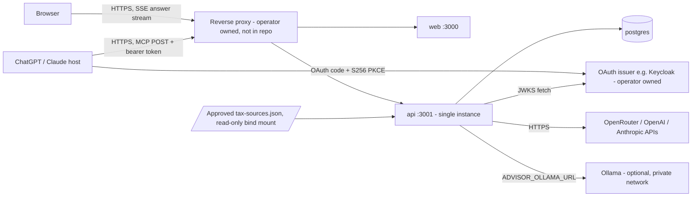
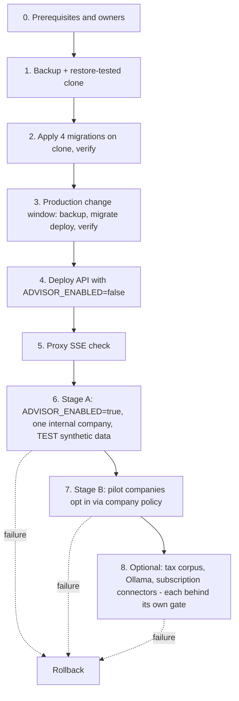
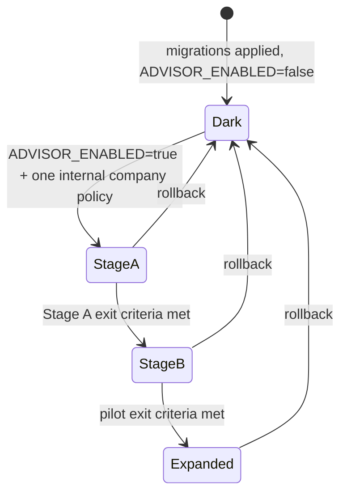
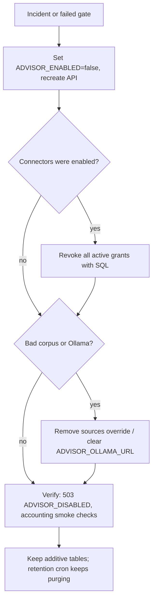

# Advisor Rollout Runbook

Operator procedure for deploying, rolling out and rolling back the tax advisor
(Doradca). Product behavior, contracts and release gates live in the
[advisor specification](specs/tax-advisor.md); this document only covers
operations. General rules from
[Production Migration Recovery](production-migration-recovery.md) and the
[Backup Restore Drill](backup-restore-drill.md) apply and take precedence.

Everything below was checked against the repository on 2026-10-31. Items the
repository cannot answer are listed under [Open questions](#open-questions);
do not treat them as decided.

## Topology

The browser calls the API directly at `NEXT_PUBLIC_API_URL` (`apps/web/src/lib/advisor-api.ts`, `credentials: 'include'`); `apps/web/next.config.ts` has no rewrites, so the Next.js server is **not** in the SSE path. The reverse proxy in front of the API is the one that must stream.



## Rollout overview



## 0. Prerequisites

- [ ] Release image is immutable and contains all four advisor migration folders (see [Production Migration Recovery, Phase 4](production-migration-recovery.md#phase-4--production-change-window)).
- [ ] `ENCRYPTION_KEY` is the installation's existing 32-byte hex key. Advisor credentials are encrypted with it; `encrypt()`/`decrypt()` fail closed on a wrong length. Never rotate it separately from existing encrypted records.
- [ ] `CORS_ORIGIN` equals the browser origin exactly. Advisor mutations reject any other `Origin`, and the API refuses to start in production without it.
- [ ] PostgreSQL backups work (`DB_BACKUP_*` configured, latest restore drill recorded).
- [ ] Named owners: release operator, provider-cost owner, and (only if tax mode is planned) tax-source owner plus qualified reviewer.

## 1–3. Database migrations

The four advisor migrations are purely additive: new enums, new tables, new indexes, and two nullable columns. They are the newest migrations in the repository, so `prisma migrate deploy` applies them in this folder order after any earlier pending ones.

| Order | Migration | Changes |
| --- | --- | --- |
| 1 | `20260919080000_tax_advisor` | Enums `AdvisorProvider`, `AdvisorTurnStatus`, `AdvisorConnectorClient`; tables `CompanyAdvisorPolicy`, `AdvisorConnectorGrant`, `AdvisorConnection`, `AdvisorConversation`, `AdvisorTurn`; foreign keys to `Company` / `CompanyMembership` with `ON DELETE CASCADE` |
| 2 | `20260930090000_advisor_connector_grant_lifecycle` | `AdvisorConnectorGrant.lastUsedAt`, `.revokedAt` (nullable) + index on `revokedAt` |
| 3 | `20261001090000_advisor_model_preview_usage` | Table `AdvisorModelPreviewUsage` (no credentials, no foreign keys) |
| 4 | `20261002100000_advisor_insight_dismissal` | Table `AdvisorInsightDismissal`, foreign key to `CompanyMembership` with cascade |

Compose startup does **not** apply migrations (`CMD ["node", "dist/main.js"]`). Until they are applied, advisor routes answer `503 ADVISOR_MIGRATION_REQUIRED`.

### Step 1 — backup before

```bash
docker compose --profile backup run --rm backup-postgres   # requires DB_BACKUP_ENABLED=true
docker compose --profile backup run --rm verify-backups
```

Record the artifact name and checksum. A logical dump is the only recovery point this repository provides (no WAL/PITR).

### Step 2 — rehearse on a restored clone

Restore the artifact to a **new** database following [PostgreSQL Restore](restore-postgresql.md) (never over production), point a one-off API container at it, and run steps 3a–3c there first.

### Step 3 — production change window

a. Check what is pending. Only the advisor migrations (and nothing unexpected) should be listed:

```bash
docker compose run --rm --no-deps api ./node_modules/.bin/prisma migrate status --schema prisma/schema.prisma
```

b. Apply. Run once, stop on the first non-zero exit and switch to [Production Migration Recovery](production-migration-recovery.md); do not retry blindly:

```bash
docker compose run --rm --no-deps api ./node_modules/.bin/prisma migrate deploy --schema prisma/schema.prisma
```

The API image's working directory is `/app/apps/api` and it ships the Prisma CLI and migrations for this purpose (see [infrastructure](infrastructure.md#api--appsapidockerfile)). If you run migrations from a dedicated release job instead, use the same image digest.

c. Verify with `psql`:

```sql
-- All four recorded as finished, none rolled back
SELECT migration_name, finished_at, rolled_back_at
FROM "_prisma_migrations"
WHERE migration_name IN (
  '20260919080000_tax_advisor',
  '20260930090000_advisor_connector_grant_lifecycle',
  '20261001090000_advisor_model_preview_usage',
  '20261002100000_advisor_insight_dismissal')
ORDER BY migration_name;
-- expect 4 rows, finished_at NOT NULL, rolled_back_at NULL

-- Seven tables exist
SELECT table_name FROM information_schema.tables
WHERE table_schema = current_schema()
  AND table_name IN ('CompanyAdvisorPolicy','AdvisorConnectorGrant','AdvisorConnection','AdvisorConversation',
                     'AdvisorTurn','AdvisorModelPreviewUsage','AdvisorInsightDismissal')
ORDER BY table_name;
-- expect 7 rows

-- Grant lifecycle columns (migration 2)
SELECT column_name, is_nullable FROM information_schema.columns
WHERE table_name = 'AdvisorConnectorGrant' AND column_name IN ('lastUsedAt','revokedAt');
-- expect 2 rows, is_nullable = YES

-- Unique indexes the application relies on for idempotency and caps
SELECT indexname FROM pg_indexes
WHERE indexname IN ('AdvisorTurn_conversationId_requestId_key',
                    'AdvisorModelPreviewUsage_userId_companyId_day_key',
                    'AdvisorInsightDismissal_membershipId_environment_insightKey_version_key');
-- expect 3 rows

-- Nothing is enabled by the migration itself
SELECT count(*) FROM "CompanyAdvisorPolicy";   -- expect 0 on first rollout
```

Then smoke-check `/health`, `/ready`, login, company list and invoice list as in the restore drill. Accounting tables are untouched by these migrations.

On the clone only, also confirm cascade behavior: deleting a test `CompanyMembership` removes its `AdvisorConnection`, `AdvisorConversation` (and `AdvisorTurn`), `AdvisorConnectorGrant` and `AdvisorInsightDismissal` rows.

## 4. Environment variables

All variables are read by the API only. Defaults are what the code does when the variable is unset or empty. Changing any of them requires recreating the API container (`docker compose up -d api`); the MCP connector configuration is read once at startup.

| Variable | Default when unset | Required? | Safe value / notes |
| --- | --- | --- | --- |
| `ADVISOR_ENABLED` | Disabled. Only the exact string `true` enables. | Required to use the advisor | Ship `false`. When not `true`: conversations and MCP reads return `503 ADVISOR_DISABLED`; provider discovery/save/test and grant issue are refused. Settings, disconnect, grant revoke, insights and the hourly retention cleanup keep working. |
| `ADVISOR_OLLAMA_URL` | Empty → Ollama shows "not configured", requests get `503 OLLAMA_NOT_CONFIGURED` | Optional | Leave empty unless Ollama is deployed. Must be `http(s)://`, no credentials/query/fragment, include `/v1`, e.g. `http://ollama:11434/v1`. Reached **from the API process**, never from the browser. |
| `ADVISOR_TAX_SOURCES_PATH` | Empty → zero sources; tax questions fail closed with `422 TAX_SOURCES_UNAVAILABLE` before any paid call | Optional | Leave empty until a reviewer-approved corpus exists. Set by `docker-compose.advisor-sources.yml` to `/app/advisor/tax-sources.json`. A malformed configured file fails closed. |
| `ADVISOR_TAX_SOURCES_HOST_PATH` | Compose aborts if the override file is used without it | Required only with `docker-compose.advisor-sources.yml` | Absolute host path to the approved JSON file. Compose variable, not read by the API. The file must already exist (`create_host_path: false`). |
| `ADVISOR_MCP_PUBLIC_URL` | Empty → MCP and protected-resource metadata routes are not registered | Optional (enables connectors) | Public `https://` URL ending in `/advisor/mcp`, no query/fragment/credentials. **Set all connector variables together**: when this is set, an invalid or missing issuer/JWKS URL throws during route registration and the API will not start. |
| `ADVISOR_OAUTH_ISSUER` | — | Required if `ADVISOR_MCP_PUBLIC_URL` is set | Exact `https://` issuer string from the access tokens (`iss`). |
| `ADVISOR_OAUTH_JWKS_URL` | — | Required if `ADVISOR_MCP_PUBLIC_URL` is set | Operator-trusted `https://` JWKS endpoint of that issuer (5 s fetch timeout). |
| `ADVISOR_OAUTH_CHATGPT_CLIENT_ID` | Empty → ChatGPT tokens rejected | Optional | Registered ChatGPT client ID, 1–200 chars. Must differ from the Claude ID (startup error otherwise). |
| `ADVISOR_OAUTH_CLAUDE_CLIENT_ID` | Empty → Claude tokens rejected | Optional | Separate registered Claude client ID. |

Related existing variables: `ENCRYPTION_KEY` (required, see prerequisites), `CORS_ORIGIN` (required in production; also the only browser origin accepted by MCP besides `https://chatgpt.com` and `https://claude.ai`). OCR's `OPENROUTER_API_KEY` is **not** used by the advisor; provider keys are entered per membership in Settings.

Changing `ADVISOR_OAUTH_ISSUER` or a client ID invalidates existing grants (grants bind issuer and client).

## 5. Reverse proxy for SSE

The repository contains **no** reverse-proxy configuration; [infrastructure](infrastructure.md#production-deployment-checklist) only requires nginx or Caddy with TLS in front of `:3000` and `:3001`. What the API itself does on `POST /companies/:companyId/advisor/conversations/:conversationId/messages` (`apps/api/src/routes/advisor.ts`):

- `Content-Type: text/event-stream`, `X-Accel-Buffering: no`, `Cache-Control: no-store`
- `status` heartbeat event every 10 seconds, then one `answer` or `error` event, then `done`
- 60-second provider deadline; a client disconnect aborts the provider call

Proxy requirements that follow from this:

| Requirement | Why |
| --- | --- |
| Response buffering off for the messages route | Otherwise events arrive only at the end. nginx honors `X-Accel-Buffering: no` unless `proxy_ignore_headers X-Accel-Buffering` is set; other proxies ignore that header. |
| No response compression on `text/event-stream` | Compression buffers small events. |
| Upstream read/idle timeout above 60 s (e.g. 120 s) | The answer can take up to the 60 s deadline. Heartbeats every 10 s keep idle timers alive in between. |
| Propagate client disconnects upstream | Cancel/close must abort the paid provider call. |
| Forward `Origin` and cookies unchanged | Origin check and session auth. |
| Forward `/advisor/mcp` and `/.well-known/oauth-protected-resource/advisor/mcp` under the same public prefix, with `Authorization` intact | Only when connectors are enabled. Metadata URL is derived from `ADVISOR_MCP_PUBLIC_URL`. |

Illustrative nginx location (**example, not repository config** — adapt prefix and upstream):

```nginx
location ~ ^/backend/companies/[^/]+/advisor/conversations/[^/]+/messages$ {
    rewrite ^/backend/(.*)$ /$1 break;
    proxy_pass http://api:3001;
    proxy_http_version 1.1;
    proxy_set_header Connection "";
    proxy_buffering off;          # belt and braces next to X-Accel-Buffering: no
    proxy_cache off;
    gzip off;
    proxy_read_timeout 120s;
}
```

Caddy's `reverse_proxy` flushes `text/event-stream` responses immediately by default; still verify.

**Verification** (against the deployed URL, after Stage A enablement, with a valid session cookie and a TEST conversation):

```bash
curl -N -sS -X POST "https://<public-api>/companies/<companyId>/advisor/conversations/<conversationId>/messages" \
  -H "Origin: <CORS_ORIGIN>" -H "Cookie: <session cookies>" -H "x-ksef-environment: TEST" \
  -H "Content-Type: application/json" \
  -d '{"requestId":"<new uuid>","question":"...","scope":{...}}'
```

Pass: `event: status` with `preparing` appears within about a second, `working` heartbeats follow at 10 s intervals, and pressing Ctrl+C marks the turn `CANCELLED`. Fail: everything arrives at once, or the stream is cut before 60 s. The browser check (DevTools → Network → EventStream) is an equivalent alternative.

## 6. Tax source corpus (optional, separate gate)

Do not mount anything until a qualified reviewer has approved the entries and the Polish evaluation set ([corpus README](specs/tax-advisor-corpus/README.md)). `sources.draft.json` must never be mounted; the loader rejects it anyway.

Initial mount:

```bash
sha256sum /secure/path/advisor-tax-sources.json   # record next to the reviewer sign-off
ADVISOR_TAX_SOURCES_HOST_PATH=/secure/path/advisor-tax-sources.json \
  docker compose -f docker-compose.yml -f docker-compose.advisor-sources.yml up -d api
```

Verify: `GET /companies/<id>/advisor/settings` reports `reviewedSourceCount` equal to the number of approved entries, and a TEST tax question cites a source. The loader enforces ≤ 128 KB, ≤ 40 unique entries, `*.gov.pl` HTTPS URLs and review dates covering today; entries whose `reviewExpiresAt` has passed silently stop being selected, so track expiry dates.

Corpus update:

1. Reviewer approves the changed entries; export a **new** file (e.g. versioned file name) outside the repository and record its SHA-256 and sign-off.
2. Validate on a non-production API first (`reviewedSourceCount`, one TEST tax question per enabled provider/model). Rerun the approved evaluation set when the corpus or a model changes.
3. Point `ADVISOR_TAX_SOURCES_HOST_PATH` at the new file and recreate the API container (command above).

The API reads the file on each request, but a single-file bind mount keeps pointing at the original inode, so editors or `mv` replacing the host file are **not** reliably visible inside the container. Always switch files by recreating the container. The persisted provenance (`sourceVersion`) is the SHA-256 of the file content, which lets you match answers to a signed-off corpus.

Rollback of a bad corpus: point back at the previous approved file and recreate, or remove the override (no sources → tax mode fails closed, record questions keep working).

## 7. Ollama placement (optional)

The repository has no Ollama service definition; placement is an open decision ([plan §10](../spec/tax-advisor-implementation-plan.md#10-remaining-decisions-and-release-dependencies)). Options:

| Option | Pros | Cons |
| --- | --- | --- |
| A. Container on the same Docker host/network, no published port | Simple, `http://ollama:11434/v1`, traffic never leaves the host | Competes with API/OCR/Chromium for CPU/RAM; GPU availability unknown |
| B. Dedicated private host reachable only from the API (VPN / private subnet / firewall allow-list) | Isolates load, GPU possible | Network setup; use `https://` or a private link, since Ollama has no built-in auth |
| C. User laptops | — | Not supported; needs a separate bridge feature |

In every case: do not expose Ollama publicly, set `ADVISOR_OLLAMA_URL` with `/v1`, pull at least one model that supports JSON Schema output, and allow `OLLAMA` in a company policy. Settings should then move from `OLLAMA_NOT_CONFIGURED` / `OLLAMA_UNREACHABLE` / `OLLAMA_NO_MODELS` to a model list. Ollama requests still consume the shared daily model-preview caps.

## 8. OAuth issuer checklist (Keycloak reference) — B3 prerequisite

The API is only an OAuth resource server. Subscription connectors (ChatGPT/Claude) stay off until every item below is proven on the deployed issuer. Source of the requirements: [connector specification](specs/tax-advisor.md#chatgpt-and-claude-subscription-connectors) and `apps/api/src/services/advisor/advisor-connector.ts`.

- [ ] Issuer deployed on HTTPS with OIDC discovery published; where it runs, how it is backed up and who administers it are recorded (open question below).
- [ ] Separate clients for ChatGPT and Claude; each host's **exact** callback URLs registered (taken from the host product at setup time).
- [ ] Authorization-code flow with S256 PKCE required; implicit and password grants disabled.
- [ ] Access tokens signed RS256 or ES256, lifetime ≤ 15 minutes (API allows 5 s clock skew).
- [ ] `aud` equals `ADVISOR_MCP_PUBLIC_URL` exactly (resource indicator / audience mapper), not a general account audience.
- [ ] `scope` contains `advisor:read`.
- [ ] `client_id` and/or `azp` match the configured client ID (if both present they must be equal).
- [ ] Admin-managed, immutable `ksiegowy_user_id` claim mapped to the existing `User.id`; **never** from a user-editable attribute. Verified with a synthetic account.
- [ ] Refresh-token and session revocation policy configured at the issuer (the API does no introspection; API-side revoke/membership removal blocks the next tool call).
- [ ] `ADVISOR_MCP_PUBLIC_URL`, `ADVISOR_OAUTH_ISSUER`, `ADVISOR_OAUTH_JWKS_URL` and both client IDs set together; API restarts cleanly.
- [ ] `GET <public prefix>/.well-known/oauth-protected-resource/advisor/mcp` returns the resource and issuer; unauthenticated `POST /advisor/mcp` returns 401 with a `WWW-Authenticate` header pointing at that metadata.
- [ ] Real ChatGPT and Claude target-account journeys completed with pilot users (release gate; mocked tests do not cover it).

## 9. Staged rollout



**Dark launch.** Deploy the release with `ADVISOR_ENABLED=false`. Advisor tables exist, nothing is processed, the provider settings page is readable. Confirm accounting flows are unchanged.

**Stage A — internal, TEST, synthetic data.**

1. Set `ADVISOR_ENABLED=true`, recreate the API.
2. As ADMIN of one internal company, enable the company policy and allow only the providers under test (`PATCH /companies/:companyId/advisor/policy` via Settings → Doradca).
3. Use the TEST KSeF environment with synthetic records only. TEST changes which records are read; it does **not** make provider calls free. Use capped provider keys.
4. Checks: save/test one connection per enabled provider/model; record question with consent; period briefing; cancel mid-stream; proxy SSE check (section 5); mobile sheet; logs show start/end/error entries only, without questions or credentials.

Exit criteria: all checks pass, no `INVALID_ANSWER` spikes, provider spend within budget.

**Stage B — company opt-in.** Pilot company ADMINs enable their own policy and choose allowed providers; non-opted-in companies remain blocked (`POLICY_DENIED`). Watch request count, latency, cancellations, provider failures and invalid answers ([plan §9](../spec/tax-advisor-implementation-plan.md#9-verification-release-and-rollback)). Tax mode, Ollama and connectors are each switched on separately, only after their own gate (sections 6–8).

```sql
-- Which companies have opted in, and with what
SELECT "companyId", enabled, "allowedProviders", "allowedConnectors", "retentionDays", "updatedAt"
FROM "CompanyAdvisorPolicy" ORDER BY "updatedAt" DESC;
```

## 10. Rollback

Rollback is configuration-only. No migration is reverted and no accounting data is touched.



1. **Switch off.** Set `ADVISOR_ENABLED=false` and run `docker compose up -d api`. API shutdown aborts in-flight provider calls; turns left `PENDING` are reported as failed after two minutes. Afterwards conversations and MCP reads return `503 ADVISOR_DISABLED`; users can still view settings, disconnect credentials and revoke grants.
2. **Revoke connector grants** (only if connectors were enabled). Snapshot, then revoke; timestamps are stored as UTC `timestamp(3)`:

   ```sql
   BEGIN;
   CREATE TABLE "advisor_grant_snapshot_<yyyymmdd>" AS SELECT * FROM "AdvisorConnectorGrant";
   UPDATE "AdvisorConnectorGrant"
   SET "revokedAt" = (now() AT TIME ZONE 'UTC')
   WHERE "revokedAt" IS NULL;
   COMMIT;

   SELECT count(*) FROM "AdvisorConnectorGrant"
   WHERE "revokedAt" IS NULL AND "expiresAt" > (now() AT TIME ZONE 'UTC');   -- expect 0
   ```

   Revoked grants never authorize a call, appear as `REVOKED` in Settings and are deleted by the hourly cleanup 30 days after `revokedAt`. Users must grant again after a re-enable. Also revoke refresh tokens/sessions at the issuer if the issuer itself is suspect. Drop the snapshot table once it is no longer needed.
3. **Optional: close company opt-ins.** Not needed while the runtime switch is off. If you want re-enabling to require fresh company opt-in, snapshot the policies first, because this loses each company's choice:

   ```sql
   CREATE TABLE "advisor_policy_snapshot_<yyyymmdd>" AS SELECT * FROM "CompanyAdvisorPolicy";
   UPDATE "CompanyAdvisorPolicy" SET enabled = false, "updatedAt" = (now() AT TIME ZONE 'UTC');
   ```

4. **Corpus / Ollama.** Remove the sources override or clear `ADVISOR_OLLAMA_URL` and recreate the API.
5. **Keep the additive tables.** Do not drop advisor tables or enums. The hourly retention cron keeps running while disabled: expired conversations (1–30 day retention), grants past their 30-day retention and preview-usage rows older than 7 days are deleted. Handle any remaining stored data under the retention/export obligations before a future contract migration. Encrypted credentials stay protected by `ENCRYPTION_KEY` and the existing backups.
6. **Verify.** A conversation request returns `503 ADVISOR_DISABLED`; `/health`, `/ready`, login, invoices and KSeF flows behave as before.

If a migration itself failed, follow [Production Migration Recovery](production-migration-recovery.md) instead; never restore over production.

Known gap: `ADVISOR_ENABLED=false` does **not** hide deterministic insight strips. `GET /insights` is not gated by the runtime switch and `AdvisorInsightStrip` does not check `operatorEnabled`. They make no model call and expose only data the member can already see, but they remain visible during a rollback (open question below).

## 11. Single-instance caveat

Run exactly **one** API replica while the advisor is enabled. Two limits are in-process memory and multiply with each replica:

| Limit | Storage | Effect of N replicas |
| --- | --- | --- |
| Model-preview spacing, 1 per user per 10 s | In-process `Map` (`advisor-access.ts`) | Up to N per 10 s |
| MCP calls, 60 per minute per grant | In-process `Map` (`advisor-connector.ts`) | Up to 60 × N per minute |

These limits are already shared through PostgreSQL and hold across replicas: daily preview caps (30 per user, 100 per company per UTC day), the 10-second provider-request reservation, six submissions per minute, one active request per membership and the atomic turn claim. Before scaling out, move the two in-memory limits to a shared store.

## Open questions

1. **Reverse proxy.** Which proxy (nginx, Caddy, other) and public prefix are used in production? No config is in the repository; the section 5 snippet is illustrative and needs to be checked against the real config.
2. **Production orchestrator.** The repository documents Docker Compose plus local Harbor image publishing; [Production Migration Recovery](production-migration-recovery.md#kubernetes-migration-job-requirements) also mentions a Kubernetes migration Job. Which one runs production, and where does `migrate deploy` run? Commands above assume Compose.
3. **Replica count.** Is the production API guaranteed to run as one instance? Needed for section 11.
4. **OAuth issuer.** Where will Keycloak (or another issuer) be hosted, who administers it, how is it backed up and monitored? Nothing in the repository defines it.
5. **Ollama.** Run on the API host or a private host, which models, and is a GPU available?
6. **Insight strips during rollback.** Should `ADVISOR_ENABLED=false` (or the company policy) also hide deterministic insights? Currently it does not.
7. **Provider egress.** Does the production network allow outbound HTTPS from the API to `openrouter.ai`, `api.openai.com` and `api.anthropic.com`, and is an egress allow-list required?
8. **Retention/export obligations** for advisor data before any future destructive cleanup: who signs off?
9. **Monitoring.** The plan lists metrics to observe, but no metrics or alerting pipeline exists for them; observation is currently log-based only.
