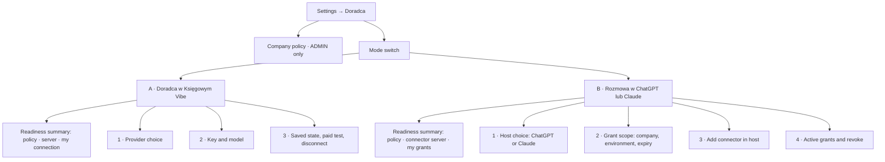
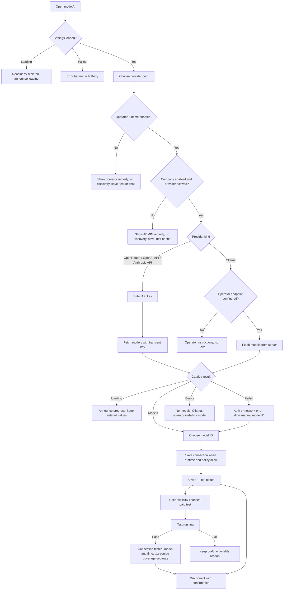
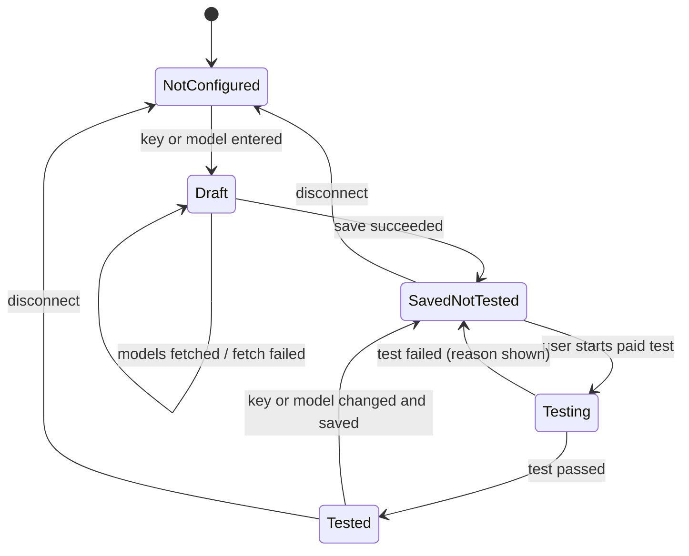
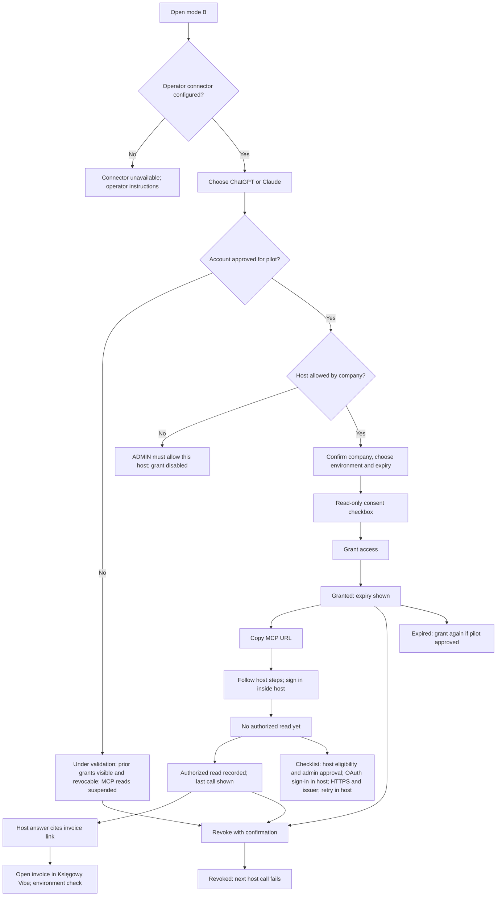
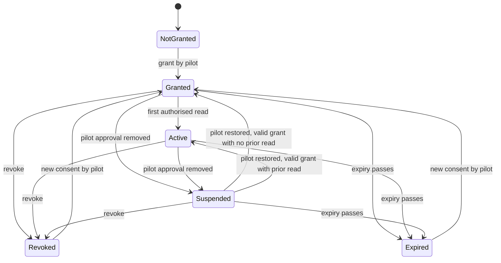
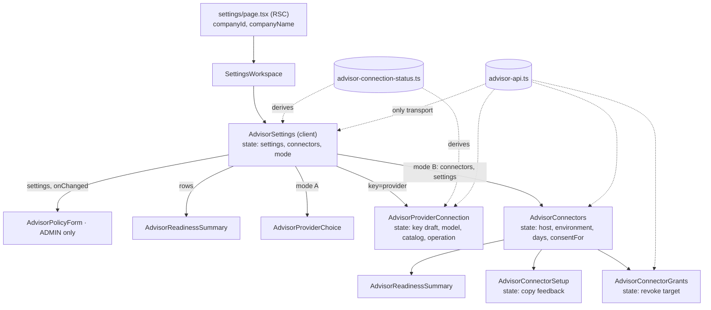
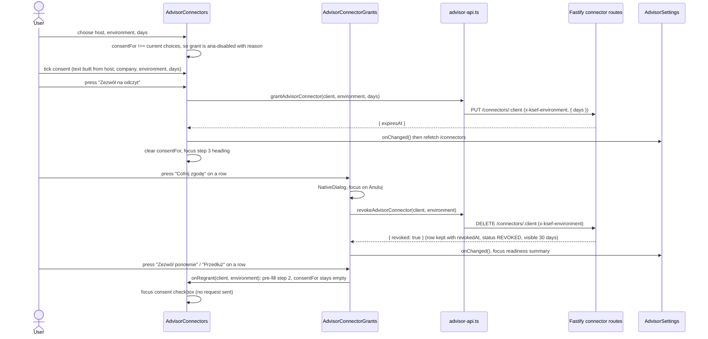
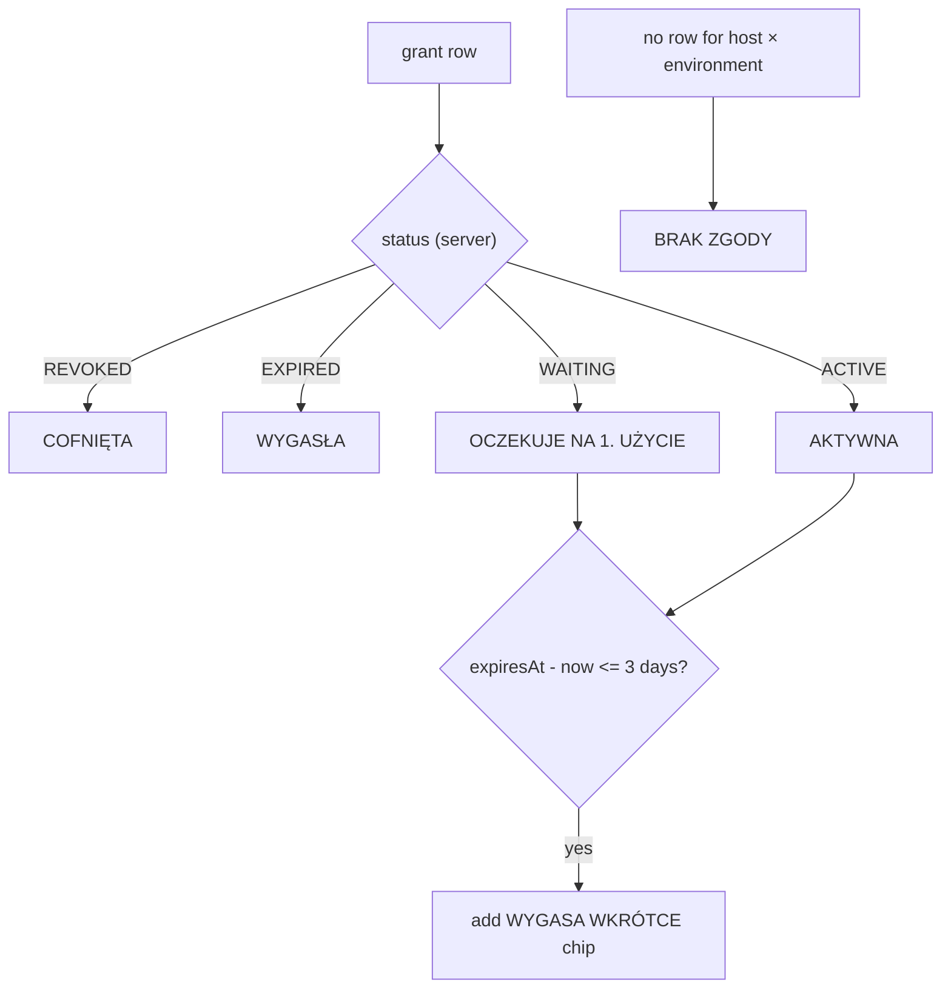
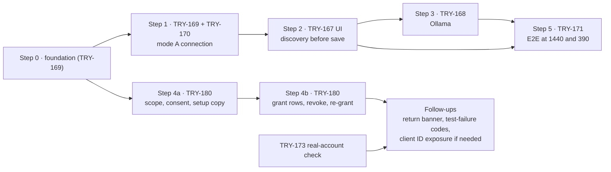

# Tax advisor connection UX — Settings → Doradca

Status: **connection settings implemented; visual/customer-journey approval pending.** The prior TRY-172 design and implementation notes below remain historical evidence, not pixel-perfect sign-off. See [the current journey and visual plan](../../spec/tax-advisor-implementation-plan.md#11-customer-journey-and-pixel-perfect-design-gate).

Tracking: [TRY-172](https://linear.app/trysoft/issue/TRY-172). Related: [tax advisor specification](tax-advisor.md), [implementation plan — provider setup design](../../spec/tax-advisor-implementation-plan.md#provider-setup-design-openrouter-and-self-hosted-ollama), [Aurora Solid tokens](aurora-solid-tokens.md).

> **Provisional:** host-specific menu steps, plan/admin eligibility, OAuth compatibility and behavior on real ChatGPT/Claude accounts remain unverified until the TRY-173/TRY-177 target-account checks. The server already records the first authorized call and returns WAITING/ACTIVE grant status; this is not proof a particular host account can connect. Older [P] microcopy below is historical proposal copy; use the graded current eligibility notes in §14.6 until real-account validation.

This document defined the replacement of the generic provider form in `AdvisorSettings.tsx` and the grant block in `AdvisorConnectors.tsx` with two separate connection modes. The implemented settings reuse Aurora Solid tokens and existing atoms/molecules.

## 0. Design evidence and approval boundary

The Aurora Solid [Claude Design artifact 5s6ojohFet7haaSAbWV9hp](https://claude.ai/artifact/5s6ojohFet7haaSAbWV9hp) and the local `docs/redesign/kv-redesign-platform-personal-1.html` show the same advisor **concept** in frames 15–19. The local [design-system export](../redesign/kv-redesign-system-design.html) supplies measurable Aurora tokens; neither export contains provider/connector settings. Google Stitch project `12153636040275536997` now also contains nine TRY-172 settings candidates (D1–D5, M1–M4), in addition to generated KV-REDESIGN 15–19 variants. The older assertion that Stitch contains no connection screens is obsolete. These assets are **candidates, not approved replacements**: the customer journey, unsafe example claims, missing states and frame-by-frame visual source must be agreed before any new screen is generated or pixel parity asserted. See [the current coverage and polish audit](../../spec/tax-advisor-implementation-plan.md#11-customer-journey-and-pixel-perfect-design-gate).

The historical artifact frame inventory below describes the embedded advisor; the connection-settings detail in sections 3–5 describes intended behavior, not a separately approved visual reference.

| # | Frame | Variant |
|---|---|---|
| 01–02 | Sign in; onboarding step 2 of 4 | desktop |
| 03–13 | Overview, outgoing invoices, new invoice with KSeF preflight, invoice detail, incoming, OCR inbox, contractors with drawer, Reports & JPK, bank reconciliation, **Settings — KSeF integration & team**, Settings — products & services | desktop |
| 14 | Mobile: the three things people do on a phone | 3 × 390 |
| **15** | **Advisor panel** (⌘J, 400px column beside rail and content: insight cards Act/Watch/Opportunity, suggestion chips, ask field, provenance footer) | desktop |
| **16** | **Answer card** (780px overlay card: question, success-tinted short answer, 3 figure tiles, breakdown table with certainty chips, note, actions, "14 DOCUMENTS · 0.9 S") | desktop |
| **17** | **Inline insights** (A list strip, B preflight rail, C explain a number, D reconciliation match; rule: at most one strip per view, advisor prepares, user confirms) | desktop parts |
| **18** | **Monday briefing** (advisor page with briefing history, figure row, week tasks, cash chart, "Last week, checked") | desktop |
| **19** | **Mobile advisor** (inline card on overview, bottom sheet with answer, briefing page) | 3 × 390 |
| 20–32 | Personal mode: home, money in & out, commitments, savings & goals, investing, reports, mobile, add/single payment, add/single commitment, new/single goal | desktop + 390 |
| 33–37 | Sign in for both modes, mode chooser, household onboarding steps 2 and 4, mobile entry | desktop + 390 |

**Not in the historical frames 15–19:** Settings → Doradca, provider/API-key setup, model discovery, paid test, company policy, ChatGPT/Claude grant/setup/revoke, readiness, connection dialogs, and light theme. The nine TRY-172 Stitch candidates cover **some** of these connection states in dark mode, but do not close every journey, content, accessibility or visual gap. The original gap list below is retained as the pre-Stitch brief, not a claim that no screens exist.

Design tokens in the artifact (all inline, dark only). They match the dark values in [Aurora Solid tokens](aurora-solid-tokens.md) and `apps/web/src/app/globals.css`:

| Group | Values |
|---|---|
| Page and frame | page `#060710`; frame gradient `155deg #0d1024 → #080a14 → #0f1226`; frame radius 20px (mobile 34px); shadow `0 30px 90px rgba(0,0,0,.6)` on frames only |
| Surfaces | chrome/rail/panel `#0a0c18`; card `#10132a`; raised/field `#171b36`; hover row `#131734`; hairlines `rgba(236,238,247,.07–.12)` |
| Text | `#eceef7` at 1 / .78 / .7 / .62 / .45 / .35 alpha |
| Accent | primary `#a78bfa` (hover `#c4b1fd`); primary gradient `140deg #b39cfb → #7aa7f2` with ink `#0c0d1c`; logo gradient `140deg #a78bfa → #5eb8f0`; advisor border `rgba(167,139,250,.28–.40)` |
| Status | success `#58cf9a`, warning `#f5be5a`, danger `#f07a6a`, info `#5eb8f0`; chip fill = status at .12–.18 alpha |
| Type | Sora 500/600 (body 12.5–14px, card title 14.5–15px, page title 25–27px, letter-spacing −0.03em); IBM Plex Mono for eyebrows, chips, IDs, numbers (10–11px, uppercase, tracking .12–.18em) |
| Radius | chip 5–6px, control 9px, inset 11–12px, card 14–16px, overlay card 18px, bottom sheet 26px top |
| Spacing | gaps 8/10/12/14/16/18px; card padding 15–20px; control padding 9px 12–14px; chrome padding 0 22px; main padding 26px |
| Patterns | status = 3px coloured left border on a card; insight confidence in mono at the top right; scrim `rgba(6,7,16,.72)`; no blur anywhere |

### Historical visual QA findings (2026-10-01, before the TRY-172 Stitch candidates)

Evidence: artifact frames 12, 15, 16 and 19 compared with the `advisor-settings.spec.ts` screenshots (20 tests passed at 1440 and 390, light theme, which is the Playwright default) and with the component source.

Blockers (fix before calling the advisor UI design-aligned):

1. **Advisor panel content is a form, not the frame 15 layer.** `AdvisorConversation.tsx` stacks provider, period, question-kind and history selects, an evidence checkbox and a textarea. Frame 15 shows a header (30px gradient tile, "Doradca", mono "CZYTA: <view>, <period>", Esc), insight cards and suggestion chips, then one ask field pinned to the bottom with a provenance line. Fix: show provider and period as the mono context line with a "Zmień" control; pin the textarea and Send to the bottom (`mt-auto`); move history behind a ghost button; keep the evidence checkbox as one line under the field.
2. **`<summary className="flex …">` removes the disclosure marker.** "Inni dostawcy API" in `AdvisorProviderChoice.tsx`, and calculations, evidence and sources in `AdvisorAnswerCard.tsx`, look like plain text with no expand cue. Fix: add a chevron icon that rotates on `[open]`, or drop `flex` and keep `list-item`.
3. **Full-page screenshots crop to the viewport.** The provider-connection screenshots are 1000/844px tall because the shell scrolls inside `main`, so visual QA cannot see steps 1–2. Fix in `advisor-settings.spec.ts`: screenshot the `section` locator, or scroll it into view in steps. Also add one `colorScheme: 'dark'` pass, because the design exists only in dark.
4. **Settings → Doradca has no design frame** (see the gap list below). Treat sections 3–4 as provisional visual design until Claude Design covers them.

Polish:

| # | Where | Deviation | Fix |
|---|---|---|---|
| P1 | `atoms/Badge.tsx` | Chips are mixed case, 28px tall with 12px padding; the design chip is uppercase mono 10px, padding 4×8px, radius 5px | Add `uppercase`, `min-h-0 px-2 py-1`; chips are not targets, so 44px does not apply |
| P2 | `molecules/Banner.tsx` (`info`) | Billing and host disclosures are grey filled blocks; the design's notices are a `#10132a` card with a 3px coloured left border | `info`: `bg-surface-raised border-l-[3px] border-l-primary`; `warning`: left border `warning-ink` |
| P3 | `AdvisorConnectors.tsx` host and environment radios | Native browser-blue radios | `accent-[var(--primary)]`, as in `AdvisorProviderChoice` |
| P4 | `AdvisorReadinessSummary.tsx` | Chip column; the design's status row is "label · mono coloured status · right-aligned action" (frame 12, "Connection ONLINE · 118 MS · Test now") | Render the status as mono text in the status colour, and put "Sprawdź połączenie" or "Przejdź do kroku" on the right |
| P5 | Step headings in `AdvisorProviderConnection` / `AdvisorConnectors` | The step numbers in sections 3.4 and 4.3 ("1 Gdzie działa model") are missing | Prefix them with a mono eyebrow "KROK 1/3" |
| P6 | `AdvisorAnswerCard.tsx` | The short answer is a heading on the card; the calculation is hidden in `<details>` | Use a success-tinted block (`rgba(88,207,154,.09)`, border .26, radius 14) with the mono eyebrow "KRÓTKA ODPOWIEDŹ"; show up to 3 figure tiles and the breakdown table open; keep evidence and sources behind a "Pokaż źródła" button |
| P7 | `atoms/NativeDialog.tsx` bottom sheet | Radius 16px and no grabber; the design sheet has radius 26px at the top, a primary .34 top border and a 40×4px grabber | Add these only when `bottomSheet` is set |
| P8 | `AdvisorWorkspace.tsx` docked aside | Plain `h2` title; the design header has a 30px gradient tile and a mono context line | Reuse the header pattern from frame 15 |
| P9 | Settings shell (`SettingsWorkspace.tsx`) | KPI tiles and a second 200px section column; frame 12 puts SECTIONS in the 226px rail under Settings, and the page title is the section name with a mono eyebrow | Out of advisor scope; track with the Aurora redesign plan |
| P10 | Mobile app header (shell) | About 155px tall, with the tagline and company select stacked; frame 14/19 uses one ~56px row (logo, short company name, TEST chip) | Shell work, tracked in `mobile-first-remediation.md` |
| P11 | Buttons | `text-sm` (14px) against 12.5–13.5px in the design | Keep 14px for legibility; this is an intentional deviation |

Intentional deviations (keep): the artifact's KSeF token row shows a masked tail ("•••• 4F2A · Replace"). Invariant I7 forbids that for API keys, so after save the key field stays empty with the helper text. Light theme, 44px targets and contrast-corrected muted text are additions, not design drift. The previous exclusion of proactive insights and briefing is superseded by the shipped deterministic strips and on-demand briefing in the [tax advisor specification](tax-advisor.md); scheduled delivery and unsupported forecast/tax claims remain outside the current release.

### Original design gaps (pre-Stitch brief; current status in implementation plan §11)

1. **Settings → Doradca entry**: its place in the frame 12 SECTIONS list, and the page header (eyebrow and title).
2. **Mode switch A/B**: the design has only the compact TEST/PROD segmented pill. Decide between a pill and two cards with a status line.
3. **Mode A, provider setup**: provider cards (OpenRouter, Ollama, plus OpenAI API and Anthropic API collapsed), billing disclosure, key field (saved and empty states), model field with discovery count, save, and the read-only Ollama operator row.
4. **Mode A, verification**: readiness rows (policy · server · my connection), the paid test with its cost note, tested and failed states, and disconnect.
5. **Mode B, connector**: host choice (ChatGPT/Claude), grant scope (company, environment, expiry, consent), MCP address with copy, host steps with verification badges, the grants list (waiting, active, expiring, expired, revoked) and revoke.
6. **Company policy card** (admin only): allowed providers and connectors.
7. **Dialogs**: disconnect and revoke confirmations, on desktop and as a mobile bottom sheet. The artifact has only the answer overlay and the advisor sheet.
8. **Advisor states**: not configured (panel, sheet, answer), loading or thinking, empty history, provider error, and policy blocked. None are drawn.
9. **Light theme** for all of the above, or a decision that the advisor is dark-only.
10. **Return-to-invoice banner** (section 4.5) and the mobile 390 versions of items 1–8.

## 1. Product invariants

These rules override any layout or copy decision below.

| # | Invariant | Design consequence |
|---|---|---|
| I1 | A ChatGPT or Claude subscription is never an embedded API credential | Mode B has no key field, no model picker, and no "use my subscription here" control. Mode A never mentions subscriptions except to say they do not apply |
| I2 | No label promises subscription billing inside the application | Mode B is named after *where the conversation happens* ("Rozmowa w ChatGPT lub Claude"), not after billing |
| I3 | API billing is separate from ChatGPT/Claude plans | Mode A shows a persistent billing disclosure next to provider choice and before the first save |
| I4 | The host product owns conversation storage and answer wording | Mode B shows a persistent host-ownership disclosure above the grant controls |
| I5 | Provider connection belongs to the user's company membership and applies to TEST and PRODUCTION | Mode A shows a scope line ("Dotyczy Twojego konta w firmie X · TEST i PRODUKCJA") and never renders an environment selector |
| I6 | Ollama endpoint is operator-controlled | No URL input anywhere; the endpoint is a read-only status row |
| I7 | Secrets are never shown after save | After save the key field is empty with "Klucz zapisany" helper text; no reveal, no masked tail, no copy |
| I8 | Discovery and the paid test are different operations | Different buttons, different labels, different success/error copy; the test is never triggered automatically |
| I9 | Connector access is read-only and scoped to company + environment + expiry | Mode B grant form always shows all three before the grant button is enabled |

## 2. Information architecture

`SettingsWorkspace` already renders the **Doradca** section. Inside it, the advisor area becomes:



- **Company policy** stays a separate card, visible only when `canManagePolicy` is true. Members see its *result* in each mode's readiness summary, not the editor.
- **Mode switch:** two visible, separate connection options using the existing `aria-pressed` button pattern. Both can be configured at the same time; switching changes only the settings view, not the current conversation or TEST/PRODUCTION accounting context. **Approved 2026-10-04:** each button shows its own concise status before switching; derive A from the embedded settings snapshot **for the provider selected in Settings**, and B from the connector snapshot, including loading/error instead of invented readiness. Choosing a different provider inside A updates A's line; the line keeps describing that selection while B is open. Another usable provider does not mask a selected provider's blocker or silently change the separate conversation's provider. For A, after a passing synthetic test with runtime and provider policy enabled, say **“Connection tested”** (Polish candidate: “Połączenie przetestowane”); this says nothing about reviewed tax guidance or every future answer. If access is disabled, the line leads with the **current operator/company/provider blocker**, even for a previously tested connection; show the test history inside Mode A. Other A labels and B labels remain open in the [journey ledger](../../spec/tax-advisor-implementation-plan.md#115-customer-approval-ledger). Neither saved credentials nor WAITING grants alone mean “ready.”
- **Mode B status scope approved 2026-10-04:** aggregate the grants returned for **this member of the selected company** across ChatGPT/Claude and TEST/PRODUCTION, regardless of the currently displayed host/environment choice. `GET /connectors` is membership-scoped, not company-wide. Distinguish WAITING (no successful authorized read yet) from ACTIVE (`lastUsedAt` recorded after an authorized tool response), and do not treat the public endpoint as proof that either real host account can connect. If the endpoint or company-wide policy blocks use, the headline must not suggest current access. If ChatGPT has an allowed ACTIVE grant and Claude is denied, the same line shows **both** the authorized-read history and the Claude policy restriction; an old ACTIVE grant for a denied host does not count as currently eligible but remains visible in the detail row. Describe WAITING as **“Grant issued · no authorized read yet”** and ACTIVE as **“Authorized read recorded”**, using concise separate counts for multiple grants. Polish candidates are “Udzielono zgody · bez autoryzowanego odczytu” and “Odnotowano autoryzowany odczyt”; exact localized words remain for review. The existing `grantsActive` count and “Aktywna” detail chip have not yet been aligned with this choice.
- **Mode B inactive-only choice approved 2026-10-04:** when all retained grants are EXPIRED or REVOKED, show **“No current access”** plus separate counts/reasons for expiry and intentional revocation, not the never-granted message. Keep the historical rows and fresh-consent route inside B. Candidate “Brak bieżącego dostępu · 1 wygasła, 1 cofnięta”; final Polish words/layout need visual review.
- **Mode B pre-validation exposure approved 2026-10-04:** both mode choices remain visible. Until deployed issuer and actual ChatGPT **and** Claude target-account flows are verified, show “under validation” to non-pilot members, with their existing grant/status history and Revoke available; restrict new/reissued Grant on the API by authenticated membership to operator-approved pilot accounts. Disable non-pilot Open-host onboarding in the UI; it is external navigation, not a server authorization endpoint. **Pilot removal:** deny subsequent MCP reads immediately in `requireAdvisorConnectorGrant()`, retain the unexpired grant and historical WAITING/ACTIVE event, show pilot restriction as the current blocker rather than current access; Revoke remains available. Reinstatement before expiry resumes the unrevoked grant. An endpoint and a WAITING grant are not host-connection proof. `GET /connectors` and the Mode B button need a truthful pilot-eligibility state, including loading/error; existing `PUT /connectors/:client` and MCP read checks lack pilot enforcement.
- **Approved default (2026-10-04):** every entry to Settings → Doradca starts in **Mode A**, whether direct or from the blocked panel. A user can switch to B for that visit; no mode is saved between entries. Remove the current device-wide `localStorage` and module-global mode/listener logic. No `mode=embedded` URL parameter is needed.

**First-use entry implemented 2026-10-06:** pressing Doradca without a usable embedded provider stays on the current page and opens the desktop dock or mobile sheet with the current blocker and an explicit **Settings → Doradca** action. It does not redirect automatically, embed credential setup, enable the answer composer, or send a model request. `AdvisorConversation` checks operator runtime, company policy, conversation-selected provider allowance, then that member's saved connection. The same card and noneditable composer render for all four blockers; only a user click follows the Settings link.

**Blocked-entry shell approved 2026-10-04 (visual only):** use the shipped `DashboardShell`/`AdvisorPanel` 400px desktop dock and `NativeDialog` 26px-radius mobile sheet, consistent with historical Aurora frames 15/19. Keep existing focus, close, scroll and light/dark token behavior. This is **not** approval of any Stitch answer content or of the still-missing pixel reference. Customer copy for all four blocked states is approved below. No Stitch creation or editing is authorized by this shell choice.

**Blocked-entry composition approved 2026-10-04 (visual direction):** place one compact reason/owner/remedy card **immediately below** the header and company/environment context, with its Settings → Doradca action above the fold in desktop dock and mobile sheet. Keep the existing composer visibly anchored at the bottom but noneditable, with Send unavailable and its reason; do not put a provider form or sample answer in this state. Operator off, company off, selected provider denied and no saved connection use the same placement with truthful, distinct copy. All four sets of Polish copy are approved below; final dark/light 1440/390 screenshots still need approval. This is not Stitch editing permission.

**Blocked-entry copy density approved 2026-10-04:** show **one current reason and its owner** in the top card, not a list of every operator/company/provider/connection gate. Prioritize runtime-off, then company-off, then selected-provider denial, then missing saved connection; the selected provider is the conversation's provider, not whatever Settings last displayed. The one Settings action remains visible; detailed status/history lives in Settings. Approved Polish copy for all four states follows. Do not print raw `ADVISOR_ENABLED` or other environment variable names in customer-facing blocked copy.

**Operator-off blocked-panel copy approved 2026-10-04:** reason “Doradca jest wyłączony na serwerze.”; owner “Może go włączyć operator usługi.”; action “Otwórz ustawienia Doradcy”; disabled-composer hint “Nie możesz wysłać pytania, dopóki operator nie włączy doradcy.” Show these in the approved one-reason card and noneditable composer; Settings → Doradca opens in Mode A. These are customer-visible strings only: operator setup instructions belong outside the blocked panel. Exact 1440/390 dark/light pixels remain unapproved; no Stitch or application edits are authorized by this copy approval.

**Company-policy-off blocked-panel copy approved 2026-10-04:** reason “Doradca jest wyłączony dla tej firmy.”; owner “Może go włączyć administrator firmy.”; action “Otwórz ustawienia Doradcy”; disabled-composer hint “Nie możesz wysłać pytania, dopóki administrator firmy nie włączy doradcy.” Apply only when the operator runtime is enabled and company policy is off, ahead of provider or connection blockers. Show the same Settings action to every member, but only the company ADMIN can edit the policy there. Keep the composer noneditable and Send unavailable; no Stitch or application edit is authorized by this copy approval.

**Selected-provider-denied blocked-panel copy approved 2026-10-04:** reason “Dostawca {provider} nie jest dozwolony w tej firmie.”; owner “Może go dopuścić administrator firmy.”; action “Otwórz ustawienia Doradcy”; disabled-composer hint “Nie możesz wysłać pytania przez {provider}, dopóki administrator firmy nie zezwoli na tego dostawcę.” Substitute the display name of the **conversation-selected provider** (OpenRouter, OpenAI API, Anthropic API or Ollama), not the provider last displayed in Settings. Apply when operator runtime and company advisor policy are enabled but this provider is outside `allowedProviders`; another eligible provider does not suppress this blocker. All members may open Settings, only the company ADMIN changes its allowlist. Keep the composer noneditable and Send unavailable. Copy approval does not authorize Stitch or application edits.

**Missing saved-connection blocked-panel copy approved 2026-10-04:** reason “Nie masz jeszcze zapisanego połączenia z {provider}.”; owner “Możesz je zapisać dla swojego konta w tej firmie.”; action “Otwórz ustawienia Doradcy”; disabled-composer hint “Nie możesz wysłać pytania przez {provider}, dopóki nie zapiszesz połączenia.” Substitute the conversation-selected provider's display name, not the provider last displayed in Settings. Apply after the operator, company policy and selected-provider gates pass, when this member has no saved connection to that provider. Settings may disclose additional operator-dependent Ollama setup requirements; this copy does not promise reachability or tax-answer readiness. Keep the composer noneditable and Send unavailable. Copy approval does not authorize Stitch or application edits.

**Blocked-entry design chosen for implementation 2026-10-06:** the authorized Stitch phase produced 16 individually generated screens, but visual audit found **inconsistent styling within the same theme/size**; none is an implementation reference. The [single-source blocked-entry reference](tax-advisor-blocked-entry-reference.html) renders four fixtures × desktop/mobile × light/dark from one DOM and stylesheet; the [16 direct review links and geometry](../../spec/tax-advisor-implementation-plan.md#111-evidence-inventory-and-comparison) remain the design baseline. The running advisor now uses the existing Aurora dock and `NativeDialog` sheet with a single state-driven blocker card and pinned disabled composer. Browser tests cover blockers and navigation; final real-app visual comparison, accessibility review and deployment verification are separate gates.

**Settings landing implemented 2026-10-06:** the blocked-panel action and direct Settings → Doradca route open **Mode A — Doradca w Księgowym Vibe**. Mode B remains a visible alternative for that visit. `AdvisorSettings` uses local component state initialized to A; no shared device `localStorage`, module-global fallback, or `mode=embedded` URL parameter remains. The link is `/dashboard/settings?section=advisor`.

## 3. Mode A — Doradca w Księgowym Vibe (API billing)

### 3.1 Flow



Model discovery before save uses the implemented transient `POST /connections/:provider/model-preview` route (typed key not persisted or logged, rate-limited). Manual model ID entry remains available when preview fails or returns no models; neither discovery nor saving runs a paid synthetic test.

### 3.2 Connection state model



`Tested` means a **synthetic connection test passed**, not “ready for tax advice.” For the provider currently selected in Settings, with `operatorEnabled`, `enabled` and `allowedProviders` including that provider, the Mode A choice can say **“Connection tested”** (Polish candidate “Połączenie przetestowane”). When a gate closes, show the current blocker on the choice and retain the previous test state in the detailed connection summary. Switching Settings providers updates the choice status; it does not change the advisor conversation's provider. Readiness is computed, not stored. Saving resets `testedAt` on the server, which matches `Tested → SavedNotTested`.

**First question decision (2026-10-04):** this synthetic test is **optional**. A saved but untested connection can answer an explicit question when operator and company/provider policy allow it; the conversation's selected provider must show an untested/cost warning beside Send, not claim that Mode A was tested or tax guidance is ready. Cloud API calls may cost money; Ollama consumes operator resources. The API does not gate answers on `testedAt`; the current conversation UI still lacks the warning.

### 3.3 Provider cards

Native radio inputs inside a `fieldset` (one radio group, arrow-key navigation for free). OpenRouter and Ollama are shown first as large cards; OpenAI API and Anthropic API sit under a native `<details>` "Inni dostawcy API" that opens automatically when one of them already has a saved connection.

| Provider | Run location line | Billing line | Needs | Card status chip |
|---|---|---|---|---|
| OpenRouter | Chmura · OpenRouter kieruje zapytanie do wybranego modelu | Rozliczenie w Twoim koncie OpenRouter | Klucz API | Allowed / Not allowed + Saved / Tested |
| Ollama | Serwer operatora · sieć API Księgowego Vibe | Bez klucza; koszt infrastruktury operatora | Brak klucza | Endpoint configured / not configured + Saved / Tested |
| OpenAI API | Chmura · OpenAI | Rozliczenie API OpenAI, osobne od ChatGPT | Klucz API | as above |
| Anthropic API | Chmura · Anthropic | Rozliczenie Claude Console, osobne od planu Claude | Klucz API | as above |

The label for `ANTHROPIC` changes from "Claude API" to "Anthropic API" so it cannot be confused with a Claude subscription (I1, I2). The Claude model family is named in the card body, not the label.

### 3.4 Desktop layout — 1440px

Frame: 226px rail, main pane padding 26px, settings nav 200px + 16px gap → settings content column ≈ 946px. With the 400px advisor dock open the column drops to ≈ 546px and uses the mobile stacking rules below.

**Visual structure approved 2026-10-04 (not a pixel state):** use Stitch D1 `fe92620179ae45f2904f2806a19b19f0` for desktop and M1 `71e22d2f85f540259d3e2d6b05f24093` for mobile ordering: two modes, compact readiness, provider choice, then connection controls. D1's server-off/populated-model combination is invalid, while M1 is a saved state rather than first setup. Retain Aurora tokens and shipped accessible controls; a truthful first-use screenshot in both themes is still needed. Neither reference authorizes Stitch edits.

```text
┌ Doradca ─────────────────────────────────────────────────────────────── 946px ┐
│ [ A · W Księgowym Vibe  Brak połączenia ]  [ B · ChatGPT/Claude  Weryfikacja ] │  two mode choices, independent statuses
│                                                                              │
│ ┌ Gotowość (Surface inset, 3 rows) ───────────────────────────────────────┐  │
│ │ Zgoda firmy        [DOZWOLONY]   wybrany dostawca                       │  │
│ │ Serwer doradcy     [WŁĄCZONY]   połączenie można skonfigurować          │  │
│ │ Moje połączenie    [NIESKONFIGUROWANE]                                  │  │
│ └──────────────────────────────────────────────────────────────────────────┘  │
│ Dotyczy Twojego konta w firmie „{companyName}” · TEST i PRODUKCJA            │  caption, muted
│                                                                              │
│ 1 Gdzie działa model                                                         │
│ ┌ ( ) OpenRouter ─────────────────┐  ┌ ( ) Ollama ─────────────────────────┐ │
│ │ Chmura · klucz API               │  │ Serwer operatora · bez klucza       │ │
│ │ Rozliczenie w OpenRouter          │  │ Status serwera: gdy znany           │ │
│ │ [DOZWOLONY]                       │  │ [NIEDOZWOLONY]                      │ │
│ └──────────────────────────────────┘  └─────────────────────────────────────┘ │
│ ▸ Inni dostawcy API (OpenAI API, Anthropic API)                              │
│ ┃ Odpowiedzi w Księgowym Vibe są rozliczane przez dostawcę API. Abonament    │
│ ┃ ChatGPT lub Claude ich nie obejmuje.                                       │
│                                                                              │
│ 2 Klucz i model                                                              │
│ Klucz API OpenRouter                                                         │
│ [Wpisz klucz API                              ]          max 560px field    │
│ Model                                                                        │
│ [Wpisz identyfikator modelu / wybierz po pobraniu] [Pobierz listę modeli]   │
│ Pobranie listy nie wysyła pytania do modelu.                                 │
│ [Zapisz połączenie]                                     after valid key/model│
│                                                                              │
│ 3 Sprawdzenie                                                                │
│ [NIESKONFIGUROWANE]  Test po zapisaniu, wyłącznie na wyraźne żądanie.       │
└──────────────────────────────────────────────────────────────────────────────┘
```

Rules: provider cards in a 2-column grid when the content column is ≥ 640px (use `md:` only when the settings nav is stacked; at `lg` with the nav beside, the column is wide enough). Field and action row max width 560px for readable line length. **Only after save**, show the paid test and a separately placed destructive disconnect action at least 24px away; neither belongs to an unsaved first-use state.

**Saved-state hierarchy approved 2026-10-04 — “Status first; test secondary”:** show the saved model and its precise connection status before actions. The synthetic test is optional, visibly secondary, and accompanied by its provider-cost notice; saving never starts a test. Disconnect is separate, requires a confirmation naming the selected provider, and never implies deletion of provider-owned logs. A passing test establishes only connection reachability, not tax-advice readiness. D2 `b404d78f4d1c42718fcef221dbc79c19` illustrates a saved connection and confirmation, but its generic “Gotowe” must not override gate/source truth; M2 `e4199d2e2f5e4eec87a2ef75ea419705` is a **blocked** mobile reference, not the saved mobile state. Exact wording and desktop/mobile dark/light pixels remain unapproved.

**Blocked Settings hierarchy approved 2026-10-04 — “Three rows plus one action blocker”:** keep company policy, advisor server and selected connection in the three-row readiness summary, each with its own precise reason. Near a disabled Save/Test control, show only the highest-priority current blocker for the selected provider (operator runtime → company policy → provider denial → provider setup), naming the owner and remedy; do not repeat every gate as another banner. Preserve existing connection status and Disconnect even if saving is blocked. D3 `0423846f2cb9414399c5f6472611d847` stacks mutually different states for comparison, and M2 `e4199d2e2f5e4eec87a2ef75ea419705` is a multiply blocked mobile candidate; neither is a literal approved account state. The current form still renders multiple blocker banners and needs alignment after visual sign-off. Exact customer copy and state-specific dark/light pixels remain open.

### 3.5 Mobile layout — 390px

16px side margins → 358px content. Settings section nav wraps above the panel (existing behaviour). Bottom navigation (90px + safe area) is already reserved by the shell.

```text
┌ 390 ──────────────────────────────┐
│ Doradca                           │
│ ┌───────────────┬───────────────┐ │  mode switch, 2 buttons, 44px min
│ │ W Księgowym   │ W ChatGPT     │ │
│ │ Vibe · brak   │ lub Claude    │ │
│ │ połączenia    │ Weryfikacja   │ │
│ └───────────────┴───────────────┘ │
│ ┌ Gotowość ─────────────────────┐ │  rows stack: label / chip / reason
│ │ Zgoda firmy      [DOZWOLONY]  │ │
│ │ Serwer doradcy   [WŁĄCZONY]   │ │
│ │ Moje połączenie  [BRAK]       │ │
│ └───────────────────────────────┘ │
│ TEST i PRODUKCJA · Twoje konto    │
│ 1 Gdzie działa model              │
│ ┌ ( ) OpenRouter ───────────────┐ │  full width cards, 1 column
│ └───────────────────────────────┘ │
│ ┌ ( ) Ollama ───────────────────┐ │
│ └───────────────────────────────┘ │
│ ▸ Inni dostawcy API               │
│ ┃ Rozliczenie API osobno …        │
│ 2 Klucz i model                   │
│ [ Wpisz klucz API           ]     │  full width, 44px
│ [ Wpisz model / wybierz     ]     │
│ [   Pobierz listę modeli    ]     │  full width secondary
│ [     Zapisz połączenie     ]     │  enabled only with valid key/model and gates
│ 3 Sprawdzenie                     │
│ [NIESKONFIGUROWANE]               │
│ Test po zapisaniu, jawnie płatny. │
├───────────────────────────────────┤
│  bottom navigation (shell)        │
└───────────────────────────────────┘
```

No sticky action bar: the shell's bottom navigation already owns the thumb zone, and the virtual keyboard would cover a sticky bar while the key field is focused. Each step ends with its primary action, so scrolling to the end of a step brings that action into the lower third. No horizontal scrolling; long model IDs wrap with `break-all` in IBM Plex Mono.

### 3.6 Ollama variant

The key field is replaced by a read-only status row; no URL is ever displayed or editable for members. Customer-facing blocked copy names the operator as owner and explains the remedy without exposing an environment-variable name or its value.

```text
Serwer Ollama        [SKONFIGUROWANY]  Osiągalność: nie sprawdzono
[Pobierz modele z serwera]
Model                [llama3.1:8b …              ▾]
Klucz nie jest potrzebny. Serwer API musi mieć dostęp do Ollama; „localhost”
oznacza serwer API, nie Twój komputer. Koszt infrastruktury ponosi operator.
[Zapisz model]
```

## 4. Mode B — Rozmowa w ChatGPT lub Claude (read-only connector)

All host-specific content in this section is **[P]** until TRY-173.

### 4.1 Flow



**No authorized read yet — approved 2026-10-04:** the grant exists, but `lastUsedAt` is empty. Do not infer that host OAuth failed, that the host account is connected, or that retrying requires another grant. Show a concise optional checklist for supported host plan/account and workspace-admin approval, completing OAuth sign-in **inside the host**, public HTTPS MCP/issuer reachability, and retrying the connection/action **in the host**. Keep company, TEST/PRODUCTION, selected host and expiry visible; if a grant is expired/revoked, require new explicit consent before retry. If pilot approval was removed, show that blocker first and keep the historical grant/revoke affordance; no host retry can bypass the server gate. Host-specific menu/error wording remains provisional until live target-account validation. The app has no callback or failure signal for external-host OAuth; only successful authorized MCP reads advance the observed state.

### 4.2 Grant state model



One grant exists per membership × environment × host. The grants list therefore has at most four rows (2 hosts × TEST/PRODUCTION).

**Read-only visual hierarchy approved 2026-10-04 — “Status, then explainer”:** D4 `a8952846385142f7987e468f0b4595c8` (desktop) and M3 `ec44e06b1dd449658706bf2f6bc84cc0` (mobile) illustrate host cards, scoped consent, MCP address and an ordered host checklist, not working target-host integrations. On both sizes, place concise endpoint/pilot/observed-grant status immediately beneath the mode switch, followed by the ownership/privacy/billing explainer, host choice, pilot-only consent/setup and grants/history. Nonpilots keep prior-grant visibility and Revoke but cannot Grant/re-grant/Open-host. D4 already shows status first; M3 needs the same order. A grant awaiting first authorized read is not a confirmed host connection; citation-return copy stays prospective until the opaque entry and real target-host proof exist. Exact Polish copy and dark/light pixels remain open; no Stitch edits authorized.

### 4.3 Desktop layout — 1440px

```text
┌ Doradca ─────────────────────────────────────────────────────────────── 946px ┐
│ [ A · Brak połączenia ]  [ B · Zgoda wydana · bez odczytu ]                    │
│ ┌ Gotowość ────────────────────────────────────────────────────────────────┐ │
│ │ Zgoda firmy          [DOZWOLONY]  ChatGPT · [NIEDOZWOLONY] Claude        │ │
│ │ Serwer konektora     [ADRES USTAWIONY] Publiczny HTTPS, host niezweryfik. │ │
│ │ Moje zgody           [BEZ ODCZYTU] ChatGPT · TEST · do 11.10.2026          │ │
│ └──────────────────────────────────────────────────────────────────────────┘ │
│ ┃ Rozmowa odbywa się w ChatGPT lub Claude. To ta aplikacja przechowuje        │  info banner (I4)
│ ┃ historię i formułuje odpowiedzi. Księgowy Vibe udostępnia tylko odczyt      │
│ ┃ wybranych danych i nie otrzymuje hasła ani tokenu Twojego konta.            │
│ ┃ Abonament nie opłaca odpowiedzi doradcy w Księgowym Vibe.                   │
│                                                                              │
│ 1 Aplikacja       ( ) ChatGPT   ( ) Claude                                   │  radio cards, 2 cols
│                                                                              │
│ 2 Zakres dostępu                                                             │
│ Firma           {companyName} (bieżąca firma)                                │  read-only
│ Środowisko      ( ) TEST   ( ) PRODUKCJA                                     │  radio; PRODUKCJA uses danger chip
│ Ważność         ( ) 7 dni  ( ) 30 dni                                        │
│ [ ] Zezwalam ChatGPT na odczyt kwot i numerów dokumentów tej firmy w         │
│     środowisku TEST przez 7 dni. Zgoda nie obejmuje zmiany dokumentów.       │  text reflects choices
│ [Zezwól na odczyt]                                                           │  primary
│                                                                              │
│ 3 Dodaj konektor w ChatGPT                       [P]                         │
│ Adres konektora (MCP)                                                        │
│ [https://api.example.pl/advisor/mcp                    ] [Kopiuj adres]      │  read-only mono field
│ 1. Otwórz ustawienia ChatGPT → Aplikacje i konektory …                        │  ordered list
│ 2. Włącz tryb deweloperski, jeśli wymaga tego Twój plan …                    │
│ 3. Utwórz konektor, wklej adres, wybierz logowanie OAuth.                    │
│ 4. Zaloguj się kontem Księgowego Vibe w oknie, które otworzy ChatGPT.        │
│ ▸ Ograniczenia konta i administratora                                        │  <details>
│ ▸ Instalacja własna: wymagany publiczny HTTPS                                │  <details>
│ [Otwórz ChatGPT ↗]                                                           │  secondary, new tab
│                                                                              │
│ 4 Moje zgody                                                                 │
│ Aplikacja   Środowisko   Stan                  Ważna do        Akcja         │  table, 44px rows
│ ChatGPT     TEST         [OCZEKUJE NA 1. UŻYCIE]  11.10.2026   [Cofnij]      │
│                                                                              │
│ Powrót do dokumentu: planowana ścieżka, ukryta do czasu wdrożenia            │  not live: no app links in MCP results
│ bezpiecznego linku i weryfikacji w kontach ChatGPT/Claude.                    │
└──────────────────────────────────────────────────────────────────────────────┘
```

### 4.4 Mobile layout — 390px

Same order, one column, with Mode B status immediately after the mode switch and the ownership explainer beneath it. The MCP URL field and **Kopiuj adres** stack (field full width, button full width below). The original table-to-cards proposal is **not implemented or approved**; the shipped grant list already stacks responsive rows. If a card treatment is chosen, put host + environment first, then observed status + expiry, then its full-width action; Revoke must remain reachable even for nonpilots. **Otwórz ChatGPT / Claude** is pilot-only and stays at the end of step 3; on phones a host app may intercept the link, and plan/account availability remains unverified **[P]**.

**Mobile grant-history density approved 2026-10-04 — “All grant cards visible”:** show every grant returned for this member, at most four host × environment records, without collapsing EXPIRED/REVOKED behind History. Each shows host/environment, observed status, expiry or last-used evidence and its available action; the API returns expired/revoked grants only during its retention window. The shipped `AdvisorConnectorGrants` already renders all returned rows in one responsive list and confirms Revoke. Re-grant must remain pilot-only, while Revoke stays available to nonpilots. D5 `c719a920d9e147c9850441fa0bddd426` stacks state examples and contains an unsafe pre-switch document preview, which is excluded; M4 `bc091033e88a409580744627c3b30830` shows mobile cards and confirmation but does not prove host integration. Exact card geometry/copy and dark/light pixels remain open.

### 4.5 Return to a cited document — required before Mode B is complete

**Approved 2026-10-04:** a host citation may link back into Księgowy Vibe only through an **opaque application entry**, not a URL that discloses invoice number, company name, amount or environment metadata. This return is a Mode B completion gate alongside real-host eligibility and the deployed issuer. MCP results currently return facts but **no application URLs**; the route, link generation and return UI are planned, not implemented. The D5 prototype's pre-switch invoice metadata must not ship.

| Condition | UI and access rule |
|---|---|
| Not signed in | Send through the existing sign-in flow, then resume the opaque link; do not disclose whether the document exists. |
| Signed in, no access, removed document or invalid link | One generic unavailable/not-found state, no company/environment/document metadata or existence confirmation. |
| Signed in, authorized for the record and already in its company/environment | Resolve and open the document normally after access checks. |
| Signed in, authorized but in a different company and/or TEST/PRODUCTION environment | Show only an access/context prompt after membership verification. Offer an **explicit** switch to the required company/environment, without invoice title, amount or record fields; never auto-switch. After the user chooses to switch, recheck access and then open the record. Cancel leaves current context unchanged. |

The app authorization check is separate from a connector grant: revoking a grant stops subsequent MCP reads, not a signed-in member's existing right to view their own document. A copied host link still requires current application access. Host-specific citation rendering and whether ChatGPT/Claude preserve clickable URLs remain provisional until real-account verification; do not advertise this return as working before live proof.

## 5. Per-state UI table

Chip text uses `Badge` (IBM Plex Mono 10px, uppercase). "Announce" lists the live-region politeness.

### 5.1 Shared and mode A

| State | Trigger (data) | Chip / tone | Visible message | Actions enabled | Announce |
|---|---|---|---|---|---|
| Settings loading | `settings === null`, no error | — | Skeleton rows in readiness card (opaque `surface-raised` bars, no shimmer under reduced motion) | None | polite "Wczytuję ustawienia doradcy" |
| Settings failed | request error | `danger` | `ErrorState` with error text | Spróbuj ponownie | assertive |
| Policy disabled (company) | `enabled === false` | NIEAKTYWNY · `draft` | "Administrator firmy musi włączyć doradcę przed zapisaniem połączenia." ADMIN sees link to policy card | Provider choice and existing connection status visible; no discovery, save, test or use; disconnect remains available | — |
| Provider denied | provider ∉ `allowedProviders` | NIEDOZWOLONY · `danger` | "Administrator musi zezwolić na {provider}, zanim zapiszesz połączenie." | Provider choice and existing connection status visible; no discovery, save, test or use; disconnect remains available | — |
| Operator runtime disabled | `operatorEnabled === false` | WYŁĄCZONY · `warning` | "Operator musi włączyć doradcę na serwerze przed zapisaniem połączenia." No raw configuration keys or restart instructions in customer copy | Provider choice and existing connection status visible; no discovery, save, test or chat; disconnect remains available | — |
| No provider chosen | first visit | — | Step 2/3 collapsed with hint "Wybierz dostawcę" | Provider radios | — |
| Ollama not configured | `ollamaAvailable === false` | BRAK SERWERA · `draft` | "Operator musi skonfigurować serwer Ollama i dostęp sieciowy z serwera API." | No Save rendered; radio still selectable to read instructions | — |
| Ollama unreachable | discovery error `OLLAMA_UNREACHABLE` (new) | NIEOSIĄGALNY · `danger` | "Serwer API nie łączy się z Ollama. Naprawić może tylko operator (sieć, adres, zapora)." | Ponów | assertive |
| Ollama no models | discovery returns `[]` | BRAK MODELI · `warning` | "Na serwerze Ollama nie ma zainstalowanych modeli. Operator musi pobrać model." | Ponów; Save disabled | polite |
| Catalog loading | discovery pending | — | Button shows spinner + "Pobieram listę…"; entered key/model preserved | Other inputs remain editable; button disabled | polite |
| Catalog failed (auth) | `CREDENTIAL_INVALID` / 401 | — | Field error under key: "Dostawca odrzucił klucz. Sprawdź, czy jest aktywny." | Ponów; manual model entry | assertive |
| Catalog failed (network/rate) | `PROVIDER_ERROR` / `RATE_LIMITED` | — | Inline warning; manual model ID still possible | Ponów | assertive |
| Catalog empty (cloud) | `[]` | — | "Dostawca nie zwrócił modeli dla tego klucza. Wpisz identyfikator ręcznie." | Manual entry | polite |
| Catalog loaded | list | — | "{count} modeli" + hint about JSON Schema support | Choose/search | polite count |
| Saving | PUT pending | — | Primary button busy | All controls disabled in step 2 | — |
| Saved, not tested | connection, `testedAt === null` | ZAPISANE — NIE PRZETESTOWANE · `warning` | Model ID + cost disclosure | Test (if runtime and policy allow), Disconnect | polite "Zapisano połączenie" |
| Test running | POST test pending | SPRAWDZANIE · `primary` | "Wysłano przykładowe pytanie…" | Test disabled; page can be left; no auto retry | polite |
| Tested | `testedAt` set | PRZETESTOWANE · `success` | "{provider} · {model} · {date time}". "Gotowe do pytań" only when policy and runtime allow | Retest, Disconnect | polite |
| Test failed | test error | BŁĄD TESTU · `danger` | Reason mapped from error code (key, quota, reachability, unsupported structured output); model and key state kept | Retest, change model | assertive |
| Disconnect confirm | Disconnect pressed | — | `NativeDialog`: what is deleted (key, model, test result), history remains | Odłącz · Anuluj (focus on Anuluj) | dialog title |
| Disconnected | DELETE done | NIESKONFIGUROWANE · `draft` | "Odłączono {provider}. Historia rozmów pozostaje." | Configure again | polite |
| Migration missing | `ADVISOR_MIGRATION_REQUIRED` | — | Existing error copy | None | assertive |

### 5.2 Mode B

| State | Trigger (data) | Chip / tone | Visible message | Actions enabled | Announce |
|---|---|---|---|---|---|
| Connectors loading | `/connectors` pending | — | Skeleton for grants list | None | polite |
| Connector server not configured | `endpoint === null` | NIEDOSTĘPNY · `draft` | Operator must configure OAuth server and public HTTPS address | None in steps 2–4 | — |
| Host not allowed | client ∉ `allowedConnectors` or policy disabled | NIEDOZWOLONY · `danger` | "Administrator firmy musi zezwolić na {host}." | Grant disabled with reason (`aria-describedby`) | — |
| Not granted | no grant for host × environment | BRAK ZGODY · `draft` | Steps 3 hidden until grant exists; URL still visible read-only for admins planning setup | Grant (after consent) | — |
| Granting | PUT pending | — | Button busy | Disabled | — |
| Granted, waiting for first host call | `status === 'WAITING'`, `lastUsedAt === null` | OCZEKUJE NA 1. UŻYCIE · `warning` | Grant issued; no authorized read recorded. Host/account/issuer troubleshooting is provisional. | Revoke; Copy/Open host only for eligible pilots | polite "Udzielono zgody do {date}" |
| Authorized read recorded | `status === 'ACTIVE'`, `lastUsedAt` set | ODCZYT ODNOTOWANY · `success` | "Ostatni autoryzowany odczyt: {date time}"; not proof that the host account is currently connected | Revoke; re-grant only for eligible pilots | — |
| Revoke confirm | Revoke pressed | — | `NativeDialog`: next host request will fail; host keeps its own conversation history | Cofnij zgodę · Anuluj | dialog title |
| Revoked | GET returns `status === 'REVOKED'` within retention | COFNIĘTA · `draft` | "Zgoda cofnięta. {host} nie odczyta już danych. Historię rozmów usuń w {host}." | Re-grant only for eligible pilots | polite |
| Expired | GET returns `status === 'EXPIRED'` within retention | WYGASŁA · `draft` | "Zgoda wygasła {date}." | Re-grant only for eligible pilots | — |
| Expiring soon | unexpired grant with `expiresAt` within 3 days | WYGASA WKRÓTCE · `warning` | "Wygasa {date}." | Extend by fresh consent/re-grant for eligible pilots only; Revoke remains | — |
| Copy succeeded | clipboard write resolved | — | Button text becomes "Skopiowano" for 2s | — | polite "Skopiowano adres konektora" |
| Copy failed / unsupported | clipboard rejected | — | Field auto-selects text; hint "Skopiuj ręcznie" | — | polite |

## 6. Component inventory

All mapped to existing components; no new tokens. "New composition" means a component built only from existing atoms, owned by the advisor feature folder.

| UI element | Existing component / pattern | Notes |
|---|---|---|
| Section and step cards | `Surface` tone `panel`; inner wells tone `inset` | Step heading `card-title` 14px/600 |
| Mode switch | `SettingsWorkspace` `aria-pressed` button pattern | Two buttons, `min-h-11`, active uses `bg-foreground/5` like settings nav |
| Readiness summary | `Surface` inset + `Badge` | New composition `AdvisorReadinessSummary`; rows are a `dl` |
| Status chips | `Badge` tones `draft`, `primary`, `success`, `warning`, `danger` | Do not invent tones; environment uses `InvoiceEnvironmentChip` mapping |
| Provider / host cards | Native `input type="radio"` inside `label` styled with `Surface` inset, `rounded-card` | Selected: `border-primary`; focus ring `outline-primary` 2px offset |
| Other API providers | Native `<details>/<summary>` | `summary` `min-h-11` |
| Disclosures (billing, host ownership, scope) | `Banner` tone `info` (role `status`), not live-updated | Static text; avoid repeated announcements by rendering without live region changes |
| Operator / admin blockers | `Banner` tone `warning` | role `alert` only when it appears after an action |
| Key field | `FormField` + `Input type="password"` | `autoComplete="off"`, `spellCheck={false}`, `autoCapitalize="none"`, no reveal toggle after save |
| Model picker | `FormField` + `Input` with native `datalist` | Keeps manual entry; count in hint text |
| MCP URL | `FormField` + read-only `Input` (mono) + `Button` secondary "Kopiuj adres" | `navigator.clipboard.writeText`, select-on-focus fallback |
| Host instructions | Ordered list inside `Surface` inset | Content from translations, marked [P] |
| Grants list | Shipped responsive `AdvisorConnectorGrants` list; desktop table/mobile inset-card split remains a design candidate | Show every returned grant (at most four), including expired/revoked within retention; final geometry still requires sign-off |
| Buttons | `Button` variants: `primary` (save, grant), `secondary` (fetch models, test, copy, open host), `danger` (disconnect, revoke), `ghost` (retry) | `loading` prop for busy state |
| Confirmations | `NativeDialog` | Focus starts on cancel (`data-dialog-cancel`) |
| Load / empty / error | Skeleton built from `Surface` inset bars; `EmptyState`; `ErrorState` | Loading and empty are required for the catalog and grants list |
| Environment selection | Native radios; labels "TEST" / "PRODUKCJA" with existing chip tones | Mode B only (I5) |

## 7. Microcopy

Keys are English and extend `advisorText` in `apps/web/src/lib/advisor-translations.ts`. "Changed" marks an existing key whose text must change.

### 7.1 Shared

| Key | Polish | Note |
|---|---|---|
| `modeEmbedded` | Doradca w Księgowym Vibe | replaces `inAppMode` |
| `modeEmbeddedDescription` | Odpowiedzi powstają w tej aplikacji. Wymagają klucza API OpenRouter, OpenAI lub Anthropic albo modelu Ollama udostępnionego przez operatora. | replaces `inAppModeDescription` (adds Ollama) |
| `modeExternal` | Rozmowa w ChatGPT lub Claude | replaces `subscriptionMode`; names location, not billing (I2) |
| `modeExternalDescription` | Rozmawiasz w ChatGPT lub Claude na swoim koncie. Księgowy Vibe udostępnia tylko odczyt wybranych danych firmy. | replaces `subscriptionModeDescription` |
| `readiness` | Gotowość | |
| `readinessPolicy` | Zgoda firmy | |
| `readinessServer` | Serwer doradcy | |
| `readinessConnection` | Moje połączenie | |
| `readinessConnectorServer` | Serwer konektora | |
| `readinessGrants` | Moje zgody | |
| `loadingSettings` | Wczytuję ustawienia doradcy… | |
| `retry` | Spróbuj ponownie | |
| `policyDisabled` | Administrator firmy musi włączyć doradcę. | |
| `askAdministrator` | Poproś administratora firmy o zgodę. | |

### 7.2 Mode A

| Key | Polish | Note |
|---|---|---|
| `connectionScope` | Dotyczy Twojego konta w firmie „{company}” — w środowisku TEST i PRODUKCJA. | I5 |
| `billingDisclosure` | Odpowiedzi w Księgowym Vibe rozlicza wybrany dostawca API. Abonament ChatGPT lub Claude ich nie obejmuje. | I3 |
| `stepProvider` | Gdzie działa model | |
| `stepKeyAndModel` | Klucz i model | |
| `stepVerify` | Sprawdzenie | |
| `otherProviders` | Inni dostawcy API | |
| `providers.ANTHROPIC` | Anthropic API | Changed from "Claude API" |
| `providerOpenRouterLocation` | Chmura · OpenRouter przekazuje zapytanie do wybranego modelu | |
| `providerOpenRouterBilling` | Rozliczenie w Twoim koncie OpenRouter | |
| `providerOpenAiBilling` | Rozliczenie API OpenAI — osobne od abonamentu ChatGPT | |
| `providerAnthropicBilling` | Rozliczenie w Claude Console — osobne od planu Claude | |
| `providerOllamaLocation` | Serwer operatora · sieć serwera API | |
| `providerOllamaBilling` | Bez klucza API. Koszt infrastruktury ponosi operator. | |
| `providerAllowed` | Dozwolony | chip |
| `providerDenied` | Niedozwolony | chip |
| `providerDeniedDescription` | Administrator musi zezwolić na {provider}, zanim zapiszesz połączenie. | Approved blocked-save copy; no promise of preconfiguration |
| `credential` | Klucz API {provider} | Changed: includes provider |
| `credentialSaved` | Klucz zapisany. Wpisz nowy tylko, aby go zastąpić. | Changed; helper text, not placeholder |
| `fetchModels` | Pobierz listę modeli | replaces `models` |
| `refreshModels` | Odśwież listę modeli | after save |
| `fetchModelsHint` | Pobranie listy nie wysyła pytania do modelu. | I8 |
| `fetchingModels` | Pobieram listę modeli… | |
| `modelCount` | Dostępne modele: {count} | |
| `modelHint` | Wybierz model obsługujący odpowiedzi JSON ze schematem. Możesz też wpisać identyfikator ręcznie. | Changed |
| `catalogEmpty` | Dostawca nie zwrócił modeli dla tego klucza. Wpisz identyfikator ręcznie. | |
| `credentialRejected` | Dostawca odrzucił klucz. Sprawdź, czy jest aktywny i ma środki. | |
| `ollamaEndpoint` | Serwer Ollama | |
| `ollamaConfigured` | Skonfigurowany | chip |
| `ollamaNotConfigured` | Operator musi skonfigurować serwer Ollama i dostęp sieciowy z serwera API. | |
| `ollamaUnreachable` | Serwer API nie łączy się z Ollama. Naprawić to może tylko operator: adres, sieć lub zapora. | |
| `ollamaNoModels` | Na serwerze Ollama nie ma zainstalowanych modeli. Operator musi pobrać model, potem odśwież listę. | |
| `ollama` | Klucz nie jest potrzebny. „localhost” oznacza serwer API, nie Twój komputer. | Changed |
| `fetchServerModels` | Pobierz modele z serwera | |
| `save` | Zapisz połączenie | unchanged |
| `saveModel` | Zapisz model | Ollama |
| `connectionSaved` | Zapisano połączenie. Nie zostało jeszcze sprawdzone. | replaces generic `saved` |
| `savedNotTested` | Zapisane — nie przetestowane | chip |
| `test` | Sprawdź połączenie (płatne żądanie) | Changed |
| `testOllama` | Sprawdź połączenie (zasoby serwera) | |
| `testBilling` | Test wysyła przykładowe pytanie bez danych firmy i może naliczyć koszt API. | Changed |
| `testRunning` | Wysłano przykładowe pytanie… | |
| `testPassed` | Połączenie działa: {provider} · {model} · {dateTime} | |
| `testPassedNotReady` | Połączenie działa, ale pytania są zablokowane: {reason} | |
| `readyForQuestions` | Gotowe do pytań | |
| `testFailed` | Test nie powiódł się. {reason} Zapisany klucz i model pozostają bez zmian. | |
| `testBlockedRuntime` | Test jest niedostępny, dopóki operator nie włączy doradcy na serwerze. | |
| `disconnect` | Odłącz | unchanged |
| `disconnectTitle` | Odłączyć {provider}? | dialog |
| `disconnectBody` | Usuniemy zapisany klucz, model i wynik testu. Historia rozmów pozostanie. | dialog |
| `disconnected` | Odłączono {provider}. | |

### 7.3 Mode B (connector copy is provisional)

| Key | Polish | Note |
|---|---|---|
| `hostOwnership` | Rozmowa odbywa się w {host}. To {host} przechowuje historię i formułuje odpowiedzi — Księgowy Vibe nie sprawdza każdego zdania. | I4 |
| `noSecretsCollected` | Księgowy Vibe nie otrzymuje hasła ani tokenu Twojego konta {host}. | |
| `subscriptionNotEmbedded` | Abonament {host} nie opłaca odpowiedzi doradcy w Księgowym Vibe. | I1/I2 |
| `stepHost` | Aplikacja | |
| `stepScope` | Zakres dostępu | |
| `stepAddConnector` | Dodaj konektor w {host} | |
| `stepGrants` | Moje zgody | |
| `scopeCompany` | Firma | |
| `currentCompany` | {company} (bieżąca firma) | |
| `environment` | Środowisko danych | unchanged |
| `expiry` | Ważność zgody | |
| `expiryDays` | {days} dni | options 7, 30 (API accepts 1–30) |
| `connectorConsent` | Zezwalam {host} na odczyt kwot i numerów dokumentów firmy {company} w środowisku {environment} przez {days} dni. Zgoda nie obejmuje zmiany dokumentów. | Changed; reflects choices |
| `grant` | Zezwól na odczyt | Changed (duration moved to consent text) |
| `granted` | Udzielono zgody do {date}. | |
| `connectorAddress` | Adres konektora (MCP) | Changed |
| `copyAddress` | Kopiuj adres | |
| `copied` | Skopiowano | |
| `copyFallback` | Zaznaczono adres — skopiuj go ręcznie. | |
| `chatGptSteps` | 1. W ChatGPT otwórz Ustawienia → Aplikacje i konektory. 2. Jeśli plan tego wymaga, włącz tryb deweloperski. 3. Utwórz konektor, wklej adres i wybierz logowanie OAuth. 4. Zaloguj się kontem Księgowego Vibe w oknie otwartym przez ChatGPT. | **[P]** TRY-173 |
| `claudeSteps` | 1. W Claude otwórz Ustawienia → Konektory. 2. Wybierz „Dodaj własny konektor” i wklej adres. 3. Połącz i zaloguj się kontem Księgowego Vibe w otwartym oknie. | **[P]** TRY-173 |
| `accountRestrictions` | Ograniczenia konta i administratora | `<summary>` |
| `chatGptRestrictions` | Własne konektory są dostępne tylko w wybranych planach ChatGPT. W kontach firmowych administrator obszaru roboczego musi je dopuścić. | **[P]** |
| `claudeRestrictions` | Własne konektory są dostępne tylko w wybranych planach Claude. W organizacjach właściciel może dodać konektor dla wszystkich lub go zablokować. | **[P]** |
| `selfHostedHttps` | Instalacja własna: wymagany publiczny HTTPS | `<summary>` |
| `selfHostedHttpsBody` | {host} łączy się z konektorem ze swoich serwerów. Adres musi być publiczny, z ważnym certyfikatem HTTPS. Adresy localhost, sieci firmowej i VPN nie zadziałają. | |
| `openHost` | Otwórz {host} | replaces `openSubscription`; opens new tab |
| `opensNewTab` | (otwiera się w nowej karcie) | visually hidden suffix |
| `waitingFirstCall` | Oczekuje na pierwsze użycie | chip **[P]** |
| `waitingFirstCallHelp` | Jeśli {host} nie korzysta z konektora: sprawdź plan i zgodę administratora, adres HTTPS oraz czy logujesz się tym samym kontem Księgowego Vibe. | **[P]** |
| `active` | Aktywna | chip **[P]** |
| `lastUsed` | Ostatnie użycie: {dateTime} | **[P]** |
| `expiresSoon` | Wygasa wkrótce | chip |
| `expired` | Wygasła | chip **[P]** |
| `expiredOn` | Zgoda wygasła {date}. | |
| `grantAgain` | Zezwól ponownie | |
| `revoke` | Cofnij zgodę | unchanged |
| `revokeTitle` | Cofnąć zgodę dla {host}? | dialog |
| `revokeBody` | Następne zapytanie {host} o dane tej firmy zostanie odrzucone. Historię rozmów usuń w {host}. | dialog |
| `revoked` | Zgoda cofnięta. {host} nie odczyta już danych tej firmy. | |
| `connectorUnavailable` | Połączenie z ChatGPT i Claude jest niedostępne: operator musi skonfigurować serwer autoryzacji i publiczny adres HTTPS. | Changed |
| `hostNotAllowed` | Administrator firmy musi zezwolić na {host}. | |
| `returnToDocument` | Odpowiedzi w {host} mogą zawierać link do dokumentu. Otworzy się tutaj, w środowisku objętym zgodą. | **[P]** |
| `documentOtherEnvironment` | Ten dokument pochodzi ze środowiska {environment}. | return banner |
| `switchEnvironment` | Przełącz na {environment} | |
| `switchCompany` | Przełącz firmę | |

Remove `companyIdentifier` ("Identyfikator firmy do rozmowy") from the visible UI: tools receive the company through the grant scope, and a raw identifier invites copy/paste mistakes. Keep it only if TRY-173 shows hosts need it in the prompt.

## 8. Accessibility (WCAG 2.1 AA)

- **Structure:** one `h2` for the Doradca section, `h3` per step. Mode switch buttons use `aria-pressed` and `aria-controls` like `SettingsWorkspace`. Provider/host/environment/expiry choices are native radios in `fieldset` + `legend`.
- **Targets:** every interactive element `min-h-11` (44px); radio cards are entire-label hit areas ≥ 44px tall; 8px minimum gap between adjacent targets, 24px between the paid test and destructive actions.
- **Focus:** after save, move focus to the step 3 status heading; after grant, to the step 3 heading of mode B; after disconnect/revoke, back to the mode's readiness summary. `NativeDialog` restores focus to its trigger on cancel. Focus ring: 2px `--primary` outline with 2px offset (Aurora).
- **Announcements:** one shared polite `role="status"` region per mode for operation results; `role="alert"` only for failures caused by the user's last action. Never announce on every keystroke; catalog count is announced once on load. Do not render static disclosures inside live regions.
- **Disabled controls:** prefer `aria-disabled="true"` with `aria-describedby` pointing to the reason (policy, runtime, consent) so screen-reader users learn why; native `disabled` only while a request is in flight.
- **Key field:** labelled with the provider name, `autoComplete="off"`; helper text linked with `aria-describedby`. Errors use `FormField` `error` (sets `aria-invalid`).
- **External links:** **Otwórz {host}** has a visually hidden "(otwiera się w nowej karcie)" suffix and `rel="noopener noreferrer"`.
- **Copy:** button announces "Skopiowano adres konektora"; fallback selects the field text.
- **Language and units:** dates via `toLocaleString('pl-PL')`; environment names spelled out ("PRODUKCJA"), not colour-only.
- **Motion:** micro-interactions use `transform`/`opacity` only and are disabled under `prefers-reduced-motion: reduce`: a 160ms scale "pop" (1 → 1.04 → 1) on a newly set success chip; a 200ms 4px horizontal shake on the key field when the provider rejects the key. No motion on chip state that changes without user action.
- **Gestures:** no swipe-to-revoke or swipe-to-disconnect; destructive actions always need a visible button and a confirmation dialog.

## 9. Light and dark themes

- Use only existing tokens: `surface-panel` cards, `surface-raised` inset wells, `outline` hairlines, `outline-control` field borders, status `bg-<status>` + `text-<status>-ink` chips, `primary` for selected radio-card border and focus.
- Selected radio card: `border-primary` (≥ 3:1 against card in both themes) plus the checked native radio — never colour alone.
- PRODUKCJA environment uses the existing `danger` chip; TEST uses `warning` (same as `InvoiceEnvironmentChip`).
- Banners: `info` tone for disclosures, `warning` for operator/admin blockers, `error` only for failed actions. No large filled blocks (Aurora rule §1).
- Mono font (IBM Plex Mono) for model IDs and the MCP URL; these wrap with `break-all` on mobile. Configuration keys belong in operator documentation, not customer-visible blocked copy.
- Skeletons use opaque `surface-raised` bars; no shimmer gradient, no blur, no shadow.
- Dark: muted copy uses `--muted` (0.60) minimum; light uses 0.64. Disabled text `foreground-disabled` only on inactive controls.
- Follow system theme via the existing `ThemeSwitcher`; nothing in this design is theme-specific beyond tokens.

## 10. Security alignment (SecOps)

| Concern | Design decision |
|---|---|
| Secret exposure | Key accepted once; never echoed, masked-tail, logged in UI state after save, or stored in browser storage. Field cleared on save, provider change and unmount |
| Transient discovery | "Pobierz listę modeli" sends the typed key to the preview route only; the UI explains it does not send a question. Rate-limit errors are surfaced, not retried automatically |
| Paid action consent | The test is a separate secondary button with cost text; never auto-run after save |
| Arbitrary endpoints | No URL input for Ollama or connectors; endpoint names shown as operator variables |
| Scope clarity | Mode B consent text is generated from the selected host, company, environment and duration; grant button stays disabled until consent is checked for exactly that combination (changing any choice clears consent, as today) |
| Least surprise on return links | Never auto-switch company or environment from a link |
| Revocation | Revoke states that host history is not deleted by Księgowy Vibe |
| Clipboard | Only the public MCP URL is copyable; no secret is ever copyable |

## 11. API dependencies for frontend-architect

| Needed by design | Current API | Gap |
|---|---|---|
| Model discovery before save | `GET /connections/:provider/models` requires saved connection | Planned preview route (transient key, rate-limited) — plan phase 3 |
| Ollama unreachable vs. not configured vs. no models | `ollamaAvailable` (configured only) | Distinct error code for reachability from discovery (e.g. `OLLAMA_UNREACHABLE`) |
| Test failure reason after reload | Only `testedAt` on success | Acceptable: failure shown for the session only; no persistence needed |
| Grant "waiting for first host call" / "authorized read recorded" | `AdvisorConnectorGrant.lastUsedAt` is returned by `GET /connectors` and updated on authorized MCP reads | Copy/UI must distinguish a grant from an observed read, never infer host-account connection |
| Expired grant visibility | `GET /connectors` returns unrevoked grants until retention after expiry | Show only returned records; no synthetic expired row after cleanup |
| Revoked state | DELETE sets `revokedAt`; GET returns recent revoked grants until retention cleanup | Nonpilots can inspect and Revoke, but re-grant requires a server-enforced pilot gate |
| Current company name in mode B scope | Not in connector settings | Available from existing company context in the shell |

## 12. Open questions for the connector eligibility check (TRY-173)

Connector copy in §4 and §7.3 stays provisional until these are answered on real accounts:

1. Which ChatGPT plans (Plus, Pro, Business, Enterprise, Edu) can add a custom MCP connector today, and does it require developer mode? Is it read-only-tool friendly without extra approval?
2. For ChatGPT Business/Enterprise, what exactly must a workspace admin enable, and can a member request it from the connector setup screen?
3. Which Claude plans (Pro, Max, Team, Enterprise) can add a custom remote connector, and who (owner vs. member) can add it in organisations?
4. Exact current menu paths and labels in both products (web and mobile/desktop apps) for adding a connector, in Polish UI where available.
5. Do both hosts support OAuth with dynamic client registration, or must the operator pre-register client IDs and exact callback URLs? Which callback URLs?
6. Can a host connector be added from mobile apps, or only on the web? This decides the mobile copy in §4.4.
7. What does the host show when the connector is unreachable or the token is rejected (revoked/expired grant)? Can we rely on that message, or must our copy explain it?
8. Do host answers render links returned by tool results as clickable links to `/dashboard/invoices/:id`? Do tool results need absolute URLs, and should they include company/environment hints for the return banner?
9. Is a per-grant "last used" timestamp acceptable from a privacy perspective (it reveals host activity to the user only)? Confirms the `lastUsedAt` API change.
10. Should the connector instructions mention that the user must sign in with the *same* Księgowy Vibe account that granted access, and how does the OAuth server display that account?
11. Does either host cache tool results across conversations after revocation, and how should revocation copy describe it?
12. Grant duration options: are 7 and 30 days enough, or should TEST default shorter?

## 13. Handoff checklist

- frontend-architect: split `AdvisorSettings.tsx` into policy, mode switch, embedded connection and external connection boundaries; define state ownership for draft key, catalog and operation status; keep `advisor-api.ts` as the only transport.
- frontend-engineer: implement per §5 tables and §7 keys; update `advisor-translations.ts`, `docs/specs/tax-advisor.md` and E2E tests (policy denied, OpenRouter first setup, saved/tested, Ollama not configured/configured, grant/revoke).
- After TRY-173: replace **[P]** copy, remove the provisional banner from this document, and resolve §11 gaps.
- When the user adds Claude Design frames for the §0 design gaps, link them in §0 and re-run the visual QA.


## 14. Frontend architecture and delivery plan

Owner: frontend-architect. Added: **2026-10-01**. Status: **foundation implemented (steps 0.1 to 0.5, TRY-169); steps 1 to 6 planned**. Covers TRY-167 (frontend part), TRY-168, TRY-169, TRY-170, TRY-171 and TRY-180. Backend contracts from TRY-167 and TRY-181 are **implemented** (merged 2026-10-01); §14.5 records the contract as built. User decisions of 2026-10-01 are recorded in §14.8. The ordered backlog for frontend-engineer is §14.12.

### 14.1 Decisions

| Decision | Choice | Why |
|---|---|---|
| Rendering | Settings page stays a Server Component; the advisor area is one client island. The container `AdvisorSettings.tsx` keeps `'use client'`, and its children run as client components because the container imports them | The area contains forms, dialogs and clipboard actions. The server passes `companyId` and `companyName`; mode is local component state, never persisted |
| Data fetching | Keep the existing `useEffect` + `AbortController` + refetch-after-mutation pattern. **No React Query, Zustand or Context** | Two GET endpoints, one consumer tree, no cache shared across routes. A library would be a new dependency for about four fetch calls |
| Transport | `advisor-api.ts` stays the only transport. Components call named endpoint functions (§14.4), never `advisorRequest` with inline paths | Endpoint paths, the `x-ksef-environment` header and request bodies are defined in one place, so the backend contract is reviewable in one file |
| Draft reset | `AdvisorProviderConnection` is rendered with `key={provider}` | Changing provider remounts the component, which clears the key draft, catalog and operation status. No reset effects are needed, and the secret leaves memory (§10) |
| Consent validity | Store `consentFor = "${host}:${environment}:${days}"` instead of a boolean. Consent counts only while it matches the current choices | This implements "changing any choice clears consent" (I9) without effects |
| Status derivation | One pure function, `embeddedConnectionReadiness()`, in `lib/advisor-connection-status.ts`, computed from the settings snapshot and never stored in state. Grant status is **not** derived on the client: `GET /connectors` returns a server-computed `status` (§14.5 #4); the client only adds the "expires soon" flag inline (`expiresAt - now <= 3 days`) | One tested source for readiness chips, the mode-switch status line and the enabled/disabled actions; no duplicated grant logic |
| Operation feedback | One discriminated union per form: `{ name: 'discover' \| 'save' \| 'test' \| 'disconnect'; phase: 'running' \| 'succeeded' \| 'failed'; message: string } \| null` | This fixes TRY-169 ("Zapisano" after test or discovery): each message comes from `name`, so the generic `perform()` goes away |
| Grants list markup | One `ul` of rows with a responsive grid (columns at `md`, stacked below it), **not** a desktop `table` plus separate mobile cards | One markup for at most four rows, so desktop and mobile cannot drift apart. It matches §4.4 visually |
| Unit test runner | Add `vitest` (same major as `apps/api`, latest secure patch at implementation time) to `@ksiegowy/web`, node environment only, for `advisor-connection-status.ts` | Branch-heavy logic deserves a cheap test. No jsdom or Testing Library: Playwright with mocked routes already covers rendering (existing `advisor.spec.ts` pattern) |

### 14.2 Component boundaries

All files are in `apps/web/src/components/advisor/` unless noted. Sizes are estimates, and every file must stay under 500 lines.

| File | Kind | Owns (state) | Renders | Est. lines |
|---|---|---|---|---|
| `AdvisorSettings.tsx` | container | `settings`, `connectors` (fetched in parallel), load error, local `mode` initialized to `'embedded'` on every entry | Policy card (ADMIN), mode switch (two `aria-pressed` buttons with independent concise status lines), the active mode | existing file |
| `AdvisorPolicyForm.tsx` | new, extracted as-is from `AdvisorSettings` | Policy draft, its own save status | Enable, allowed providers, allowed hosts, retention | ~80 |
| `AdvisorReadinessSummary.tsx` | new, shared by both modes | none | `dl` of `{ label, chip, tone, reason }` rows, skeleton while `rows === null` | ~50 |
| `AdvisorProviderChoice.tsx` | new | none (controlled) | `fieldset` radio cards, `<details>` for OpenAI/Anthropic API (open when either has a saved connection), billing disclosure (I3) | ~90 |
| `AdvisorProviderConnection.tsx` | new, `key={provider}` | Key draft, model draft, catalog, operation, disconnect dialog open | Step 2 (key field or Ollama status row, model `datalist`, discover, save) and step 3 (status chip, cost text, test, disconnect `NativeDialog`), plus the scope line (I5, TRY-170) | ~260 |
| `AdvisorConnectors.tsx` | rewrite, mode B | `host`, `environment`, `days`, `consentFor`, grant operation | Host-ownership disclosure (I4), step 1 host radios, step 2 scope + consent + grant | ~180 |
| `AdvisorConnectorSetup.tsx` | new | Copy feedback (2s) | Step 3: read-only MCP URL, copy button with select fallback, `ol` of host steps [P], two `<details>`, open-host link | ~100 |
| `AdvisorConnectorGrants.tsx` | new | Revoke dialog target | Step 4: grant rows, chips from `grant.status`, revoke `NativeDialog`, "Zezwól ponownie" / "Przedłuż" (calls `onRegrant(client, environment)`, which pre-fills step 2; never grants, §14.8 issue 4) | ~120 |
| `lib/advisor-connection-status.ts` | new, pure | — | `embeddedConnectionReadiness()` only | ~60 |

Kept unchanged: `AdvisorWorkspace`, `AdvisorAnswerCard`. `AdvisorConversation` changes only as described in §14.8 issue 5.



Data flow rule: children never refetch on their own. Every mutation runs `onChanged()`, which makes the container refetch `/settings` and `/connectors`, and only then does the child show its success message and move focus (§8). The draft key is never passed up.

### 14.3 State and data flow per state

The state tables in §5.1 and §5.2 map onto these sources. "Snapshot" means the API response that the container holds.

| UI state (§5) | Source | Derived by |
|---|---|---|
| Settings loading / failed | container `settings === null`, load error | container |
| Policy disabled, provider denied, runtime disabled | snapshot `enabled`, `allowedProviders`, `operatorEnabled` | `embeddedConnectionReadiness()` |
| Saved not tested / tested / disconnected | snapshot `connections[].testedAt` | `embeddedConnectionReadiness()` |
| Ollama not configured | snapshot `ollamaAvailable` | `embeddedConnectionReadiness()` |
| Catalog loading / failed / loaded, Ollama unreachable (`502 OLLAMA_UNREACHABLE`) / no models (`409 OLLAMA_NO_MODELS`) / not configured (`503 OLLAMA_NOT_CONFIGURED`) | discover operation + catalog; Ollama states come from the error `code`, never from an empty list | `AdvisorProviderConnection` local |
| Saving, test running, test failed (session only) | operation union | `AdvisorProviderConnection` local |
| Connector unavailable, host not allowed | snapshot `endpoint`, `settings.enabled`, `allowedConnectors` | `AdvisorConnectors` |
| Not granted / waiting / active / expired / revoked | `grants[].status` (`WAITING` \| `ACTIVE` \| `EXPIRED` \| `REVOKED`, server-computed); no row = not granted | `AdvisorConnectorGrants` reads it as-is |
| Expiring soon | `status` is `WAITING`/`ACTIVE` and `expiresAt - now <= 3 days` | inline in `AdvisorConnectorGrants` |
| Copy succeeded / failed | clipboard promise | `AdvisorConnectorSetup` local |

Signature (grant status needs no client function, the API sends `status`):

```ts
embeddedConnectionReadiness(settings: AdvisorSettings, provider: AdvisorProvider): {
  policy: 'disabled' | 'denied' | 'allowed';
  runtime: 'enabled' | 'disabled';
  connection: 'notConfigured' | 'savedNotTested' | 'tested';
  ollamaConfigured: boolean;
  canDiscover: boolean;   // runtime enabled && policy allowed (decided, §14.8 issue 1)
  canTest: boolean;       // canDiscover && connection !== 'notConfigured'
  readyForQuestions: boolean;
};
```

Mode A: discover, save, explicit test.

```mermaid
sequenceDiagram
  actor User
  participant Form as AdvisorProviderConnection
  participant Api as advisor-api.ts
  participant Server as Fastify advisor routes
  participant Container as AdvisorSettings
  User->>Form: type key, press "Pobierz listę modeli"
  Form->>Form: operation = discover/running (inputs stay editable)
  Form->>Api: discoverAdvisorModels(companyId, provider, credential?)
  alt typed key or OLLAMA
    Api->>Server: POST /connections/:provider/model-preview { credential? }
  else saved connection, empty key field
    Api->>Server: GET /connections/:provider/models
  end
  Server-->>Form: { models } (sorted) or error code (CREDENTIAL_REQUIRED, RATE_LIMITED, PROVIDER_ERROR, OLLAMA_*)
  Form->>Form: catalog or failed (key and model kept)
  User->>Form: choose model, press "Zapisz połączenie"
  Form->>Api: saveAdvisorConnection(provider, { model, credential? })
  Api->>Server: PUT /connections/:provider
  Server-->>Form: ok (testedAt reset to null)
  Form->>Container: onChanged()
  Container->>Server: GET /settings + GET /connectors
  Form->>Form: clear key, operation = save/succeeded, focus step 3 heading
  Note over Form: The test never runs automatically (I8)
  User->>Form: press "Sprawdź połączenie (płatne żądanie)"
  Form->>Api: testAdvisorConnection(provider)
  Api->>Server: POST /connections/:provider/test
  Server-->>Form: { testedAt } or error code
  Form->>Container: onChanged() on success; on failure keep the reason for this session only
```

Mode B: grant, then revoke.



Grant status mapping. The server computes `status` with this precedence (replaces the provisional parts of §4.2); the client maps it to chips and adds only "expires soon":



Server precedence, for reference: `revokedAt` set → `REVOKED`; else `expiresAt <= now` → `EXPIRED`; else `lastUsedAt` set → `ACTIVE`; else `WAITING`.

### 14.4 Client boundary — `advisor-api.ts`

Keep `advisorRequest`, `advisorErrorMessage` and `streamAdvisorAnswer` as they are. Add named endpoint functions, with no hooks and no caching. Types come from `packages/types/src/advisor.ts`, which the backend engineer owns in TRY-181. The frontend does not edit that file in parallel.

| Function | Request | Response | Ticket |
|---|---|---|---|
| `readAdvisorSettings(companyId, signal)` | `GET /settings` | `AdvisorSettings` (unchanged) | 169 |
| `saveAdvisorPolicy(companyId, policy)` | `PATCH /policy` | ignored | 169 (extracted) |
| `saveAdvisorConnection(companyId, provider, { model, credential? })` | `PUT /connections/:provider` | ignored | 169 |
| `deleteAdvisorConnection(companyId, provider)` | `DELETE /connections/:provider` | ignored | 169 |
| `testAdvisorConnection(companyId, provider)` | `POST /connections/:provider/test` | `{ testedAt: string }` | 169 |
| `discoverAdvisorModels(companyId, provider, credential?)` | `POST /connections/:provider/model-preview` with `{ credential }` when a key is typed or `{}` for `OLLAMA`; otherwise `GET /connections/:provider/models` (saved connection) | `AdvisorModelPreview` (`{ models: string[] }`, sorted) | 167, 168 |
| `readAdvisorConnectors(companyId, signal)` | `GET /connectors` | `AdvisorConnectorSettings` (grants carry `status`, §14.5 #4) | 180 |
| `grantAdvisorConnector(companyId, client, environment, days)` | `PUT /connectors/:client` + `x-ksef-environment`, body `{ days }` | `{ expiresAt: string }` | 180 |
| `revokeAdvisorConnector(companyId, client, environment)` | `DELETE /connectors/:client` + `x-ksef-environment` | `{ revoked: true }` (ignored) | 180 |

Error handling stays as it is: every function rejects with the API `{ code }`, and components show `advisorErrorMessage(error)`. New codes only need translations. Unknown codes fall back to `ADVISOR_ERROR`.

### 14.5 Backend contract as implemented (TRY-167, TRY-181)

Source of truth: `packages/types/src/advisor.ts` (`AdvisorConnectorGrantStatus`, `AdvisorConnectorGrant`, `AdvisorModelPreview`, `AdvisorOllamaErrorCode`), `apps/api/src/routes/advisor-settings.ts`, `apps/api/src/routes/advisor-connectors.ts`. All open questions from the earlier draft are closed.

| # | Contract (implemented) | Frontend consequence |
|---|---|---|
| 1 | **Preview route:** `POST /companies/:companyId/advisor/connections/:provider/model-preview` (not `models/preview`). Body strictly `{ credential?: string }` (trimmed, 1–4096 chars, extra keys rejected). Available for all four providers. Gates in order: membership, `ADVISOR_DISABLED` (503, runtime off), `POLICY_DENIED` (403, policy disabled or provider not allowed), `CREDENTIAL_REQUIRED` (400, hosted provider without `credential`), `RATE_LIMITED` (429). Ollama ignores `credential`. Response `{ models: string[] }`, sorted. The key is never stored or logged; the non-GET origin check applies | Discovery is `aria-disabled` with the reason when the runtime is off or the provider is denied; manual model entry still allows save (§14.8 issue 1). Send `{}` for Ollama, `{ credential }` otherwise; do not call preview without a typed key for hosted providers |
| 2 | Preview errors: `CREDENTIAL_REQUIRED` (400), `RATE_LIMITED` (429, **one preview per user per 10 s**), `PROVIDER_ERROR` (502, or 429 when the provider rate-limits; this includes a rejected key, there is **no** `CREDENTIAL_INVALID` code) | The "rejected key" case shows the `PROVIDER_ERROR` copy, which must mention a possibly wrong key. On `RATE_LIMITED` the discover button shows "Odczekaj chwilę" and is re-enabled after 10 s |
| 3 | **Ollama:** `OLLAMA_NOT_CONFIGURED` (503), `OLLAMA_UNREACHABLE` (502, connection, DNS, timeout or non-2xx), `OLLAMA_NO_MODELS` (**409**, not `200 []`). `OLLAMA_UNAVAILABLE` is removed. Same codes from the preview, saved-models and test routes. `settings.ollamaAvailable` still means "configured" | Rename the `errors.OLLAMA_UNAVAILABLE` key in `apps/web/src/lib/advisor-translations.ts` to `OLLAMA_NOT_CONFIGURED`, add `OLLAMA_UNREACHABLE` and `OLLAMA_NO_MODELS`. The no-models state comes from the 409 code; an empty `models` array is never expected |
| 4 | **Grant shape** in `GET /connectors`: `grants: Array<{ client; environment; status: 'WAITING' \| 'ACTIVE' \| 'EXPIRED' \| 'REVOKED'; expiresAt; lastUsedAt \| null; revokedAt \| null }>`, `status` computed on the server. `clients` lists the hosts that have a pre-registered OAuth client; `endpoint` is the public `/mcp` URL or `null` | `connectorGrantStatus()` is dropped. Chips map from `status`; "expires soon" is the only client-side computation. A host missing from `clients` is "unavailable", not "not allowed" |
| 5 | Revoked and expired grants are returned for **30 days** (`advisorGrantRetentionDays`), then cleaned up | Render whatever comes back; no client-side filtering |
| 6 | `DELETE /connectors/:client` sets `revokedAt` and keeps the row; response `{ revoked: true }`. The MCP token check rejects revoked grants | Focus moves to the readiness summary; the row turns `COFNIĘTA` after refetch |
| 7 | `PUT /connectors/:client` (grant or re-grant) upserts with a new `expiresAt` and resets `lastUsedAt` and `revokedAt` to `null`. Body strictly `{ days }` (1–30); response `{ expiresAt }`. Requires `x-ksef-environment`; `CONNECTOR_UNAVAILABLE` (503) when the host has no client; `POLICY_DENIED` (403) when the host is not allowed | A re-granted row shows `OCZEKUJE NA 1. UŻYCIE` again. The UI sends 7 or 30 |
| 8 | `lastUsedAt` is kept (user decision) and shown only to the grant owner | Show it in the grant row as "Ostatnie użycie" when not null |
| 9 | **Not implemented:** distinct test-failure reasons (`CREDENTIAL_INVALID`, quota, reachability, structured output) | Follow-up ticket. The UI shows the generic `PROVIDER_ERROR` copy; no frontend work is blocked |
| 10 | No change to `GET /settings`. The company name comes from the settings page (`getCompany`), not from the advisor API | — |

### 14.6 Translation key plan (`advisor-translations.ts`)

Keep a single file (estimated ~220 lines after the change). Group the new keys by owner so the parallel mode A and mode B work merges cleanly. Use interpolation functions as in `lib/translations.ts` (for example, `credential: (provider: string) => \`Klucz API ${provider}\``), not `{placeholder}` string replacement.

| Group | Contents | Notes |
|---|---|---|
| top level (unchanged) | Conversation keys used by `AdvisorConversation`, `AdvisorWorkspace`, `AdvisorAnswerCard` (`settings`, `loading`, `disabled`, …) | Untouched to avoid churn |
| `modes` | `embedded`, `embeddedDescription`, `external`, `externalDescription` | §7.1 |
| `readiness` | `title`, `policy`, `server`, `connection`, `connectorServer`, `grants`, `loadingSettings`, `retry`, `policyDisabled`, `askAdministrator` | §7.1 |
| `policy` | Existing `enable`, `allowed`, `savePolicy`, `retention`, plus `allowedHosts` and `allowedHostsDescription` (replace `connectorsAllowed`, which says "abonament" and breaks I2). Copy below | Moved |
| `embedded` | All §7.2 keys. `providers.ANTHROPIC` changes from "Claude API" to **"Anthropic API"** (user decision) | Mode A only |
| `external` | All §7.3 keys. Host steps become arrays rendered as an `ol`: `hostSteps: { CHATGPT: string[]; CLAUDE: string[] }`, `hostRestrictions: { CHATGPT; CLAUDE }`, `webOnlySetup`, `sameAccountNotice`, `lastUsed`. Copy from TRY-173 below; items still unverified carry a `// unverified (TRY-173)` comment | Mode B only |
| `errors` | Rename `OLLAMA_UNAVAILABLE` → `OLLAMA_NOT_CONFIGURED`; add `OLLAMA_UNREACHABLE`, `OLLAMA_NO_MODELS`, `CREDENTIAL_REQUIRED`, `CONNECTOR_UNAVAILABLE`, `ADVISOR_DISABLED` (aligned with `testBlockedRuntime`). Reword `PROVIDER_ERROR` to cover a rejected key (there is no `CREDENTIAL_INVALID`) | Shared |

Proposed copy (Polish, for ux-ui-architect review; no "abonament", no billing claim, I2):

| Key | Copy |
|---|---|
| `policy.allowedHosts` | "Aplikacje, w których członkowie mogą rozmawiać z Doradcą" |
| `policy.allowedHostsDescription` | "Członek zespołu łączy własne konto ChatGPT lub Claude i daje tej aplikacji dostęp tylko do odczytu danych firmy. Księgowy Vibe nie otrzymuje danych logowania do tych aplikacji." |
| `errors.PROVIDER_ERROR` | "Dostawca odrzucił żądanie. Sprawdź klucz API i spróbuj ponownie." |
| `errors.OLLAMA_NOT_CONFIGURED` | "Operator nie skonfigurował Ollama." |
| `errors.OLLAMA_UNREACHABLE` | "Serwer Księgowy Vibe nie może połączyć się z Ollama. Spróbuj ponownie lub poproś operatora o sprawdzenie usługi." |
| `errors.OLLAMA_NO_MODELS` | "Ollama nie ma zainstalowanych modeli. Poproś operatora o pobranie modelu." |

#### Mode B setup copy (from `docs/specs/tax-advisor-connector-eligibility.md`)

Replaces the [P] steps in §7.3. Labels: (v) verified, (p) partial, (u) unverified. Host menu names change often, so copy names them generically.

- **Both hosts:** show `endpoint` (ends with `/mcp`, HTTPS) as the URL to paste (v). Show `external.webOnlySetup`: "Dodaj połączenie w przeglądarce. Dodawanie z aplikacji mobilnej nie zostało potwierdzone." (Claude can use an existing connector on mobile; ChatGPT MCP apps are web-only per its Help Center). Show `external.sameAccountNotice`: "Gdy aplikacja poprosi o logowanie, zaloguj się tym samym kontem Księgowy Vibe, które udzieliło zgody." (recommended, not documented by either host (u)).
- **ChatGPT steps:** 1) "Otwórz ChatGPT w przeglądarce." (v, web only) 2) "W ustawieniach włącz tryb dewelopera, jeśli jest dostępny na Twoim koncie." (menu differs by plan; Polish labels (u)) 3) "W sekcji aplikacji lub wtyczek wybierz „+”, podaj nazwę i wklej adres połączenia." (v for developer flow) 4) "Utwórz połączenie i zaloguj się." **Restrictions:** Pro read/fetch is documented; Plus appears in the developer guide but conflicts with Help Center scope (u until target-account check); Business requires an admin/owner, Enterprise/Edu an admin or RBAC-authorised developer; Free unsupported/unknown (u). Do not promise a particular plan without seeing the target workspace.
- **Claude steps:** Free, Pro, Max: 1) "Otwórz Dostosuj → Łączniki → Dodaj własny łącznik." 2) "Wklej adres połączenia i dodaj." 3) "W rozmowie włącz łącznik przez „+”." (v; Polish labels (u)). Team, Enterprise: "Właściciel organizacji dodaje łącznik w ustawieniach organizacji; potem każdy członek wybiera Połącz i loguje się własnym kontem." (v). **Restrictions:** Free allows one custom connector (v).
- **OAuth client (user decision: pre-registered client per host in Keycloak, no open DCR).** The operator registers one client per host with the exact callbacks: Claude `https://claude.ai/api/mcp/auth_callback` (v); ChatGPT `https://chatgpt.com/connector_platform_oauth_redirect`, which needs issuer identification (`authorization_response_iss_parameter_supported`) on Keycloak (u, needs a test realm). Callback URLs are operator configuration (README), **not** end-user copy. Open (u): whether the user must type the pre-registered client ID into the host's "own OAuth client" option. `GET /connectors` exposes only host names in `clients`, not client IDs, so if a client ID must be shown, that is a backend follow-up; until then step 3 shows no client ID.
- **Recovery copy** (our wording, never host strings): revoked or expired grant → "Udziel zgody ponownie w kroku 2, a potem połącz się ponownie w aplikacji."; the data already shared in a host conversation follows that host's retention rules (§12 q11).

Remove (no longer used): `inAppMode`, `inAppModeDescription`, `subscriptionMode`, `subscriptionModeDescription`, `subscriptions`, `subscriptionDescription`, `openSubscription`, `companyIdentifier`, `connectorsAllowed`, `saved`, `tested`, `models`, `expires`, `grant` (replaced by `external.grant`).

### 14.7 File list

| Path | Change |
|---|---|
| `apps/web/src/components/advisor/AdvisorSettings.tsx` | Rewrite as the container (§14.2) |
| `apps/web/src/components/advisor/AdvisorPolicyForm.tsx` | New, extracted |
| `apps/web/src/components/advisor/AdvisorReadinessSummary.tsx` | New |
| `apps/web/src/components/advisor/AdvisorProviderChoice.tsx` | New |
| `apps/web/src/components/advisor/AdvisorProviderConnection.tsx` | New |
| `apps/web/src/components/advisor/AdvisorConnectors.tsx` | Rewrite (mode B container) |
| `apps/web/src/components/advisor/AdvisorConnectorSetup.tsx` | New |
| `apps/web/src/components/advisor/AdvisorConnectorGrants.tsx` | New |
| `apps/web/src/components/advisor/AdvisorConversation.tsx` | Replace the inline settings with a link (§14.8 issue 5) |
| `apps/web/src/lib/advisor-api.ts` | Add endpoint functions (§14.4) |
| `apps/web/src/lib/advisor-translations.ts` | Regroup keys (§14.6) |
| `apps/web/src/lib/advisor-connection-status.ts` | New, pure status derivation |
| `apps/web/src/lib/advisor-connection-status.test.ts` | New, vitest |
| `apps/web/package.json` | Add `vitest` devDependency and a `"test": "vitest run"` script |
| `apps/web/src/app/dashboard/settings/page.tsx` | Pass `companyName`, plus `initialSection` from `searchParams.section` |
| `apps/web/src/app/dashboard/settings/SettingsWorkspace.tsx` | Optional `initialSection` prop used as the initial active section (deep link `?section=advisor`; unknown values fall back to the default section). No URL syncing on tab change (YAGNI) |
| `packages/types/src/advisor.ts` | No change: `AdvisorConnectorGrant`, `AdvisorConnectorGrantStatus`, `AdvisorModelPreview`, `AdvisorOllamaErrorCode` already exist (TRY-181) |
| `apps/e2e/tests/advisor-settings.spec.ts` | New (§14.9) |
| `apps/e2e/tests/advisor.spec.ts` | Remove the old "settings separate API billing…" test (superseded) |
| `docs/specs/tax-advisor.md`, `README.md`, this file | Update after implementation (status, §11 gaps resolved) |

No new atoms or molecules. Reuse `Surface`, `Badge`, `Banner`, `FormField`, `Input`, `Button`, `NativeDialog`, `ErrorState` and `InvoiceEnvironmentChip`.

### 14.8 UX sign-off

**Historical implementation sign-off (2026-10-01), not current journey or pixel sign-off.** The customer changed the blocked-save decision on **2026-10-04**: neither operator-disabled nor company-denied providers may be saved until enabled. §3 and §5 above and the revised test scenario 3 below contain the approved target behavior; the dated implementation notes at the end remain evidence of the current UI gap.

| # | Issue | Where | Resolution |
|---|---|---|---|
| 1 | Discovery and save gating while blocked | §3.1, §5.1 | **Superseded 2026-10-04.** Discovery and Save are both blocked when the operator runtime is off, company policy is off or the selected provider is denied; the API PUT already rejects those cases. Manual model entry is only a discovery fallback for an eligible provider. Existing connection status and disconnect remain available. |
| 2 | Test-failure reasons have no API codes | §5.1 "Test failed" | **Open, not blocking.** Generic `PROVIDER_ERROR` copy (§14.5 #9); distinct codes are a backend follow-up |
| 3 | Revoked was "session only" in §5.2, but the backend retains grants | §4.2, §5.2, §11 | **Decided.** Persisted chips from server `status`; revoked and expired rows visible for 30 days; `lastUsedAt` kept and shown. §5.2 and §11 owners update their sections accordingly |
| 4 | One-click "Zezwól ponownie" / "Przedłuż" would bypass consent (I9) | §4.3, §5.2 | **Decided.** The row action pre-fills step 2 (host, environment), leaves consent unticked and moves focus to the consent checkbox. It never grants in one click |
| 5 | First-use advisor entry and Mode A landing | `AdvisorConversation.tsx`, `AdvisorWorkspace.tsx`, `AdvisorSettings.tsx` | **Approved 2026-10-04:** open a blocked 400px dock/mobile sheet on the current page with precise blocker and Settings link. Every Settings → Doradca entry starts in **Mode A**, whether via that link or directly; B remains a visible switch for the visit. No automatic navigation, embedded setup form, answer submission or model call. Remove device-global mode persistence and fix blocked composer/reasons. |
| 6 | Policy card copy says "abonament" (breaks I2) | §7 | **Decided.** Keys `policy.allowedHosts` and `policy.allowedHostsDescription`, proposed copy in §14.6, pending ux-ui-architect wording review only |
| 7 | KISS: step 3 hidden until a grant exists adds a role branch | §5.2 | Default kept: show step 3 whenever `endpoint` is set, for everyone |
| 8 | Two grant markups (table and cards) | §4.3, §4.4, §6 | Default kept: one responsive `ul` (§14.1) |
| 9 | §4.5 return-to-invoice banner | §4.5 | **Decided.** Split out of TRY-180 into a follow-up ticket; not part of this delivery |
| 10 | Shake and chip "pop" motion | §8 | Default kept: built last, CSS only, off under reduced motion, dropped if it slips |
| 11 | Light-theme screens not drawn | §0 | Default kept: tokens only (§9); Playwright screenshots in both themes go to review |
| 12 | Both mode choices expose status before selection | `AdvisorSettings.tsx` | **Approved 2026-10-04:** keep a concise, independent status line on A and B even while the other mode is selected. A follows the Settings-selected provider; B aggregates only this member's grants across hosts/environments. A mixed B state shows both a policy-allowed ACTIVE grant and another host's restriction, not a false global success or global blocker; denied grants do not count as currently eligible. Current cards show description only. Do not conflate saved/tested, WAITING/ACTIVE, endpoint configured/host validated, or API connectivity/tax-source readiness. Final B copy still needs customer review (ledger 2f). |

Also decided: the UI label "Claude API" becomes "Anthropic API" (§14.6); Mode B uses a pre-registered OAuth client per host, and the setup copy follows the TRY-173 findings (§14.6, Mode B setup copy).

### 14.9 Test plan

**Unit tests** (`pnpm --filter @ksiegowy/web test -- src/lib/advisor-connection-status.test.ts`), with fixtures from small builders that include only the fields each case needs:

- `describe('embeddedConnectionReadiness()')`: policy disabled; provider denied while the runtime is enabled; runtime disabled while the provider is allowed (separate reasons, TRY-169); saved not tested; tested and ready; tested but blocked by policy; Ollama not configured.
Grant status is server-computed and covered by API route tests; there is no client unit test for it.

**Playwright** (`apps/e2e/tests/advisor-settings.spec.ts`). Each scenario loops over `{ width: 1440 }` and `{ width: 390 }`, mocks `**/companies/test-company-id/advisor/**` with a stateful in-test handler (existing pattern), asserts `body.scrollWidth === viewport.width`, and saves a full-page screenshot to `testInfo.outputPath`.

| # | Scenario | Key assertions | Ticket |
|---|---|---|---|
| 1 | OpenRouter first setup | Key → "Pobierz listę modeli" sends a POST to the preview route with `{ credential }`; count is shown; model chosen; save sends PUT with `{ model, credential }`; key field empty with saved helper; chip "Zapisane — nie przetestowane"; **test request count is 0**; test → chip "Przetestowane"; scope line (TEST i PRODUKCJA) visible | 167, 169, 170, 171 |
| 2 | Rejected key, rate limit | Preview returns 502 `PROVIDER_ERROR`: error mentions the key, key value kept, manual model ID still saves; a second preview returning 429 `RATE_LIMITED` shows the wait message | 167, 171 |
| 3 | Policy gates | Separate operator-off, company-off and provider-denied fixtures at 1440 and 390: explain who enables each; discovery, Save and test cannot submit (zero preview/PUT/test calls even via form submit); existing connection still displays and can disconnect; after enabling both gates, Save becomes available | Connection alignment |
| 4 | Ollama not configured | `ollamaAvailable: false`: operator text, no save button, no URL input anywhere | 168, 171 |
| 5 | Ollama configured | Discovery sends `{}` to `model-preview`; 502 `OLLAMA_UNREACHABLE` → message + retry; retry returns 409 `OLLAMA_NO_MODELS` → no-models message, save disabled; retry returns models → choose, "Zapisz model" sends PUT **without** `credential`; explicit test | 168, 171 |
| 6 | Disconnect | Dialog opens with focus on Anuluj; confirm sends DELETE; chip "Nieskonfigurowane"; focus on readiness | 169 |
| 7 | Grant | Consent text reflects host, environment and days; grant `aria-disabled` until consent; changing environment clears consent; grant sends PUT with `x-ksef-environment: PRODUCTION` and `{ days: 7 }`; copy URL (clipboard permission granted) shows "Skopiowano"; open-host link has `target=_blank` and `rel` containing `noopener` | 180 |
| 8 | Grant states | Mocked grants with `status` `WAITING`, `ACTIVE` (expiring within 3 days), `EXPIRED`, `REVOKED` → chips, `lastUsedAt` shown; revoke dialog → DELETE with the environment header, mock returns `{ revoked: true }` and the row turns revoked; "Zezwól ponownie" pre-fills step 2, consent unticked, focus on consent, **no request sent** | 180 |
| 9 | Connector blockers | `endpoint: null` → unavailable; host not in `allowedConnectors` → grant disabled with the reason | 180 |
| 10 | Settings mode default | At 1440 and 390, select B, leave Settings, then enter Doradca directly **and** through a blocked panel: both paths select A with B still switchable. No mode is stored in `localStorage`; blocked panel shows its reason and explicit Settings action without submitting | Mode alignment |
| 11 | Both mode statuses | With independent settings and connector fixtures at 1440 and 390, both choices expose their own derived state before switching; pending/error cannot display a stale success, saved is not tested, WAITING means grant issued without an authorized read, and ACTIVE means an authorized read was recorded, not a real-account integration claim. With two embedded providers (one tested, one denied), the A choice follows the Settings selection and changing it updates only A, not the conversation provider. With separate ChatGPT TEST and Claude PRODUCTION grants, B summarizes this member's states without depending on its hidden host/environment selection. When ChatGPT remains policy-allowed and Claude becomes denied, both facts appear; Claude's historical ACTIVE grant does not count as currently eligible. When the only retained grants are EXPIRED/REVOKED, show no current access plus both distinct reasons, not the never-granted state. Assert final localized words after review of ledger 2e/2f | Mode-status alignment |

TRY-171 is done when scenarios 1, 2, 4 and 5 pass at both widths. The backend engineer owns API route tests for §14.5.
### 14.10 Implementation sequence

Backend TRY-167 and TRY-181 are merged, so no frontend step waits on the API any more. The only external dependency left is the TRY-173 real-account check, which gates removing the "(u)" marks, not the build.



Two tracks start after step 0: mode A (1 → 2 → 3) and mode B (4a → 4b). They touch separate files. The only shared file is `advisor-translations.ts`, and the `embedded` and `external` groups keep both tracks' edits apart in it. Each step's PR includes its own E2E scenarios and doc updates (`docs/specs/tax-advisor.md`, README, §11 of this file). The ordered backlog is §14.12.

### 14.11 SecOps alignment checklist

Review with secops-security-auditor before steps 2 and 4b are merged:

- The preview key is sent only in a POST body, is never persisted, and is never logged (check Fastify request logging and the error serializer). The frontend keeps it only in component state, which `key={provider}` remounts, successful saves and unmount all clear. It is never written to `localStorage`.
- Preview is rate-limited per user (one per 10 s, per process; see the `ponytail:` note in `advisor-access.ts`) and the origin check applies (non-GET).
- The MCP resource rejects grants with `revokedAt` set or a past `expiresAt` (§14.5 #6).
- `lastUsedAt` is rendered only in the owner's own grant list (`GET /connectors` is scoped to the membership).
- Pre-registered OAuth clients per host; no anonymous DCR on the Keycloak realm. Callback URLs live in operator configuration, never in user-editable fields.
- Consent is bound to the exact host × environment × days combination (`consentFor`). Row actions never grant directly (§14.8 issue 4).
- The only clipboard content is the public MCP URL. Host links use `rel="noopener noreferrer"`. No user-supplied endpoint exists anywhere (I6).
- Do not persist advisor mode in `localStorage` or a module-global fallback; each Settings → Doradca entry starts in A. Secret drafts also remain component-local.
- Return links never switch company or environment automatically (§4.5, follow-up).

### 14.12 Implementation backlog (for frontend-engineer)

Ordered; steps in the same "Lane" column after step 0 can run in parallel (separate files). Each step ends with `pnpm --filter @ksiegowy/web lint`, typecheck and its E2E scenarios at 1440 and 390, plus the doc updates required by `CLAUDE.md`.

| # | Ticket | Lane | Work | Files | Done when |
|---|---|---|---|---|---|
| 0.1 | TRY-169 | foundation | Add endpoint functions from §14.4 (`model-preview` path, `{}` body for Ollama, typed with `AdvisorModelPreview`, `AdvisorConnectorSettings`) | `lib/advisor-api.ts` | Typecheck green |
| 0.2 | TRY-169 | foundation | Regroup translations (§14.6); rename `errors.OLLAMA_UNAVAILABLE` → `OLLAMA_NOT_CONFIGURED`, add the new codes, "Anthropic API", `policy.allowedHosts*` copy, remove dead keys | `lib/advisor-translations.ts` | No unused keys; no "abonament" in the file |
| 0.3 | TRY-169 | foundation | `embeddedConnectionReadiness()` + vitest (add `vitest` and `test` script) | `lib/advisor-connection-status.ts`, `.test.ts`, `apps/web/package.json` | Unit tests green |
| 0.4 | TRY-169 | foundation | Container split: `AdvisorSettings` (parallel fetch, mode switch), `AdvisorPolicyForm`, `AdvisorReadinessSummary` | `components/advisor/*` | Existing E2E green |
| 0.5 | TRY-169 | foundation | Deep link: `initialSection` prop, `page.tsx` reads `searchParams.section`, passes `companyName`; dock and mobile sheet link instead of inline settings | `SettingsWorkspace.tsx`, `settings/page.tsx`, `AdvisorConversation.tsx` | E2E 10 |
| 1 | TRY-169, TRY-170 | mode A | `AdvisorProviderChoice`, `AdvisorProviderConnection` (`key={provider}`, operation union, explicit test, disconnect dialog, scope line, cost text); discovery via saved route only | `components/advisor/*` | E2E 3, 6 |
| 2 | TRY-167 | mode A | Discovery before save via `model-preview`; disabled with reason when runtime off or provider denied; 10 s wait on `RATE_LIMITED`; `PROVIDER_ERROR` keeps key and manual entry | `AdvisorProviderConnection.tsx` | E2E 1, 2 |
| 3 | TRY-168 | mode A | Ollama: no key field, `OLLAMA_NOT_CONFIGURED` / `OLLAMA_UNREACHABLE` (retry) / `OLLAMA_NO_MODELS` (save disabled) states from error codes | `AdvisorProviderConnection.tsx` | E2E 4, 5 |
| 4a | TRY-180 | mode B | `AdvisorConnectors` (host, environment, days, `consentFor`), `AdvisorConnectorSetup` (URL copy, Mode B setup copy from §14.6 with web-only and same-account notices); hosts missing from `clients` shown as unavailable | `AdvisorConnectors.tsx`, `AdvisorConnectorSetup.tsx` | E2E 7, 9 |
| 4b | TRY-180 | mode B | `AdvisorConnectorGrants`: chips from `status`, expires-soon flag, `lastUsedAt`, revoke dialog, re-grant pre-fills step 2 via `onRegrant` (no request) | `AdvisorConnectorGrants.tsx`, `AdvisorConnectors.tsx` | E2E 8 |
| 5 | TRY-171 | both | Run the full `advisor-settings.spec.ts` at both widths, light and dark screenshots for review; delete the superseded test in `advisor.spec.ts` | `apps/e2e/tests/*` | E2E 1–10 green |
| 6 | — | docs | Update `docs/specs/tax-advisor.md`, README, §11 and this section's status to "implemented" | docs | Reviewed |

Follow-up tickets (not in this delivery): §4.5 return-to-invoice banner; distinct test-failure codes (§14.5 #9); exposing the pre-registered client ID to users if TRY-173 shows the host needs it typed in; replacing "(u)" marks after the TRY-173 real-account check.

Implementation status (2026-10-01): steps 0.1 to 0.5 are done. Details of what landed and what differs from the plan:

- Done: endpoint functions (`advisor-api.ts`), regrouped translations (`modes`, `readiness`, `policy`, `embedded`, `external`; only keys that are used today, so steps 1 to 4 add their own copy), `embeddedConnectionReadiness()` with vitest (`pnpm --filter @ksiegowy/web test`), container split (`AdvisorSettings`, `AdvisorPolicyForm`, `AdvisorReadinessSummary`), per-form operation status, `?section=advisor` deep link, dock and mobile sheet link instead of inline settings.
- Mode A (steps 1, 2 and 3; TRY-169, TRY-170, TRY-167 UI, TRY-168) is done. `AdvisorProviderChoice` renders the radio cards (OpenRouter and Ollama first, OpenAI API and Anthropic API in a `<details>`), the billing disclosure and the TEST/PRODUCTION scope line from `companyName`. `AdvisorProviderConnection` (`key={provider}`) holds the key and model drafts, discovery before save through `model-preview`, the 10 s wait after `RATE_LIMITED`, the `DAILY_LIMIT_REACHED` state (429 from the per-user 30/day or per-company 100/day cap: the existing "try again tomorrow" error text, discovery disabled until reload or provider change, no polling, `Retry-After` is not read because the request helper only surfaces the error body; manual model entry and save stay possible, covered by Playwright at 1440 and 390), the key-rejected error under the key field, the blockers (runtime off, policy off, provider denied, each with who can resolve it), Ollama states from the error codes (not configured, unreachable with retry, no models with save disabled), the explicit paid test with its cost notice, and the disconnect dialog. Focus moves to the verification step after save and to the readiness summary after disconnect. `advisor-settings.spec.ts` covers scenarios 1, 2, 4 and 5 at 1440 and 390 in `describe('provider connection')`.
- Mode A differences from the design: blocked discovery and test use native `disabled` with `aria-describedby` instead of `aria-disabled` (the shared `Button` always derives `aria-disabled` from `disabled`); the "no provider chosen" state is not built (the provider with a saved connection, otherwise OpenRouter, is preselected); the shake and chip-pop motion (issue 10) is not built; scenarios 3 and 6 (policy gates, disconnect) are covered by Playwright, see the verification note below.
- `AdvisorConnectors` is controlled by the container (no own fetching) and only treats `WAITING` and `ACTIVE` grants as granted. The mode B redesign (step 4a/4b) is not built.
- Not done yet: `companyIdentifier` is still shown in mode B until step 4a.
- The existing "advisor settings" e2e test was updated for the mode switch; `advisor-settings.spec.ts` exists (step 5).
- Mode B (steps 4a and 4b, TRY-180) is built: `AdvisorConnectors` (host, environment, days, `consentFor`; hosts missing from `clients` are unavailable, hosts outside `allowedConnectors` are not allowed), `AdvisorConnectorSetup` (MCP address with copy and select fallback, per-host step arrays, restrictions, HTTPS note, web-only and same-account notices, each marked verified, partial or unverified per the eligibility doc) and `AdvisorConnectorGrants` (one responsive list, chips from server `status`, browser-computed "expires soon" at 3 days or less, `lastUsedAt`, revoke dialog, re-grant and extend pre-fill step 2 without a request). `companyIdentifier` and the old host links are gone; no client ID or callback URL is shown. `AdvisorSettings` and the settings page now pass `companyName`. E2E scenarios 7, 8 and 9 live in the `connectors` block of `advisor-settings.spec.ts` at 1440 and 390. Not built: the return-to-invoice banner (§4.5) and the motion polish; layouts follow §4.3 and §4.4 (the Claude Design artifact has no mode B frame, see §0).
- Integrated verification (2026-10-01): web `tsc`, web vitest (7 tests), API `tsc` and API vitest (168 tests) pass; web lint reports only the unrelated unused `redirect` in `onboarding/layout.tsx`. Playwright scenarios 3 (policy gates), 6 (disconnect dialog) and 10 (dock deep link) were added to `describe('provider connection')` at 1440 and 390, each with the no-horizontal-scroll check. Scenario 3 asserts native `disabled` on the test button (see the Mode A differences) and a PUT without `credential`. `advisor-settings.spec.ts` passed 100 of 100 with `--repeat-each=5`, including the revoke-focus test. The full e2e suite passed except `mobile-regression.spec.ts`, whose dock label expectation was still "Asystent podatkowy AI — wkrótce" and now reads "Otwórz doradcę". Not verified: light-theme screenshots and a human review of the screenshots.
- Visual QA fixes (2026-10-01): the panel (`AdvisorConversation`) follows screen 15: mono context line with a "Zmień" control (provider, period, question kind and consent behind it), history behind a ghost button, ask field pinned to the bottom with the data disclosure above it; `AdvisorWorkspace` dock header with brand tile, subtitle and Esc hint. `summary` elements regained a rotating chevron. `Badge variant="tag"` (uppercase, compact), `Banner variant="accent"` (3px left border), `NativeDialog sheet` (26px top radius and grabber) are opt-in variants, so shared defaults are unchanged. `AdvisorStepEyebrow` renders "Krok n z 3" (aria-hidden), radios use the primary accent, `AdvisorReadinessSummary` uses status rows, `AdvisorAnswerCard` has a green short-answer block (only for `answered`), figure tiles and the calculations open by default. Dark and light both use existing tokens only. E2E: `advisor-settings.spec.ts` screenshots the full `#settings-panel` (viewport grown to the section height) in light and dark at 1440 and 390; the theme is switched through `data-theme` because the app reads it from localStorage, not from `prefers-color-scheme`. Remaining: dock action buttons wrap onto two lines in the 400px dock, P9/P10/P11 intentionally skipped.
- `declined` answers (2026-10-01): `AdvisorAnswerCard` renders status `Poza zakresem doradcy` with the neutral short-answer block (green stays `answered` only), labels `explanation` as `W czym mogę pomóc` and shows no assumptions, questions, calculations, evidence or sources because the contract leaves them empty; no citations UI. The calculations summary now reads `Wyliczenia` because it is open by default. `advisor.spec.ts` covers a `declined` fixture at 1440 and 390 (label, hidden empty sections, no horizontal scroll, light and dark screenshots).

**Customer-journey correction (2026-10-04):** the old implementation and test results above predate the approved “Block save until enabled” decision. `PUT /connections/:provider` already rejects operator-off and company-denied requests; `AdvisorProviderConnection` must also prevent Save (including form submission) while either gate is closed, render the relevant remedy, and preserve the ability to view/disconnect a pre-existing connection. Update scenario 3 in `advisor-settings.spec.ts` to assert **zero** blocked PUT/model-preview/test calls at 1440 and 390, then re-run the focused checks. No new or revised Stitch screen is requested until the whole journey is agreed.

**Default-mode correction implemented 2026-10-06:** every Settings → Doradca entry starts in Mode A, regardless of whether B was chosen earlier. `AdvisorSettings.tsx` no longer persists or shares mode across visits. The existing section-only Settings link navigates from a blocked panel, and browser coverage enters via that link after switching to B on an earlier visit. No `mode=embedded` parameter or revised Stitch screen is required.
