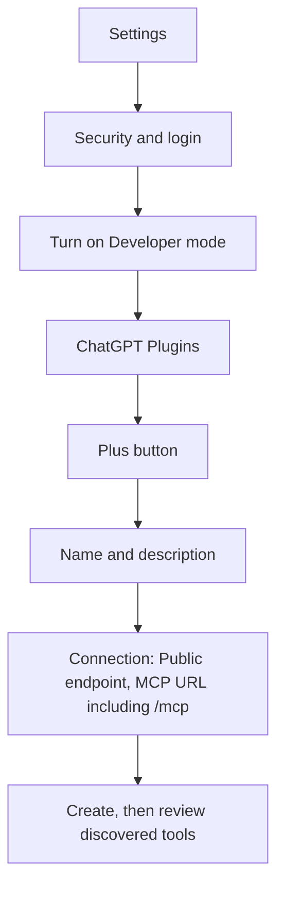

# Tax advisor connector eligibility (TRY-173)

Research date: 2026-10-01. Read-only desk research against official documentation. No real ChatGPT or Claude account was used, so nothing here replaces the release gate in `docs/specs/tax-advisor.md` ("demonstrate this configuration on the target accounts").

Labels: **verified** = read on an official page on the access date; **partial** = official source seen only through a search snippet or a summarised fetch; **unverified** = not found or needs a real account.

Method caveat for the 2026-10-01 research below: pages were fetched through a summarising tool and some `help.openai.com` pages returned 403. The 2026-10-03 recheck above reads the current official Help Center and developer documentation directly; target-account behaviour remains unverified.

## Official documentation recheck — 2026-10-03

This desk recheck **supersedes conflicting plan/menu claims below** but does not verify the target accounts. [OpenAI's developer-mode guide](https://developers.openai.com/api/docs/guides/developer-mode) says Plus, Pro, Business, Enterprise and Edu can create remote MCP apps on web via **Settings → Security and login → Developer mode → ChatGPT Plugins**. Its [Help Center article](https://help.openai.com/en/articles/12584461-developer-mode-and-mcp-apps-in-chatgpt) instead describes **Business and Enterprise/Edu** workspace-admin flows (Workspace settings → Apps → Create), says **Pro supports read/fetch MCP in developer mode**, and does not confirm Plus eligibility there. These official pages differ in scope and interface; do **not** promise Plus or self-service Business access until the intended account's actual UI is checked. The Help Center explicitly says MCP apps are **web only**, not mobile; Enterprise/Edu can delegate developer access through RBAC. Publishing is admin/owner-only.

[Claude's current custom-connector guide](https://support.claude.com/en/articles/11175166-get-started-with-custom-connectors-using-remote-mcp) confirms Free (one connector), Pro and Max individual setup at **Customize → Connectors → Add custom connector**; Team/Enterprise owners add under **Organization settings → Connectors**, then members connect individually. Enterprise custom roles with Manage access to Libraries may add connectors. Claude's cloud connects to remote servers even for Desktop/mobile use; the guide documents web setup paths, not adding a connector inside mobile. Both the MCP server and OAuth issuer must be reachable from the host infrastructure.

OAuth operator checklist from the current [OpenAI authentication guide](https://developers.openai.com/plugins/build/auth) and [Claude authentication guide](https://claude.com/docs/connectors/building/authentication): HTTPS protected-resource metadata and a `401` Bearer challenge, OAuth/OIDC issuer discovery, authorization-code PKCE S256, exact resource/audience and scopes, and working refresh-token handling. ChatGPT supports CIMD, DCR or predefined clients and may use `https://chatgpt.com/connector/oauth/{callback_id}` or the stable `https://chatgpt.com/connector_platform_oauth_redirect` **only** when issuer identification is advertised and returned; copy the callback displayed in its management UI. Claude uses `https://claude.ai/api/mcp/auth_callback` for hosted apps. Claude CIMD requires both `client_id_metadata_document_supported: true` and `none` in token endpoint methods, otherwise falls back to DCR; its public-client refresh tokens must rotate or be sender-constrained. Pre-registered clients require the intended host account to expose that option.

**Target-account acceptance still open:** record plan/workspace role, visible developer/custom-connector toggle and admin approvals, the actual MCP URL/setup labels, exact ChatGPT callback and client-registration choice, OAuth success/failure, tool-result link behaviour, and what each host displays after revoke/expiry or unreachable server. Never collect a consumer subscription token. TRY-177 separately requires the deployed issuer and real authenticated tool calls.

## 1. Plan eligibility

| Product | Plan | Can add custom remote MCP connector | Label |
| --- | --- | --- | --- |
| ChatGPT | Free | Custom remote MCP eligibility not confirmed in official material | unverified; do not promise |
| ChatGPT | Plus | Developer guide says yes; Help Center limits its custom-app overview to workspace plans and mentions Pro read/fetch only | conflicting official descriptions; verify on target account |
| ChatGPT | Pro | Read/fetch MCP in developer mode explicitly confirmed by Help Center; broader developer guide says full MCP | documented read access; verify target account |
| ChatGPT | Business | Admin/owner enables developer mode and creates/publishes workspace apps | official Help Center, target role unverified |
| ChatGPT | Enterprise, Edu | Admin/owner or RBAC-authorised developer creates apps; admin/owner publishes | official Help Center, target role unverified |
| Claude | Free | Yes, limited to one custom connector | verified ([add a connector](https://claude.com/docs/connectors/custom/remote-mcp), [support article](https://support.claude.com/en/articles/11175166-get-started-with-custom-connectors-using-remote-mcp), both accessed 2026-10-01) |
| Claude | Pro, Max | Yes, user adds to own account | verified (same) |
| Claude | Team | Owner adds for the organisation; members then press Connect and sign in with their own account | verified (same) |
| Claude | Enterprise | Owner, or a member whose custom role includes managing the organisation's libraries; members connect individually | verified ([add a connector](https://claude.com/docs/connectors/custom/remote-mcp)) |

Developer mode:
- ChatGPT: developer mode is required. The developer guide says **Settings → Security and login**, then **ChatGPT Plugins**; the Help Center gives workspace paths under **Workspace settings → Apps → Create** and Enterprise/Edu member paths under **Settings → Apps → Advanced Settings**. Use the target account's visible labels rather than presenting these as one stable menu.
- ChatGPT write tools need user review by default; users may remember approve/deny per tool for one conversation (verified, developer mode guide). Our four tools are read-only, but whether ChatGPT prompts for them on the target account is **unverified**. The official Help Center confirms Pro read/fetch MCP in developer mode; it does not resolve the conflicting Plus claim above.
- Claude: no developer mode concept. Team/Enterprise admin action is the Owner adding the connector (verified).

Surfaces:
- ChatGPT: MCP apps are web only, including their use (official Help Center); mobile support must not be promised.
- Claude: current support and developer guides say connectors work in claude.ai, Cowork, Desktop and mobile. The hosted OAuth callback is shared by these surfaces. Whether a custom connector can be **added** from mobile, rather than used there after web setup, remains unverified.

## 2. Menu paths to add a connector by URL

ChatGPT (English UI; Polish labels **unverified**):

Source: [connect and test](https://developers.openai.com/plugins/deploy/connect-chatgpt), accessed 2026-10-01 (verified). Product naming is unstable: older docs say "Apps and connectors" and "Developer Mode and full MCP connectors [beta]", newer docs say "Plugins". Business/Enterprise: admin/owner path is Workspace settings, Apps, Create; publishing to the workspace is Workspace settings, Apps, Drafts, Publish (partial). Use the user's visible label, never hard-code one in copy. After tool changes: open the connection, Refresh, start a new conversation.

Claude:
- Free/Pro/Max: Customize, Connectors, Add custom connector, enter URL, optional OAuth settings, Add (verified).
- Team/Enterprise Owner: Organization settings, Connectors, Add, Custom (choose Web if asked), URL, optional OAuth client, Add (verified).
- Team/Enterprise member: Customize, Connectors, find the connector labelled Custom, Connect (verified).
- Per conversation: "+" in chat, Connectors, toggle (verified). Tool permissions can be set to Blocked under Customize, Connectors (verified).
- Authentication settings cannot be edited after adding; remove and re-add, and members must reconnect (verified).
- Add dialog options: Authentication "Sign in now" / "Sign in when needed" / "No sign-in"; OAuth client "Use Claude's published identity" (CIMD, recommended) / "Register automatically" (DCR) / "Use your own OAuth client" (verified). Polish labels **unverified**.

## 3. OAuth and transport requirements

| Topic | ChatGPT | Claude |
| --- | --- | --- |
| Transport | Streamable HTTP, typically `/mcp`; developer mode also lists SSE (verified, [MCP server guide](https://developers.openai.com/apps-sdk/build/mcp-server), developer mode guide) | Streamable HTTP; a URL ending `/sse` selects legacy SSE (verified) |
| RFC 9728 protected-resource metadata | Required at `/.well-known/oauth-protected-resource` (verified, [auth guide](https://developers.openai.com/apps-sdk/build/auth)) | Required. Needs a `401` with `WWW-Authenticate: Bearer resource_metadata="..."`; a header on a `200` is ignored; probes well-known paths as fallback. `resource` must equal the URL the user typed. Only the first `authorization_servers` entry is used (verified) |
| Authorization server discovery | OAuth or OIDC discovery document (verified) | RFC 8414 first, then OIDC `openid-configuration`; Keycloak is explicitly listed as serving only the OIDC document, which is fine (verified, [troubleshooting](https://claude.com/docs/connectors/building/troubleshooting)) |
| PKCE | Must advertise `code_challenge_methods_supported: ["S256"]` (verified) | S256 on every request; must advertise it (verified) |
| Client registration | CIMD preferred, DCR supported (runs once per connection and reuses the client), or predefined client (verified) | CIMD (default choice), DCR, own pre-registered client ID with optional secret, or Anthropic-held credentials via `mcp-review@anthropic.com`. CIMD is used only if metadata advertises `client_id_metadata_document_supported: true` and `none` in `token_endpoint_auth_methods_supported`; otherwise falls back to DCR (verified) |
| Redirect URI | Default `https://chatgpt.com/connector/oauth/{callback_id}`; stable `https://chatgpt.com/connector_platform_oauth_redirect` when issuer identification is supported. Copy the exact URI shown on the connection's management page (verified) | Exactly `https://claude.ai/api/mcp/auth_callback` for web, Desktop, mobile, Cowork (verified) |
| Token endpoint auth | `none` (public client with PKCE) or `private_key_jwt` (verified) | Public client (`none`) for DCR and CIMD; optional secret when the user enters their own client. `client_credentials` grant unsupported. Token endpoint must accept `application/x-www-form-urlencoded` (verified) |
| `resource` parameter (RFC 8707) | Sent on authorize and token requests; copy into token `aud` (verified) | Sent, canonical form (lowercase scheme/host, no trailing slash, no default port, path kept); accept canonical value when checking `aud` (verified) |
| Scopes | Advertise in metadata; `openid`/`email` needed for workspace domain restrictions (verified) | `scope` in the `401` challenge, else `scopes_supported` from resource metadata; adds `offline_access` if the authorization server lists it (verified) |
| Issuer identification | Set `authorization_response_iss_parameter_supported: true` and return `iss` to get the stable redirect URI (verified) | Not mentioned (unverified) |
| Refresh | Not specified in fetched text (unverified) | Refreshes on `401` and up to 5 minutes before expiry; expects `invalid_grant` for dead refresh tokens; rotate refresh tokens for public clients (verified) |
| Latency | Not specified | 10 s for discovery, registration, token; 30 s for refresh (verified) |
| Public reachability | HTTPS public endpoint; private servers need OpenAI's Secure MCP Tunnel (verified) | Anthropic cloud connects, not the device. Hostname must resolve only to globally routable IPv4 addresses (no AAAA-only). No redirect to another host on the MCP URL (the `Authorization` header is dropped). Authorization server host must also be reachable (verified) |
| IP allowlist | Published "ChatGPT connectors" IP ranges JSON; ChatGPT also presents an OpenAI-managed client certificate (mTLS) to MCP servers (verified for ranges via [MCP server guide](https://developers.openai.com/apps-sdk/build/mcp-server); mTLS partial via search snippet) | Egress `160.79.104.0/21` (verified, [authentication](https://claude.com/docs/connectors/building/authentication)) |

Both hosts expect the resource server to validate every token (signature, issuer, expiry, audience, scopes) and return `401` with `WWW-Authenticate` to restart OAuth (verified).

## 4. Host behaviour on failures

| Situation | ChatGPT | Claude |
| --- | --- | --- |
| Revoked or expired grant, server returns `401` + `WWW-Authenticate` | Client runs OAuth again (verified). Exact user-facing text **unverified** | Refreshes reactively on `401`; if refresh fails the connector needs reconnecting. Exact reconnect prompt text **unverified** |
| Unreachable server or discovery failure | Text **unverified** | "Couldn't reach the MCP server" (verified). Note it also appears for DNS, WAF and discovery problems |
| OAuth does not complete | Text **unverified** (`invalid_client` guidance exists for dev-side) | "Authorization with the MCP server failed", with an `ofid_` reference ID in the page URL (verified) |
| Tool error | **Unverified**; `isError` handling not documented in fetched pages | "Unexpected error while invoking tool" followed by the tool name; no reference ID (verified) |

Consequence: our copy must explain recovery in our own words; do not quote host strings except Claude's three verified messages, and treat them as subject to change.

## 5. Links in tool results

- ChatGPT docs say to return "absolute, user-openable URLs for sources that the model should cite" (verified, MCP server guide). Whether markdown links to `/dashboard/invoices/:id` are rendered clickable in answers: **unverified** (model output, not a documented guarantee).
- Claude: no statement found on link rendering in tool results. **Unverified**.
- Design rule that follows: always emit absolute HTTPS URLs from a configured public web base URL; never relative paths. Company or environment hints for the return banner: cannot verify host behaviour, so keep them inside the URL query we control.

## 6. Policy and data handling

- Anthropic: developers may not offer Claude.ai login or route requests through Free/Pro/Max credentials on behalf of users, nor collect, store or intermediate Claude.ai credentials or session tokens. Products using the Agent SDK must use API key authentication. Verified via search snippets of [Legal and compliance](https://code.claude.com/docs/en/legal-and-compliance) and [Agent SDK with your plan](https://support.claude.com/en/articles/15036540-use-the-claude-agent-sdk-with-your-claude-plan), accessed 2026-10-01 (partial: pages not fully read). Our connector model is compliant by design: the user's own Claude app calls our MCP server; we never receive Claude credentials and do not run embedded inference on a subscription.
- OpenAI: terms forbid sharing account credentials. "Sign in with ChatGPT" is an official, separate mechanism for connecting a plan to third-party apps; using it "does not by itself give the app access to your ChatGPT conversations" (partial, search snippet of [help.openai.com 20001542](https://help.openai.com/en/articles/20001542-using-your-chatgpt-plan-in-other-apps-and-sites)). We do not use it, and embedded subscription inference stays out of scope. Whether SIWC would allow embedded inference for our use case: unverified, not pursued (YAGNI).
- Both vendors warn about connector risks: prompt injection, unverified third-party servers, model errors (verified, both developer-mode guide and Claude security section). Our read-only tools reduce but do not remove this.
- Data retention of conversations in host products and whether tool results are cached after revocation: Claude retention page returned 404; OpenAI pages returned 403. **Unverified**. Copy must say that data already shared in a host conversation stays under the host's retention rules, which we cannot delete.

## 7. Impact on our design

Connector setup copy (`docs/specs/tax-advisor-connection-ux.md` §4, §7.3):
1. Give separate step lists for ChatGPT and Claude. ChatGPT: web only, enable Developer mode first, Business needs an admin/owner, Enterprise/Edu needs RBAC access. Claude: Free (one connector), Pro, Max self-serve; Team/Enterprise needs an Owner.
2. Show the exact callback URL to register only when the issuer needs a pre-registered client: Claude `https://claude.ai/api/mcp/auth_callback`; ChatGPT value shown on its management page (fixed values listed in §3).
3. Show the MCP URL ending in `/mcp`, HTTPS, publicly reachable, no redirect, IPv4 A record.
4. Mobile copy: say "set up on the web", because adding from mobile is unverified for both.
5. Tell users to sign in with the same Księgowy Vibe account that granted access (see question 10).
6. Refer to host UI labels generically ("Plugins/Apps", "Connectors") with a note that names change.

OAuth issuer choice (Keycloak):
- Verified: Keycloak implements OIDC Dynamic Client Registration (RFC 7591), supports anonymous registration, and client registration policies (trusted hosts, allowed redirect URIs) ([Keycloak client registration](https://www.keycloak.org/securing-apps/client-registration), accessed 2026-10-01). It serves only the OIDC discovery document, which Claude accepts.
- Implication: DCR is workable but needs policy tuning. Trusted-hosts policy restricts by caller host, and the callers are Anthropic and OpenAI clouds, so the default policy likely blocks them; Allowed Redirect URIs policy must permit the two callback hosts. Whether this is acceptable security-wise is a decision for the operator. Claude's DCR registers a new client on every fresh connection (sprawl; needs cleanup).
- Preferred alternatives that avoid open DCR: pre-registered client per host. Claude supports it (user enters client ID; optional secret, or Anthropic-held credentials). ChatGPT supports predefined clients. This matches the existing spec text ("register each actual host's exact callback URLs") and avoids anonymous registration.
- Unverified for Keycloak (needs a test realm): CIMD support, RFC 8707 `resource` to `aud` mapping (likely needs an audience mapper), `authorization_response_iss_parameter_supported`, refresh-token rotation for public clients, `invalid_grant` on revoked grants, response latency under 10 s.
- Resource server checklist from the hosts: `401` with `resource_metadata`; `resource` equals the MCP URL exactly; `authorization_servers` lists the Keycloak realm issuer first; accept canonical `aud`; discovery and token endpoints publicly reachable from both clouds.

UX spec changes: replace provisional [P] copy with the above; remove the "works on mobile" assumption; show absolute links; add recovery text per failure class (our wording, not host strings); keep the release gate on real accounts.

## 8. The 12 open questions

1. Plans and developer mode: Business and Enterprise/Edu custom MCP apps are documented with admin controls; Pro read/fetch is documented. Plus appears in the developer guide but not the Help Center's scope statement; verify it on the target account. Free ChatGPT remains unconfirmed. Read-only tool prompts require a real-account check.
2. Business/Enterprise admin: Business, only admin/owner enable developer mode for themselves; Enterprise/Edu, RBAC grants members access; admin-published apps for the workspace (partial). Member "request access" button: cannot verify without a real account.
3. Claude plans: Free (one), Pro, Max, Team, Enterprise; Owner adds on Team/Enterprise, Enterprise custom role with library management may too; members connect individually (verified).
4. Menu paths: see §2 (verified, English). Polish UI labels and mobile paths: cannot verify without a real account.
5. OAuth registration: both support DCR and CIMD; both also support pre-registered clients. Callbacks: Claude `https://claude.ai/api/mcp/auth_callback`; ChatGPT `https://chatgpt.com/connector/oauth/{callback_id}` or `https://chatgpt.com/connector_platform_oauth_redirect` (verified).
6. Mobile: ChatGPT MCP apps are web only per Help Center. Claude can use remote connectors from mobile, but adding one from mobile is not documented.
7. Failure display: Claude's three messages verified (§4); ChatGPT text cannot be verified without a real account. Do not rely on either; our copy explains recovery.
8. Links: ChatGPT docs recommend absolute URLs; clickability in answers cannot be verified without a real account; Claude likewise. Use absolute URLs; return-banner hints are our own query parameters.
9. `lastUsedAt` privacy: not a vendor question; vendors give no constraint. Product/legal decision; shown only to the granting user. No research answer.
10. Same-account notice: not documented by either host. Recommended to include it. How Keycloak displays the account depends on realm theme; cannot verify without our realm.
11. Cache after revocation: cannot verify; neither vendor documents it in the pages reachable. Copy should say revocation stops new access, and data already in a host conversation follows the host's retention.
12. Grant duration: no vendor constraint found. Claude refreshes up to 5 minutes before expiry and needs refresh-token rotation; 7 and 30 days is our policy choice. Shorter TEST default is acceptable but unconstrained by vendors.

## Sources (accessed 2026-10-01)

- https://developers.openai.com/api/docs/guides/developer-mode
- https://developers.openai.com/plugins/deploy/connect-chatgpt
- https://developers.openai.com/apps-sdk/build/auth
- https://developers.openai.com/plugins/build/auth
- https://developers.openai.com/apps-sdk/build/mcp-server
- https://developers.openai.com/apps-sdk/deploy/troubleshooting
- https://help.openai.com/en/articles/12584461-developer-mode-and-mcp-apps-in-chatgpt (search snippet only, fetch 403)
- https://help.openai.com/en/articles/20001542-using-your-chatgpt-plan-in-other-apps-and-sites (snippet only)
- https://claude.com/docs/connectors/custom/remote-mcp
- https://claude.com/docs/connectors/building/authentication
- https://claude.com/docs/connectors/building/troubleshooting
- https://support.claude.com/en/articles/11175166-get-started-with-custom-connectors-using-remote-mcp
- https://code.claude.com/docs/en/legal-and-compliance (snippet only)
- https://support.claude.com/en/articles/15036540-use-the-claude-agent-sdk-with-your-claude-plan (snippet only)
- https://www.keycloak.org/securing-apps/client-registration
