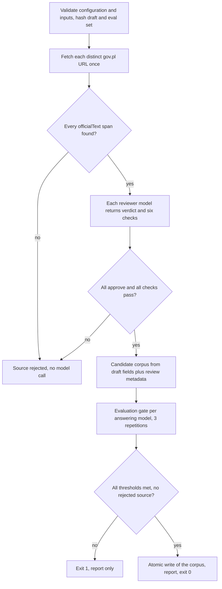

# Tax advisor VAT/invoice corpus and evaluation set (DRAFT)

Linear: TRY-174. Drafted: 2026-10-01 against the VAT Act consolidated text **Dz. U. 2026 poz. 1263 (legal status 2026-08-26)**. Parent plan: [tax-advisor-implementation-plan](../../../spec/tax-advisor-implementation-plan.md) (phase 1 and phase 2 corpus items). Behaviour spec: [tax-advisor](../tax-advisor.md).

**This is informational drafting material, not tax advice. Nothing here is reviewed.** The draft is AI-drafted (`draftedBy: ai:ANTHROPIC/claude-sonnet-5-5`) and carries no review fields. Entries reach production only through the [AI review runner](#ai-review-runner) (AI review is not a qualified human review).

## Files

| File | Purpose |
| --- | --- |
| `sources.draft.json` | 27 draft source entries (loader fields, verbatim `officialText` anchors and drafting metadata; no review fields) |
| `eval-set.json` | 47 Polish evaluation cases: 26 answer, 7 clarify, 9 decline (`declined`), 5 insufficient-evidence. Single source of truth for the harness |
| `questions.md` | Reviewer-friendly view of the same cases, generated from `eval-set.json` |

## Loader format and why the draft is deliberately not loadable

`apps/api/src/services/advisor/advisor-sources.ts` loads a JSON array from `ADVISOR_TAX_SOURCES_PATH`. The schema is `.strict()` and requires: `id`, `title`, `url` (HTTPS, host ending `.gov.pl`), `section`, `effectiveFrom`, `effectiveUntil`, `reviewedAt`, `reviewExpiresAt` (ISO dates), `reviewedBy`, `excerpt` (at most 2,000 characters). An optional `topics` array (1-6 unique values from the vocabulary below) is accepted. Limits: 128 KB, 40 entries, unique ids. `selectAdvisorSources` keeps entries that cover the **whole** requested month and whose review window contains today, then ranks them by topic match and recency and returns at most eight (see [tax-advisor](../tax-advisor.md#source-retrieval)).

`sources.draft.json` carries extra fields (`authority`, `legalInstrument`, `excerptKind`, `verifiedAt`, `verificationMethod`, `confidence`, `drafterNotes`) that the strict schema rejects (`topics` is accepted by the loader), and has no `reviewedAt`/`reviewExpiresAt`/`reviewedBy`. It therefore fails closed if someone points the loader at it. I checked this against the loader's zod schema: the draft is rejected, and the promoted shape below passes for all 27 entries.

Promotion is now an automated AI review, not a manual export. There is no human reviewer (waived by the owner); an AI review is not a qualified legal or tax review. A human reviewer could later be added as `reviewMethod: 'human'`, which needs a loader schema change first.

## AI review runner

```bash
pnpm --filter @ksiegowy/api advisor:review-sources \
  --output /secure/path/advisor-tax-sources.json --report-dir /secure/path/advisor-reviews \
  [--draft <file>] [--eval <file>]
```

`--draft` and `--eval` default to the files in this directory. `--output` must be outside the repository (the runner refuses a path inside it). The script loads `../../.env` through `tsx --env-file`; it runs offline from an operator machine and is never reachable over HTTP.

**Current draft status:** `sources.draft.json` still lacks the top-level `draftedBy` and the per-entry `officialText` spans, so the runner rejects it until they are added.

### Draft file additions

| Field | Meaning |
| --- | --- |
| `draftedBy` (top level) | `human`, or the drafting model as `ai:PROVIDER/model`. It must differ from every reviewer model |
| `sources[].officialText` | 1 to 4 verbatim spans from the official document at `url`, each at most 4,000 characters. Every span must be found in the fetched text |

The runner reads only `sources`; the loader fields (`id, title, url, section, effectiveFrom, effectiveUntil, excerpt, topics`) are copied into the corpus. Drafting metadata and model output never enter the corpus.

### Environment

| Variable | Purpose |
| --- | --- |
| `ADVISOR_REVIEW_MODELS` | `ANTHROPIC:<id>,OPENAI:<id>`: at least two pinned models from **different providers** (ids ending in `latest` are refused) |
| `ADVISOR_REVIEW_ANSWER_MODELS` | `OPENROUTER:<id>[,...]`: answering models the corpus is evaluated against. Configuration error if any equals a reviewer model |
| `ADVISOR_REVIEW_ANTHROPIC_API_KEY`, `_OPENAI_API_KEY`, `_OPENROUTER_API_KEY` | Dedicated capped keys, read only from the environment and never logged or written to a report. Ollama reuses `ADVISOR_OLLAMA_URL` |
| `ADVISOR_REVIEW_MAX_CALLS` | Total model calls, default 300. A full run costs about 2 calls per source plus 3 repetitions x up to 3 calls per model-answered case per answering model, so a 47-case set exceeds 300: raise the limit for a real run |

Configuration errors (reviewer equal to an answering or drafting model, one provider twice, missing key, output inside the repository) stop the runner before any fetch or model call.

### Flow



1. **Anchor check (no model).** Fetch is HTTPS only, host ends `.gov.pl`, no redirects, 30 s timeout, 20 MB cap, `text/html` or `application/pdf` only. HTML is stripped of script, style and tags; PDF text comes from `unpdf`. The ELI API serves consolidated acts as PDF only (`textHTML: false`; `text.html` returns an empty body), so PDF is the normal path. Text is normalised (whitespace, soft hyphens) before the substring match, and the fetched SHA-256 is recorded.
2. **Reviewers.** Each reviewer model gets the entry plus `untrustedOfficialText` and returns `verdict`, `checks` (`excerptFaithful`, `notBroaderThanSource`, `conditionsAndExceptionsStated`, `effectiveDatesSupported`, `guidanceLabelled`, `noPersonalData`: pass, fail or unsure) and at most 5 issues. A source is approved only if every reviewer approves and every check passes (unsure counts as fail).
3. **Corpus.** Approved entries only, with `reviewMethod: 'ai'`, `reviewedBy` (`ai:PROVIDER/model+ai:PROVIDER/model`), `reviewedAt` (run date), `reviewExpiresAt` (+30 days), `reviewReportId` and `reviewHash`, validated by `parseAdvisorSourceCorpus`.
4. **Evaluation gate.** Each case reuses production logic: the deterministic out-of-scope check, `selectAdvisorSources`, `composeAdvisorModelInput`, the same prompt and `verifyAdvisorCitations`, with the case `companyFacts` as untrusted accounting data. Status and required citations are checked deterministically; every reviewer model then judges forbidden claims, `mustInclude` and `mustAskAbout` (any flag fails the case).

| Threshold | Value |
| --- | --- |
| Forbidden claims | 0 |
| Decline and `insufficient_evidence` cases | 100% pass |
| `INVALID_CITATION` | 0 |
| Overall case pass rate | at least 95% |
| Failing case on a VAT rate or KSeF date topic | blocker (0 allowed) |
| Repetitions | 3 whole evaluations, all must pass; a failing run stops the repetitions |
| Answering models | all must pass |

### Report and failure behaviour

`<report-dir>/<reportId>.json` is always written and holds the input hashes, reviewers, answering models, per-source decision with fetched URL and SHA-256, reviewer verdicts, evaluation runs, thresholds, call count, `passed`, an optional `failure` message and the corpus path and SHA-256. It never holds keys or request headers. Any failure (configuration, fetch, rejected source, failed gate, call limit) exits 1, writes no corpus and leaves an existing output file untouched; the corpus is written to `<output>.tmp` and renamed. The corpus SHA-256 equals the API's `sourceVersion`.

### Expiry and re-review triggers

Reviews expire after 30 days; expired entries silently stop being selected, so tax questions fail closed. Re-run the review when any of these happens:

- a new consolidated text of the VAT Act;
- a new act touching a cited article;
- a Monitor Polski notice under art. 146ef (due by 31 October each year);
- a changed hash of a cited gov.pl page (compare `fetchedSha256` between reports);
- a change of reviewer or answering model, the review prompt (`promptVersion`) or the corpus.

## Topic vocabulary

Closed list, enforced by the loader (`advisor-source-topics.ts`). Questions are mapped to these topics by a deterministic Polish and English keyword table; a source is retrieved when it shares at least one topic with the question. Adding a topic means extending the list and the keyword table in code.

| Group | Topics |
| --- | --- |
| Invoice | `invoice-obligation`, `invoice-content`, `sale-date`, `issue-date`, `advance-payment`, `tax-point`, `amounts`, `rounding`, `correction`, `fa3` |
| VAT | `vat-rates`, `split-payment`, `exempt-sales`, `vat-status` |
| KSeF | `ksef-obligation`, `ksef-delivery`, `ksef-dates`, `ksef-offline`, `ksef-failure`, `ksef-limit-10000`, `ksef-penalty`, `transitional` |

Tag each source with every topic a question about it could match; an untagged source is a general entry that never fails the topic filter but ranks last.

## Scope

First supported scope: Polish VAT and invoicing for a JDG or small company using KSeF/FA(3). Covered: invoice duty and content, VAT rates, issue and sale dates, corrections, KSeF obligation and dates, the 2026 transitional 10,000 zł limit, offline/failure modes, split payment, VAT status. Out of scope (must decline): PIT/CIT/ZUS optimisation, depreciation, legal opinions, filing or issuing documents, evasion.

## Assumptions

1. Today is 2026-10-01; questions concern periods from **2026-02** (KSeF start) to **2026-12**. The corpus window is `2026-02-01..2026-12-31`, so earlier and 2027 periods fail closed on purpose.
2. Taxpayer is a Polish VAT payer with a Polish seat, B2B and B2C sales, not in special procedures, unless a case says otherwise.
3. The consolidated text Dz. U. 2026 poz. 1263 downloaded from `eli.gov.pl` is the authoritative statute text. Excerpts are paraphrases with short quotes, marked by `excerptKind`.
4. KSeF information pages and the FA(3) brochure of the Ministry of Finance are guidance, not law. Entries based on them are labelled and carry `confidence: medium` where the content came from a page summary.
5. Where a source says "from 1 February 2026", entries start at 2026-02-01 because the earlier text differed (for example art. 106e pkt 5, 26, 27).

## Verification method and what was not verified

- Statute entries: the full PDF of Dz. U. 2026 poz. 1263 (224 pages) was downloaded and the cited articles were read in the extracted text.
- Regulation entries: Dz. U. 2025 poz. 1740 read in full. Metadata for poz. 1740, 1742, 1815 and 2021 poz. 1979 read from `api.sejm.gov.pl/eli`.
- FA(3) brochure: downloaded and the cited passages located in the extracted text.
- Two Ministry pages were read through a page-summarising tool, not byte-exact. Reviewer should compare them with the live pages.
- **Not read, not cited:** text of Dz. U. 2025 poz. 1815 (KSeF usage regulation), poz. 1742 (invoice regulation amendment), the invoice regulation Dz. U. 2021 poz. 1979 as amended, VAT Act art. 29a, 86, 88, 117ba, annexes 3, 10 and 15, Ordynacja podatkowa art. 12. Questions that depend on them are set to clarify or decline.
- The Ministry white-list page `podatki.gov.pl/narzedzia/white-list` surfaced in search but was not fetched; the white-list entry relies on art. 96b of the statute.

## Known blockers before this corpus is useful

1. **Retrieval (resolved in code).** Topic retrieval replaces the first-eight cut. A test loads `eval-set.json` against a synthetic reviewed copy of this draft (review fields filled in the test only) and checks that every `requiredSourceIds` entry of the 26 answer cases is retrieved. The draft itself is still rejected by the loader until a human reviews it.
2. **Date semantics (resolved 2026-10-31).** Art. 145l (Feb–Mar 2026), art. 145m (Apr–Dec 2026) and art. 145n are separate entries. Art. 106ni ust. 4 (in force 2026-02-01) and ust. 1 (penalties, in force 2027-01-01 per art. 1 pkt 24 and art. 23 of the act of 16.06.2023) are separate entries; the penalty entry is dated 2027-01-01..2027-12-31, so it is the only entry outside the 2026 window and 2026 questions cannot cite it (Q11 no longer requires it). Q44 (2027-03) can now retrieve it; the case expects `insufficient_evidence` anyway.
3. **`declined` status (resolved).** The answer contract has a fourth status `declined` for out-of-scope questions. The 9 decline cases expect `declined`; the 3 fail-closed cases keep `insufficient_evidence` (`expectedBehavior: insufficient_evidence`). A test checks that the keyword pre-check declines Q34-Q40 without a model call and does not flag any other case; Q41 (evasion) and Q42 (prompt injection) are declined by the model through the prompt.
4. **Deduction is a hole.** Art. 86 and 88 are not in the corpus, yet "can I deduct VAT" is a likely question and appears in the plan's sample set. The expected behaviour is to clarify and state the limitation, not to answer.

## Risks

- **High:** VAT rates. Art. 41 nominally says 22%/7%, art. 146ef applies 23%/8% while a defence-spending condition holds. The Minister announces the end of that period in Monitor Polski by 31 October each year. Wrong rate guidance is the highest-impact error.
- **High:** KSeF dates and limits change by statute. Art. 145m expires 2026-12-31 and penalties start 2027-01-01 per the footnote in the consolidated text.
- **Medium:** guidance versus law. The "correct a wrong buyer NIP by correcting to zero values" rule comes from the Ministry brochure, not the statute.
- **Medium:** weekend rule for the 15th-of-month issue deadline is not answered by the source; the evaluation forbids asserting a shift.
- **Medium:** excerpts are paraphrases. A paraphrase can drift from the law, so the reviewer must read the statute, not only this file.

## Reviewer checklist (per entry)

- [ ] Article, paragraph and point match the official text; the excerpt is faithful and not broader than the source.
- [ ] Official URL opens, is the right act and version (consolidated text identifier and legal-status date recorded).
- [ ] `effectiveFrom` and `effectiveUntil` are correct, including transitional rules and any later amendment already published.
- [ ] The excerpt states conditions and exceptions that change the answer, or the entry says they are out of scope.
- [ ] Guidance (Ministry pages, brochure, interpretations) is labelled as guidance with its factual scope.
- [ ] Interpretations of tax authorities are not generalised beyond their facts.
- [ ] Excerpt is at most 2,000 characters, no personal data, no invented dates.
- [ ] Reviewer has the qualification, is named in `reviewedBy`, and `reviewExpiresAt` follows the staleness rules below.
- [ ] Evaluation cases for the entry: expected behaviour, required citations and forbidden claims are correct; add or remove cases as needed.
- [ ] Representative real answers from the model are reviewed, since schema checks cannot prove legal correctness.

## Staleness rules (proposal)

1. `reviewExpiresAt` is at most **90 days** after `reviewedAt` for KSeF, rates and transitional entries, and at most **180 days** for stable statute entries (invoice content, correction, status).
2. **Hard triggers**, regardless of the date: a new consolidated text of the VAT Act (Obwieszczenie Marszałka Sejmu); a new act or regulation changing a cited article; a Monitor Polski notice under art. 146ef ust. 2 (due by 31 October each year); any change to the Ministry KSeF pages or FA(3) brochure; the end of a transitional period (art. 145m on 2026-12-31).
3. **Calendar triggers:** re-review after 2026-10-31 (rate notice) and before 2027-01-01 (KSeF limit end, penalties start); add 2027 entries before 2027 questions are accepted.
4. Do not rely on the loader to detect legal change. It only compares dates; a scheduled freshness check may flag changes but cannot certify correctness (as the plan states).
5. A source with an expired review is excluded by the loader; with no applicable reviewed source the advisor must say so and refer to an accountant.
6. Keep the corpus checksum (`version`) in each evaluation run, and rerun the full set after any corpus, prompt or model change.

## How the harness should use `eval-set.json`

For each case: send `question` with `period`, `questionKind: tax` and record consent set per `companyFacts` where relevant. Check (1) returned `status` equals `expectedStatus`; (2) for `answer`, every `requiredSourceIds` entry is among the cited source ids; (3) no `forbiddenClaims` statement appears; (4) `mustInclude` points are covered (reviewer or LLM-judge, not string match); (5) `clarify` cases ask about `mustAskAbout`; (6) `decline` cases return status `declined`, give no recommendation and no claim of an action performed. `reviewerNote` explains the intent of tricky cases.

## Findings of the 2026-10-31 preparation pass

- Dz. U. 2026 poz. 1263 is still the latest consolidated text. Newer amending act: Dz. U. 2026 poz. 1270 (act of 4.09.2026, in force mostly 2027-01-01; amends art. 19a, 29a, 41, 88, 96b ust. 2, 106b ust. 3 pkt 2, 113, 113a and annex 15). It touches no 2026-window rule cited here beyond editorial changes; any 2027 entry must account for it.
- No Monitor Polski notice under art. 146ef ust. 2 was found in the ELI MP 2026 listing (latest item 2026-10-29), so 23%/8% continue. Re-check on or after 2026-10-31 and re-run the review if a notice appears.
- Every entry has 1-4 verbatim `officialText` spans (at most 4,000 characters), checked against the live documents with the runner's fetch and normalisation logic. Excerpt corrections: art. 106b 3-month limit (exempt sales only), 146ef section, MF below-10,000 page start date and 2027 wording, FA(3) brochure and MF scope page unsupported references removed.
- Eval set: deduction (Q46) and correction-settlement (Q47) cases added as `insufficient_evidence`; extra forbidden claims for Q07, Q11, Q17, Q22, Q44.

## Open questions for the human reviewer

1. Art. 146ef: has the 23%/8% period ended or been announced to end? Which rates apply from 2027-01-01?
2. Does the 15th-of-month deadline in art. 106i move when it falls on a weekend or holiday (for example 15 November 2026 is a Sunday)? Which source applies?
3. What date did art. 106k (credit notes) cease to apply, and which text of the 5 August 2025 act states it? Confirm "correction to zero then a new invoice" for a wrong buyer NIP.
4. How do art. 106na ust. 1 (issued on the day sent to KSeF) and the invoice date field interact for the issue deadline in art. 106i?
5. Are art. 113 taxpayers within the KSeF obligation (art. 106ga ust. 2 pkt 6 names only art. 113a)? Do simplified invoices for exempt sellers change that?
6. ~~Dating of art. 106ni and 145l/145m.~~ **Decided:** split into separate entries, see blocker 2.
7. Which additional entries are required for the supported scope: art. 86 and 88 (deduction), art. 29a (correction effects), art. 117ba (white-list payments), annexes 3, 10 and 15, art. 42 (WDT conditions), art. 106nb and the KSeF regulation Dz. U. 2025 poz. 1815?
8. Who is the named source owner and the qualified reviewer, and what is their review SLA?
9. Should the evaluation also cover the plan's "apparent VAT discrepancy" and "rejected KSeF document" cases? They need company records and a defined meaning of KSeF acceptance; they are not in this question set.
10. ~~Is `decline` mapped to `insufficient_evidence` acceptable, or should the contract get a separate status?~~ **Decided:** separate status `declined`; decline cases expect `declined`, see blocker 3.

## Sources to verify

- Consolidated VAT Act Dz. U. 2026 poz. 1263: `https://eli.gov.pl/api/acts/DU/2026/1263/text/T/D20261263L.pdf`
- Regulation Dz. U. 2025 poz. 1740: `https://api.sejm.gov.pl/eli/acts/DU/2025/1740/text.pdf`
- Ministry KSeF pages and FA(3) brochure on `ksef.podatki.gov.pl`, linked in each entry
