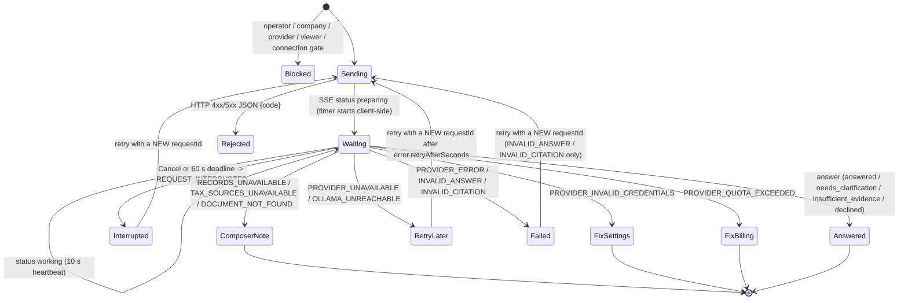

# Tax advisor error contract (ADR)

Status: accepted, backend implemented (steps 1-6 and 8, Round 2 / Decision 5 steps 1-6; web step 7 pending; deploy migration `20261109090000_advisor_turn_reply_to` before the API) · Date: 2026-11-09 · Related: [tax-advisor.md](tax-advisor.md), [advisor design notes](../redesign/advisor-design-notes.md) decisions 1, 4, 6 and 9

## Context (verified against code)

- `advisor-provider.ts` uses `PROVIDER_ERROR` for every upstream failure. Anthropic returns `429` on HTTP 429 and `502` otherwise. Model discovery always returns `502`.
- **Bug:** errors from the OpenAI SDK (OpenAI, OpenRouter and Ollama generation) and `fetch` network rejections are not wrapped. In the SSE route they fall back to `PROVIDER_ERROR`. In `POST /connections/:provider/test`, `GET /connections/:provider/models` and `model-preview` (hosted providers) they reach the shared error handler without `statusCode`, which turns them into **`500 ADVISOR_ERROR`**.
- The web app checks `discoverCode === 'PROVIDER_ERROR'` to decide that the key was rejected. The E2E test `advisor-settings.spec.ts` "a rejected key keeps the draft…" mocks `502 PROVIDER_ERROR` and expects the copy "Dostawca odrzucił żądanie. Sprawdź klucz API i spróbuj ponownie."
- `GET /settings` already returns `canManageConnections` (false for VIEWER). `CONNECTION_ROLE_REQUIRED` (403) guards only `PUT /connections/:provider` and `PUT /connectors/:client`.
- SSE already emits `status {stage:'preparing'}` and then `status {stage:'working'}` every 10 s. The deadline is `AbortSignal.timeout(60_000)`. The client ignores the payload (`onProgress()`).
- Grant states `WAITING | ACTIVE | EXPIRED | REVOKED` exist in the API, in `packages/types`, in the UI and in E2E. MCP returns `CONNECTOR_CONSENT_REQUIRED` for a revoked or expired grant.
- `needs_clarification` and `insufficient_evidence` already exist in the Zod contract, in `AdvisorAnswerStatus`, in the prompt, in the evaluation and in translations. `TAX_SOURCES_UNAVAILABLE` also exists.

## Decision 1: split provider failures

The client acts on the `code`. The HTTP status only separates "fix configuration" (502) from "transient" (503).

| Code | HTTP | Retry | Upstream signals | User action |
| --- | --- | --- | --- | --- |
| `PROVIDER_INVALID_CREDENTIALS` | 502 | no | 401, 403 (all hosted providers) | Settings: replace the key |
| `PROVIDER_QUOTA_EXCEEDED` | 502 | no | 402 (OpenRouter credits, Anthropic billing); 429 with `error.type` `insufficient_quota` and `error.code` such as `credit_balance_exhausted` or `*_spend_limit_exceeded` (OpenAI, verified 2026-11), 402 `billing_error` (Anthropic) | Billing or credits at the provider |
| `PROVIDER_UNAVAILABLE` | 503 (+`Retry-After` when upstream sends numeric seconds, clamped to 1–60) | yes | Other 429s (rate limit), 5xx, 529 (Anthropic overloaded), network errors, provider or SDK timeouts | Retry later |
| `PROVIDER_ERROR` (kept) | 502 | no | Any other 4xx (unsupported model, bad request), malformed model list | Check model/connection |
| `OLLAMA_UNREACHABLE` (existing) | 502 | yes | Ollama connection failure or 5xx, now **also during generation** | Operator |
| `REQUEST_INTERRUPTED` (existing) | SSE only | yes | User cancel/disconnect (`controller.signal`) **or** the 60 s route deadline | Retry |
| `RATE_LIMITED` (existing, app) | 429 (+`retryAfterSeconds: 10` from `reserveAdvisorProviderRequest`) | yes | The app's own throttles. Never used for upstream failures. Web copy: "Za dużo pytań naraz." / "To nic nie kosztuje — pytanie nie dotarło do dostawcy…" (no provider call was made) | Wait |
| `ADVISOR_ERROR` (existing) | 500 | yes | Residual non-`AdvisorError` failures inside generation (database, access-token re-verify after generation). **Not** `PROVIDER_UNAVAILABLE`: every provider call is classified at its source, so anything left over is internal | Retry or sign in again |

Rules:
- Classification reads only `status`, the `retry-after` header and the allowlisted string fields `error.code` / `error.type`. Bodies are read with the existing `readLimitedText` (cap 16 KB) and parsed safely. The provider body, the provider message, request headers and the credential are **never** put into `AdvisorError.message`, logs or the response. Messages stay fixed English strings, e.g. `Provider rejected the credential`.
- The OpenAI SDK path wraps `client.chat.completions.create(...)` with `.catch` and maps `OpenAI.APIError` (`status`, `code`, `type`, `headers`), `APIConnectionTimeoutError` and `APIConnectionError`. The Anthropic path and the `discoverAdvisorModels` path map the `fetch` response or rejection the same way. One mapping function lives in `advisor-provider.ts` (business name, e.g. `classifyAdvisorProviderFailure`). It has no other module and no helper/util file.
- An abort caused by the route's own signal stays `REQUEST_INTERRUPTED`. Only provider-side failures become `PROVIDER_UNAVAILABLE`.
- SSE has no headers once the stream has started, so the `error` event carries the delay itself: `{ code, message, retryAfterSeconds? }` (`AdvisorStreamError` in `packages/types`). Plain JSON responses keep the `Retry-After` header.
- Retry is a **new request**. `requestId` is an idempotency key: reusing it returns the stored terminal turn (`FAILED` / `CANCELLED`, `answer: null`) and never calls the provider again. Every explicit Retry therefore sends a new `requestId`. A duplicate `requestId` with the same input only replays the stored result (e.g. after a network blip).
- Retry is offered only when the table above says "yes". `PROVIDER_QUOTA_EXCEEDED`, `PROVIDER_INVALID_CREDENTIALS` and `PROVIDER_ERROR` show no Retry, because repeating the same paid call cannot succeed until the user acts.
- Audit log on every provider failure (warn): `{ operation, provider, model, membershipId, companyId, conversationId?, requestId, code, upstreamStatus, upstreamErrorType }`. `upstreamErrorType` must be one of the allowlisted values or `'other'`. Never credential, body, message or headers. `AdvisorError` gets one optional `upstreamStatus` field. The shared error handler logs `PROVIDER_*` codes, so the settings routes are covered.

Backwards compatibility: `PROVIDER_ERROR` stays a valid code with unchanged copy, so the current E2E test passes unchanged. The web app sets `keyRejected = code === 'PROVIDER_INVALID_CREDENTIALS' || code === 'PROVIDER_ERROR'`. It adds three new Polish translations and copies "Sprawdź klucz API" to `PROVIDER_INVALID_CREDENTIALS`. Older web builds that receive an unknown new code fall back to `ADVISOR_ERROR` copy, which is acceptable because web and API deploy together.

## Decision 2: viewer role

No new `canManageAdvisor` field. The existing `canManageConnections` is the capability flag (an alias would only duplicate it). Write attempts return `403 CONNECTION_ROLE_REQUIRED` (unchanged).

| Endpoint | VIEWER |
| --- | --- |
| `GET /settings`, `GET /connectors`, `GET /insights`, `POST /insights/:key/dismiss` | allowed |
| `DELETE /connections/:provider`, `DELETE /connectors/:client` | allowed (own data) |
| `POST /connections/:provider/test` | allowed (own existing connection, own key spend) |
| Conversations: `GET`, `POST`, `GET :id`, `DELETE :id`, `POST :id/messages` | allowed (read-only over records). Needs an existing connection, otherwise `CONNECTION_REQUIRED` |
| `PUT /connections/:provider`, `PUT /connectors/:client` | `403 CONNECTION_ROLE_REQUIRED` (today) |
| `GET /connections/:provider/models`, `POST /connections/:provider/model-preview` | **new:** `403 CONNECTION_ROLE_REQUIRED`. Today they are open: a viewer can use up the company daily preview cap but cannot save the result |
| `PATCH /policy` | ADMIN only, `403 ACCESS_DENIED` (unchanged, hidden by `canManagePolicy`) |

UI precedence: operator → company → provider → **viewer** (`!canManageConnections && !connection`) → connection. A viewer who still has a connection created before a role downgrade can chat.

## Decision 3: streaming status

Keep the SSE contract. The UI shows a client-side elapsed timer that starts when the request is sent, against a 60 s limit, plus Cancel. `status` events are only a heartbeat and keep proxies alive. A server `elapsed` field adds nothing for a request that the same client just started. After a reload, a `PENDING` turn's `createdAt` gives the start time. Type the payload in `packages/types`: `AdvisorStreamStatus = { stage: 'preparing' | 'working' }`. The deadline is a single shared value: `export const advisorAnswerTimeoutSeconds = 60` in `packages/types/src/advisor.ts`. The package already emits JS. The route uses it for `AbortSignal.timeout`, and the web app uses it for the timer and for a watchdog at `+5 s`. A `PENDING` turn seen after a reload is not re-attached; the UI shows `REQUEST_IN_PROGRESS`.

Errors raised while generating (`ACCESS_DENIED`, `POLICY_DENIED`, `CONNECTION_CHANGED`, `MODEL_CHANGED`) are `AdvisorError`s and reach the SSE `error.code` unchanged, unless the request signal was aborted (then `REQUEST_INTERRUPTED`).

## Decision 4: grants and answer states

No new codes or states. `EXPIRED` and `REVOKED` grants, `CONNECTOR_CONSENT_REQUIRED`, `needs_clarification`, `insufficient_evidence` and `TAX_SOURCES_UNAVAILABLE` already exist. "Usuń z listy" stays deferred: the cron retention window already removes these rows.

## Decision 5: round-1 additions (plan §5 C3–C7)

| ID | Ship now? | Amendment |
| --- | --- | --- |
| C3 shared timeout | yes | As in Decision 3. Only the 60 s deadline; the 120 s stale-turn threshold stays server-internal |
| C4 `retryAfterSeconds` in SSE error | yes | Also set `retryAfterSeconds: 10` on the `RATE_LIMITED` raised by `reserveAdvisorProviderRequest` |
| C5 `RECORDS_UNAVAILABLE` (422) | yes, narrowed | Throw only when `questionKind === 'records'`, `includeRecords` is true, there is no `documentId` (that keeps `DOCUMENT_NOT_FOUND`), and the built context has **no calculations and no evidence** (for contractor scope: no invoices for the contractor in the period). A tax question with an empty month still proceeds, because the legal sources carry it. The check runs before `reserveAdvisorProviderRequest`; the turn ends `FAILED`. It is not offered as Retry (composer note) |
| C6 `replyToTurnId` | yes, last in the wave | The body field sits outside the strict `scope` and must be a cuid (`AdvisorTurn.id` is `@default(cuid())`, **not** a uuid). The target must be in the same conversation (already membership- and environment-scoped), `COMPLETED`, with `answer.status === 'needs_clarification'`; otherwise `409 INVALID_REPLY`. Model input adds `clarification: { question, questions }` **inside the untrusted data envelope**, because it contains the model's own earlier text. The idempotency comparison includes `replyToTurnId`. Migration: one additive nullable column `AdvisorTurn.replyToTurnId String?`, with no FK and no backfill (turns cascade with the conversation). Apply it with `prisma migrate deploy` **before** the API rollout. Old code ignores the column, so rollback is safe |
| C7 `rejectedGross` | yes | Count an invoice as rejected only when `ksefStates some { environment, status: 'REJECTED' }` **and** `none { environment, status: 'ACCEPTED' }`, so a resubmitted and accepted invoice is not counted twice. Same `Promise.all`. Additive DTO field; the label means rejected in KSeF, not a tax figure |

## Chat request states

## Implementation brief (backend-engineer)

1. `packages/types/src/advisor.ts`: add `AdvisorProviderErrorCode = 'PROVIDER_INVALID_CREDENTIALS' | 'PROVIDER_QUOTA_EXCEEDED' | 'PROVIDER_UNAVAILABLE' | 'PROVIDER_ERROR'` and `AdvisorStreamStatus`. Rebuild `dist`.
2. `apps/api/src/services/advisor/advisor-contract.ts`: add optional `upstreamStatus` to `AdvisorError`.
3. `apps/api/src/services/advisor/advisor-provider.ts`: add the single classifier. Apply it to the Anthropic `!response.ok` branch and the fetch rejection, the OpenAI SDK `.catch`, and the `discoverAdvisorModels` non-Ollama `!ok` branch and fetch rejection. Map Ollama generation connection failures and 5xx to `OLLAMA_UNREACHABLE`.
4. `apps/api/src/routes/advisor.ts`: in the SSE catch, `controller.signal.aborted || deadline` → `REQUEST_INTERRUPTED`. Otherwise use the `AdvisorError` code. Unknown errors become `PROVIDER_UNAVAILABLE`. Log the audit fields. In the error handler, log `PROVIDER_*` at warn.
5. `apps/api/src/routes/advisor-settings.ts`: call `requireAdvisorConnectionManager` in `GET /connections/:provider/models` and before `reserveAdvisorModelPreview` in `model-preview`, so a denied call never uses up the cap.
6. Tests:
   - `advisor-provider.test.ts`: rewrite the `it.each` as a table per provider: 401/403 → INVALID_CREDENTIALS, 402 and 429 `insufficient_quota` → QUOTA_EXCEEDED, plain 429 with `retry-after: 7` → UNAVAILABLE with `retryAfterSeconds: 7`, 503 or network rejection → UNAVAILABLE, 400 → PROVIDER_ERROR. Assert that a body containing `private-key` and the provider message never appears in `error.message`.
   - `advisor.test.ts`: one viewer `model-preview` → `403 CONNECTION_ROLE_REQUIRED` with no usage upsert, and one SSE error event with the new code.
   - Settings `/test` with an OpenAI 401 → `502 PROVIDER_INVALID_CREDENTIALS` (regression for the 500).
7. Web (frontend): add three translations in `apps/web/src/lib/advisor-translations.ts`, extend `keyRejected` in `AdvisorProviderConnection.tsx`, use a client timer in `AdvisorConversation.tsx`, and add an E2E case for `PROVIDER_QUOTA_EXCEEDED`. The existing `PROVIDER_ERROR` E2E test stays.
8. Docs: link this file from `docs/specs/tax-advisor.md` (error table and the role row) and update the line "Upstream shape errors".

### Round 2 brief (Decision 5, in order)

1. `packages/types`: add `advisorAnswerTimeoutSeconds`, `AdvisorStreamError { code; message; retryAfterSeconds? }`, `AdvisorCalculation.rejectedGross`, `AdvisorTurn.replyToTurnId: string | null`, and `'RECORDS_UNAVAILABLE' | 'INVALID_REPLY'` in the code unions. This freezes Wave 0.
2. `routes/advisor.ts`: use the shared timeout; put `retryAfterSeconds` in the SSE error; change the residual fallback `PROVIDER_UNAVAILABLE` → `ADVISOR_ERROR` (logged at error). `advisor-access.ts`: `RATE_LIMITED` gets `retryAfterSeconds` 10. Test: upstream `retry-after: 7` → SSE `retryAfterSeconds: 7`; a non-`AdvisorError` → `ADVISOR_ERROR`.
3. `advisor-context.ts`: add `rejectedGross` with the accepted-exclusion rule. Test: rejected-then-accepted counts as accepted only.
4. `advisor.service.ts`: add `RECORDS_UNAVAILABLE` with the narrowed rule. Test: no provider call, turn `FAILED`, and a tax question with an empty month still calls the provider.
5. `schema.prisma` + additive migration, then `replyToTurnId` in `routes/advisor.ts` (body, idempotency, DTO) and `advisor.service.ts` (validation, untrusted `clarification`). Test: a reply without records carries the original question; a wrong conversation, wrong status or non-clarification target gets `409 INVALID_REPLY`; reusing a `requestId` with a different `replyToTurnId` gets `REQUEST_CONFLICT`.
6. Docs: `tax-advisor.md` route and error tables, this ADR's status line.

Security review (secops) for step 5: confirm that the reply target cannot be another member's turn, and that `clarification` text stays inside the untrusted envelope.

Verify during implementation: the current OpenAI `insufficient_quota` and Anthropic `billing_error` / 402 shapes (check Context7 or provider docs), and that the `openai` SDK version in use exposes `APIError.code/type/headers`.
