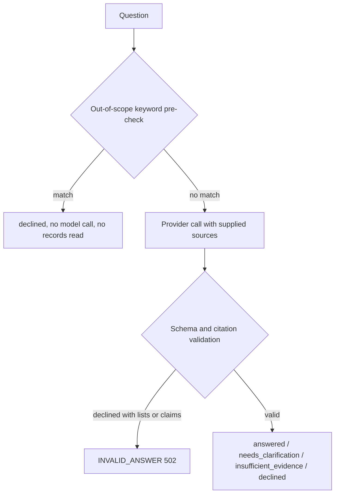
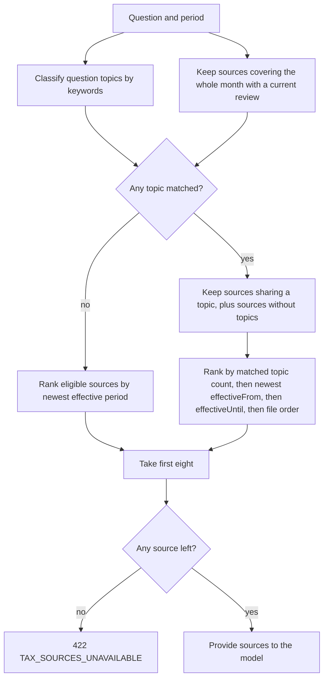
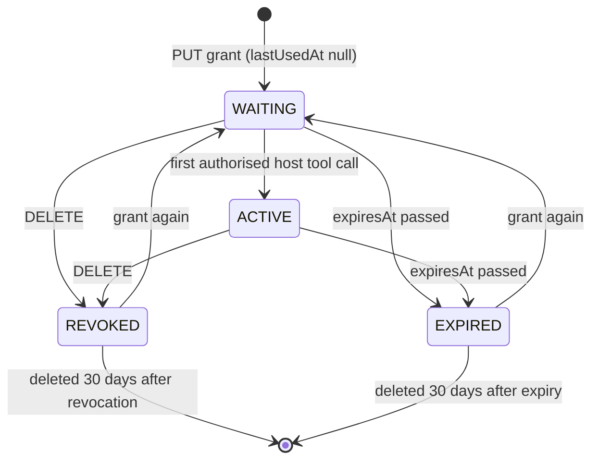
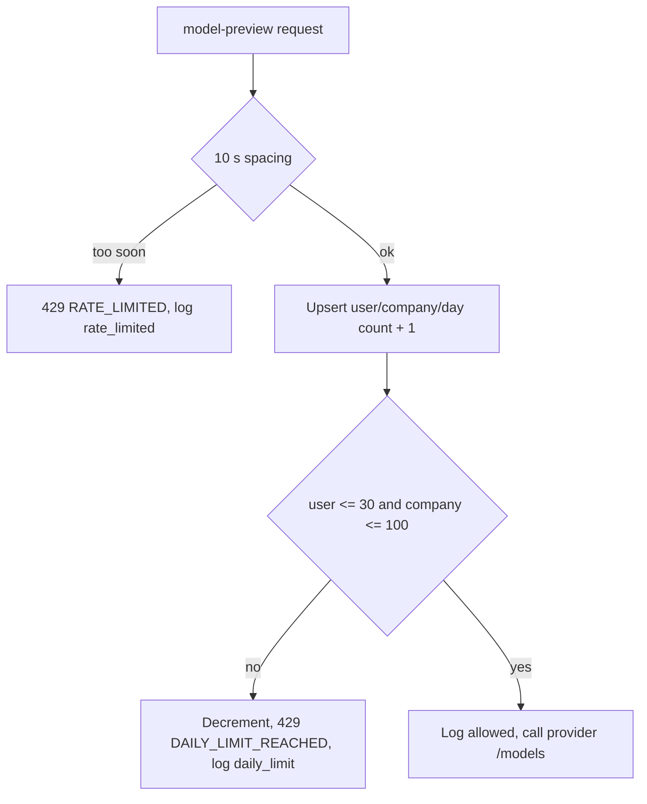
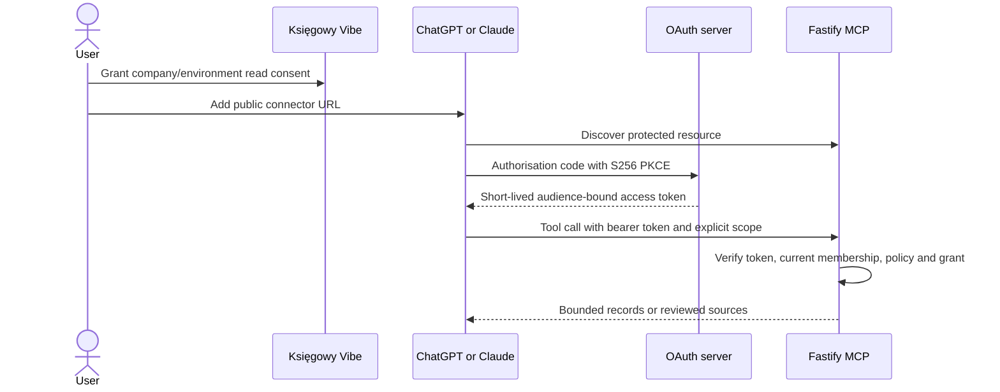

# Tax advisor

Implementation branch: `feat/tax-advisor`. Tracking: [TRY-160](https://linear.app/trysoft/issue/TRY-160/epic-implement-the-contextual-tax-advisor), phases TRY-161–TRY-166. Embedded visual references: [Aurora Solid frames 15–19](../redesign/kv-redesign-platform-personal-1.html); the newer Stitch connection candidates are audited in the [decision-gated implementation plan](../../spec/tax-advisor-implementation-plan.md#11-customer-journey-and-pixel-perfect-design-gate).

## What is implemented

- A 400px desktop dock, mobile modal sheet, header/mobile entry points, Command/Ctrl+J, Escape, and a full `/dashboard/advisor` page.
- Explicit-send conversations, monthly briefing prompts, private history, deletion, cancellation, invoice/incoming-document Explain buttons and contractor-balance Explain with selected contractor/month context. Record inclusion still requires explicit consent.
- Company processing policy, encrypted per-membership API credentials, model discovery, and a synthetic connection test. Tests can incur provider charges; opening a panel never generates an answer automatically.
- OpenRouter, OpenAI API, Anthropic API and operator-hosted Ollama transports. A selected model must support JSON Schema output. Provider/model IDs are entered or discovered, rather than baked into the application.
- Read-only MCP tools, external OAuth token verification, signed-in company/environment consent, grant expiry and revocation for ChatGPT and Claude.
- Reviewed-source loading and period selection. **No reviewed tax corpus ships with this change.** Without one, tax-mode requests stop before a paid model call. Record explanations remain available. **UI alignment pending:** `AdvisorConversation` currently allows selecting tax with zero reviewed sources and then surfaces the API error; the approved 2026-10-04 journey disables that choice with a visible reason before Send while leaving records available.

Not yet released: validated live subscription integrations, accountant-reviewed tax evaluation, scheduled briefings, tax-regime comparison, and advisor-initiated accounting mutations. There is no bank ledger or cash forecast in this slice.

**Blocked first-use entry implemented 2026-10-06:** opening Doradca without a usable embedded provider stays on the current page and shows one current reason with its owner and a **Settings → Doradca** action in the desktop dock or mobile sheet. Runtime-off takes precedence over company-off, then conversation-selected provider denial, then no saved connection for this member/provider. The blocked composer is visibly noneditable with Send disabled and no model call. The action and a direct Settings visit both start in embedded Mode A; Mode B is one visible switch away and is no longer remembered across visits. The [single-source blocked-entry visual reference](tax-advisor-blocked-entry-reference.html) replaces inconsistent Stitch candidates; final app visual/accessibility review and the other release gates remain.

## First use

1. Review and apply advisor migrations `20260919080000_tax_advisor`, `20260930090000_advisor_connector_grant_lifecycle`, `20261001090000_advisor_model_preview_usage`, and `20261002100000_advisor_insight_dismissal` to the intended database in order, then generate Prisma Client. Compose startup does not apply them automatically. Use the repository migration/backup runbooks for production; the setup UI calls out a missing advisor migration.
2. Set the existing `ENCRYPTION_KEY` to the installation's 32-byte hex encryption key; do not rotate it independently of existing encrypted records. Keep `CORS_ORIGIN` equal to the browser application's origin. The operator must set `ADVISOR_ENABLED=true` and restart the API **before a provider connection can be saved**. An ADMIN must enable the company advisor policy and allow the selected provider. Settings and previously saved connection status remain readable while blocked; provider discovery, save, test and chat do not proceed. Disconnect remains available.
3. For answers inside Księgowy Vibe, after both gates are enabled save a provider/model and API credential in **Settings → Doradca** or **Dostawcy i konfiguracja**. This uses separate API billing; ChatGPT and Claude subscriptions are not API credentials. Credentials belong to the current membership, not every colleague. **Customer-approved behavior (2026-10-04): block Save until enabled.** The API PUT already rejects blocked saves; the current settings UI still offers Save and needs alignment before this journey can be called complete.

4. To use a ChatGPT or Claude subscription, an ADMIN must allow that connector. In Settings, choose the company and TEST/PRODUCTION environment, grant read-only access, add the displayed HTTPS MCP address in the provider's app/connector settings, then sign in to the provider there. The **Otwórz ChatGPT** / **Otwórz Claude** buttons open those host applications after a grant exists; they do not sign the user into Księgowy Vibe or provision the connector. Host account eligibility and workspace-admin approval apply. Księgowy Vibe never receives the subscription password or token. This path requires the separately operated OAuth authorization server and is not a subscription-backed provider for embedded chat.

5. Confirm the operator runtime and company policy remain enabled before running a paid synthetic connection test or asking an advisor question. Explicit record consent still applies.
6. For embedded chat, optionally run the separate synthetic connection test, then open the advisor. A saved provider can be used without that test when runtime and policy allow it; the approved UI must warn beside Send that an untested question may fail or incur cloud-provider charges (Ollama consumes operator resources). Select the company/environment in the existing application controls and a month in the composer. Explicitly agree before including company facts; TEST selects synthetic accounting records but does not make API calls free.
7. Send a record question or use **Podsumowanie okresu**. Inspect the calculation and evidence sections. Tax questions require the reviewed corpus below.

**Mode B pre-validation decision (2026-10-04):** while the deployed issuer and real ChatGPT **and** Claude target-account journeys remain unverified, keep the Mode B choice, honest status, and prior grants visible to every member. Only operator-approved pilot accounts may issue/reissue a grant or use the Open-host onboarding action; non-pilots may still inspect and revoke their prior grants. The grant restriction must be checked against the authenticated membership in the API, not inferred from a disabled button; Open-host is external navigation, so its onboarding control is disabled for non-pilots. If pilot approval is removed, **deny subsequent MCP reads immediately** without deleting, revoking or extending the grant. Show prior authorized-read history as history, not current access; retain Revoke. Restoring pilot approval can resume a still-valid, unrevoked grant. The current PUT and MCP read checks do not enforce pilot approval and must be aligned before a public release.

**No host read yet (2026-10-04):** for a pilot with an unexpired grant but no `lastUsedAt`, show “No authorized read yet” and a short checklist: supported host plan/account and workspace-admin approval, OAuth sign-in inside ChatGPT/Claude, public HTTPS MCP/issuer reachability and retry in that host. The app cannot observe host-side OAuth errors, so never label this as a failed connection or claim host access from a grant alone. Keep the selected company/environment/host and expiry visible; do not require a new grant for a host retry while the grant is valid. Expired/revoked access needs fresh consent, and suspended pilot access cannot be repaired by retrying in the host.

**External citation return approved 2026-10-04:** Mode B cannot be called complete until a real ChatGPT/Claude citation opens an opaque application link that authenticates, verifies current membership and document access, and requires an **explicit** company/environment switch before revealing the document when contexts differ. Signed-out users return through sign-in; unauthorized, deleted and invalid references share a generic unavailable state without exposing document metadata. Recheck after the switch. Revoking connector access stops new MCP reads but does not revoke the customer's separate app document permission or erase a host's stored history. MCP currently returns no app URLs and there is no safe return route; the D5 pre-switch document details are an unsafe visual prototype. Live target-host link behavior and desktop/mobile safe-return states remain release gates.

**Tax-source pre-submit decision (2026-10-04):** when `/advisor/settings` reports `reviewedSourceCount === 0`, disable the tax question option and explain why near the choice; do not block record questions or send a tax request that the API will reject. A count above zero is not proof that sources cover the selected month and topic. **Positive count, no applicable source:** allow Send and rely on the server's `TAX_SOURCES_UNAVAILABLE` check before any paid provider call; retain the drafted question and month, show a truthful reason beside the composer and offer records or another month. The existing period-only translation also needs to describe a topic miss accurately. No coverage preflight or universal tax-readiness claim from a successful connection test.

**Contextual Explain decision (2026-10-04):** for a seeded document or contractor explanation, place the selected record and an unchecked record-inclusion choice beside the composer. Require an explicit include-or-ask-without choice before contextual Send becomes available; entering via Explain is not consent. **Ask without:** clear the record-specific seed immediately, show that no record will be included and focus an empty composer for the user's general question. Send `includeRecords: false` and no document/contractor scope identifier; never substitute another question or submit automatically. A new seed or company/environment change resets the choice. The current unchecked checkbox is inside “Zmień” and allows silently sending a record-specific seed without its record. Keep the general, unseeded record-consent control optional.

**Untested connection before Send (2026-10-04):** the synthetic test remains optional, never runs on Save or panel open and does not gate an otherwise eligible explicitly submitted question. The warning uses the **conversation-selected** provider's `testedAt` value, not the Settings-selected provider; it appears near Send until a successful test. The API already permits an untested saved connection. The current conversation UI still needs the warning and must also prevent Send when the operator runtime is disabled.

**Period briefing approved 2026-10-04:** **Podsumowanie okresu** fills an editable monthly-document question, exposes selected company/environment/month and a fresh **unchecked** record-inclusion choice beside the composer, and makes **no model call** until explicit Send. The briefing preset cannot be sent without explicitly including that month's records; neither a previous general-question consent nor an old month choice silently opts in. Choosing “without records” clears the document-specific preset, explains that no records will be supplied and focuses a blank general composer; the user may then type and send a different question. Changing month/company/environment or choosing a new briefing resets the inclusion choice. Once opted in, send the existing `records` question with `includeRecords: true` and no specific document/contractor ID; sums cover the selected month and each currency independently, not tax liabilities or historic payment events. The current CTA fills a document-summary question but `sendQuestion()` also permits it with `includeRecords: false`, in which case `buildAdvisorContext()` returns no accounting facts. Align desktop dock, mobile sheet and full page before calling this journey complete.

**Empty-month briefing approved 2026-10-04:** after explicit Send, use the month-scoped accounting context already loaded by the API to determine whether an unscoped consented record question has any monthly evidence or calculations. When there are none, return `RECORDS_UNAVAILABLE` (422) before `reserveAdvisorProviderRequest()` and before any cloud/Ollama generation; do not produce a fabricated period summary or reuse `TAX_SOURCES_UNAVAILABLE`. Retain the editable briefing draft and selected month, and show “No records for this month” with a **Change month** action beside the composer. Changing the month resets the briefing's record-inclusion choice. No month-availability preflight call or early disabled Send for an unknown count; a successful Save/test or a positive source count is irrelevant to record availability. Current `generateAdvisorAnswer()` builds context before the provider reservation but has no empty-record guard.

**Embedded provider setup (Settings → Doradca → Doradca w Księgowym Vibe):** choose OpenRouter, Ollama, or OpenAI API / Anthropic API under "Inni dostawcy API". Once the operator runtime and company policy allow the selected provider, models can be fetched before saving (the typed key goes only to `model-preview`; the API allows one fetch per ten seconds, and the button waits), or a model ID can be typed manually. Saving never runs the paid test, which is a separate explicit action with a cost notice. Ollama shows operator-controlled states (not configured, unreachable, no models) and has no key or URL field. For blocked providers, show the owner/remedy, existing connection status and disconnect, but do not submit discovery, Save or test. This is the approved target behavior; the UI still needs correction. The ChatGPT/Claude connector copy and visuals remain provisional until real target-account checks. See the [connection UX specification](tax-advisor-connection-ux.md) and [customer approval ledger](../../spec/tax-advisor-implementation-plan.md#115-customer-approval-ledger).

Ollama's address is configured by the operator through `ADVISOR_OLLAMA_URL`, including `/v1`, for example `http://ollama:11434/v1`. The API contacts that address; a browser user's laptop is not automatically reachable. Restrict the Ollama network service to authorised infrastructure. No user-supplied arbitrary model endpoint is accepted.

## Request and evidence contracts

Shared TypeScript contracts live in `packages/types/src/advisor.ts`. Runtime validation lives in `apps/api/src/services/advisor/advisor-contract.ts`.

Every context includes one company, explicit TEST/PRODUCTION environment, `YYYY-MM` period, question kind (`records` or `tax`), record-consent flag and optional document ID/kind. The server obtains company/user access from current database membership, never model input or a stale JWT company list. A selected document must belong to the selected company/environment/month.

The model receives only the question, up to four previous question texts when record consent is enabled, bounded invoice evidence, server-calculated amounts and applicable reviewed excerpts. It does not receive provider secrets, NIP/PESEL, addresses, bank details, arbitrary attachments, OCR bodies, item descriptions or invoice notes. Text the user enters in their question still goes to the chosen provider.

All totals cover the selected month, even when a single document is selected:

| Calculation | Meaning |
| --- | --- |
| `issuedGross`, `issuedVat` | ISSUED outgoing invoices, excluding FORMAL corrections; null correction mode and cancellation delta amounts are included |
| `acceptedGross` | The same scope restricted to ACCEPTED KSeF state in the selected environment |
| `invoiceCount` | Number of outgoing financial documents in the issued scope |

Calculations use Prisma Decimal and remain separate by currency. They are not VAT payable, deductible input VAT, payment-ledger balances or tax-return totals. Incoming documents are evidence with review status, not assumed deductible purchases. At most 20 outgoing and 20 incoming documents are sent; a truncation flag explains that amounts still cover the full month.

Dashboard accepted-sales buckets now share the formal-correction exclusion and explicitly use PLN, matching their currency label. KPI document counts still include formal corrections. Contractor/report read models have their own existing semantics; the advisor does not reuse or claim reconciliation with those totals in this release.

Contractor Explain uses ISSUED non-FORMAL invoices for the selected company, environment and contractor issued before the end of the selected month. It groups currencies independently and displays `currentOutstanding` (nonnegative invoice gross less the **currently recorded cumulative** `paymentReceived`) and `recordedPayments` on those invoices. These are current stored figures for invoices issued through the chosen month, **not** a historical month-end balance or payments made during that month/year; there is no payment transaction ledger. At most 20 linked invoice records accompany the aggregate and truncation is explicit. A contractor from another company fails closed.

Dashboard, invoices, incoming and selected-contractor views can each display at most one deterministic insight strip with linked document evidence. The API selects attention facts in priority order; no model call or accounting mutation occurs. `GET /insights?view=...` returns one supported insight or null; `POST /insights/:key/dismiss` records dismissal for the current membership, TEST/PRODUCTION environment, insight key and version. A revised version may surface again. Switching company changes membership-scoped evidence and dismissal; VIEWER users have read-only evidence links and may dismiss their own strip.

**Insight action approved 2026-10-04:** the deterministic strip links to its returned evidence records and offers personal Dismiss; it has **no direct “Ask advisor” action**, no generated question/answer and no provider call. To discuss one document, the customer follows its authorized link and may choose that page's separate Explain action with the approved record-consent choice. Do not imply that an entire multi-document insight can be attached as one scoped chat input; the current request scope supports at most one selected document. Keep “no insight” as no strip, not a fabricated recommendation.

### Answer statuses

| Status | Meaning | Citations | Required fields |
| --- | --- | --- | --- |
| `answered` | In scope, supported by supplied facts and sources | Required for tax guidance | `shortAnswer`, `explanation` |
| `needs_clarification` | In scope, facts missing | None required | `questions` |
| `insufficient_evidence` | In scope, reviewed sources or facts are insufficient | None | `shortAnswer`, assumptions |
| `declined` | Out of scope: PIT/CIT/ZUS, tax form choice, depreciation, tax optimisation or evasion, legal opinions, filing or issuing documents, instruction override | Not allowed | `shortAnswer` (at most 400 characters, why it is out of scope), `explanation` (1-600 characters, what the advisor can help with); empty assumptions, questions, evidence, sources and calculations, `containsTaxGuidance` false |

`declined` is stored in the existing `AdvisorTurn.answer` JSON with turn status `COMPLETED` (turn status is a request lifecycle, unrelated to answer status), so there is no migration. Provenance of a deterministic decline has `sourceVersion: not-applicable` and `recordsIncluded: false`.



The pre-check (`isAdvisorQuestionOutOfScope` in `advisor-source-topics.ts`) only uses unambiguous phrases (PIT, CIT, ZUS as whole words, estonian CIT, depreciation, optimisation, linear vs scale, legal opinion, filing JPK or declarations, issue-and-send commands). It never runs the model, so it must not match in-scope VAT/invoice wording; tests assert this against all non-decline evaluation cases. The model prompt instructs the same decline rule for what the keywords miss.

The model returns bounded structured text, status, assumptions, questions and evidence/source IDs. Unknown IDs are rejected. Reported tax guidance requires a cited supplied source. Server-owned calculations, source links and provenance are attached after validation. The UI renders plain text and application-constructed links. Schema/citation checks cannot prove that every sentence is legally correct: reviewed evaluation remains a release gate.

**Answer citation visibility approved 2026-10-04:** when the returned answer contains document evidence and/or reviewed sources, show a compact, always-visible summary immediately below the answer text: a document label/count and a reviewed-source title with its effective dates (plus the remaining count if needed). Preserve the detailed document amounts/links and reviewed-source sections/excerpts behind separate expandable controls. Label these as references, not proof that every sentence is correct; show no evidence/source claim or empty section when the corresponding list is empty (including a clarification with no citations; a decline has none). Render only returned, authorized evidence for the same company/environment/month and applicable reviewed sources; no fabricated examples or cross-context document metadata. `AdvisorAnswerCard` currently hides both evidence and sources in closed `<details>` and needs the summary in desktop dock, page, mobile sheet and history replay.

**Clarification continuation approved 2026-10-04:** for `needs_clarification`, show the missing-fact question(s) above an editable reply in the **same conversation**. A customer types the missing fact and explicitly submits; selecting the answer or opening it never sends automatically. Associate the reply with the completed clarification turn, and provide the provider only bounded prior **user question plus that turn's clarification question(s)** so a short factual answer is meaningful; do not replay the whole assistant answer, other turns, previous document evidence or legal excerpts as implicit conversation memory. Current `generateAdvisorAnswer()` passes at most four prior *question texts* only when `includeRecords` is true and has no clarification-specific context, so a short follow-up is not yet supported. Extend the message contract with a reply-to turn identifier, persist and compare it in request-ID idempotency checks, and validate that the origin is a completed `needs_clarification` turn in the same membership/company/environment and period before building context. Per-turn record inclusion stays an explicit visible choice and only sends current authorized records when opted in; if the period or selected record context changes, do not attach a stale clarification. Conversation detail/history must show which reply answered which prompt.

Transport schemas omit unsupported string/array length constraints and describe those bounds to the model; the complete Zod schema still validates every returned answer. This supports Anthropic both directly and through OpenRouter without weakening application-side limits. See [Anthropic structured-output constraints](https://platform.claude.com/docs/en/build-with-claude/structured-outputs).

## API and lifecycle

Browser routes use the existing authenticated session and require the exact configured Origin on mutations. Every response is `Cache-Control: no-store`. Base path: `/companies/:companyId/advisor`.

| Route | Purpose |
| --- | --- |
| `GET /settings`, `PATCH /policy` | Masked settings; ADMIN-only company policy |
| `PUT /connections/:provider`, `DELETE /connections/:provider` | Save encrypted personal key/model; disconnect |
| `POST /connections/:provider/test`, `GET /connections/:provider/models` | Synthetic structured-output test; model discovery for a saved connection |
| `POST /connections/:provider/model-preview` | Model discovery before a connection exists; body `{ "credential"?: string }`, response `{ "models": string[] }` |
| `GET /conversations`, `POST /conversations` | Own unexpired history; create pinned-provider/model conversation |
| `GET /conversations/:conversationId`, `DELETE /conversations/:conversationId` | Own history detail/deletion |
| `POST /conversations/:conversationId/messages` | UUID request ID, question, scope; validated answer via SSE. Planned clarification follow-up: optional reply-to turn ID, server-validated against the same completed clarification turn and context, persisted for idempotency/history; not yet implemented |
| `GET /connectors`, `PUT /connectors/:client`, `DELETE /connectors/:client` | Own subscription grants with `status`, `lastUsedAt`, `revokedAt`; PUT body `{ "days": 30 }` (re-granting resets usage and clears revocation); DELETE revokes (soft) |
| `GET /insights?view=...`, `POST /insights/:key/dismiss` | Deterministic evidence-backed view insight and personal versioned dismissal; explicit KSeF environment required |

### Model preview and Ollama errors

`model-preview` is authenticated, requires current membership and a company policy that allows the provider, and accepts only a strict body. The submitted key is used for one `/models` request, then discarded: it is never stored, logged or echoed. Hosted providers require `credential` (`CREDENTIAL_REQUIRED`); for Ollama the endpoint is always the operator-controlled `ADVISOR_OLLAMA_URL` and no address can be submitted. Requests are throttled to one per user every ten seconds (`RATE_LIMITED`, HTTP 429); this spacing is per API process. A database-backed daily cap also applies (`DAILY_LIMIT_REACHED`, HTTP 429 with `Retry-After` in seconds until the next UTC midnight): 30 previews per user and 100 per company per UTC day (including Ollama). No placeholder model is ever stored.

| Code | HTTP | Meaning |
| --- | --- | --- |
| `OLLAMA_NOT_CONFIGURED` | 503 | `ADVISOR_OLLAMA_URL` is missing or invalid (also returned when saving or generating). Replaces `OLLAMA_UNAVAILABLE`. |
| `OLLAMA_UNREACHABLE` | 502 | The API server could not connect, timed out, or Ollama returned a non-success status |
| `OLLAMA_NO_MODELS` | 409 | Ollama is reachable but has no installed models |

Conversation and connector mutations require `x-ksef-environment: TEST|PRODUCTION`; settings are shared across environments within a membership. A conversation cannot switch provider/model. Connection changes require a new conversation.

SSE carries `status`, `answer`, `error`, `done` events. Only a fully validated answer is displayed. There is no raw model-token stream. Client disconnect/cancel and the 60-second deadline abort the provider call. A completed duplicate request returns the existing answer; reusing an ID with different input fails. A database membership row lock and atomic turn claim prevent concurrent duplicate provider calls across API processes. A pending turn older than two minutes is reported/reconciled as failed after a process interruption.

Limits: 4,000 question characters, 100 conversations per membership, 100 turns per conversation, one active request per membership, six submissions per minute and a ten-second provider-request reservation (also used by tests/discovery). History lists return the newest 50 conversations. Failed requests do not silently retry or switch providers. A manually repeated question can incur another charge.

Membership, policy, session validity and connection identity are rechecked before saving an answer. Credentials are never returned. The hourly cron deletes expired conversations (cascading to turns) and connector grants that are past the grant retention period (below). History is hidden immediately at expiration. Company history retention is 1–30 days from conversation creation; lowering retention also shortens existing expiry. Deleting a company membership cascades credentials, conversations and grants. Provider-owned storage/backups follow separate retention policies.

**Conversation entry and resume approved 2026-10-04:** closing/reopening the advisor within one mounted page visit retains the visible thread and unsent draft; it does not submit or restore another conversation automatically. A new navigation/visit opens a blank conversation, with unexpired membership/company/environment History available only by explicit selection. A new contextual Explain seed follows its separate consent flow. Before a company or TEST/PRODUCTION change exposes the advisor under the new context, clear any cached prior thread, history list, scoped draft and record-inclusion choice so another company's data never remains visible; `AdvisorWorkspace` already keys the provider/panel by company and environment, so retain and verify this remount boundary. A close while generating aborts the active request; reopening shows the stopped outcome and preserves the typed draft rather than resuming generation automatically.

**History deletion approved 2026-10-04:** delete only the selected member-owned conversation after a clear confirmation that identifies it. Cancel changes nothing; successful deletion removes its active application history/turns, clears any draft or pending clarification tied to it, refreshes the company/environment-scoped list and leaves a blank composer. Failed deletion leaves the conversation visible with an error. No bulk-delete or Undo in this journey. Explain that provider-owned storage/logs and any backups follow their own retention and are not erased by deleting a Księgowy Vibe thread. `DELETE /conversations/:conversationId` already checks membership and environment; replace the current `window.confirm` with an accessible, theme-matched dialog when implementing the approved visual treatment.

## Reviewed tax source corpus

Set `ADVISOR_TAX_SOURCES_PATH` to an operator-controlled JSON array. A missing path means no sources; malformed configured data fails closed. Limit: 128 KB, 40 unique entries; at most eight applicable entries are supplied. In Docker, mount the file read-only and use its container path.

The repository's `sources.draft.json` contains **pending, unreviewed** entries and must never be mounted. After a qualified reviewer signs off the entries and the Polish evaluation set, export an approved JSON file outside the repository using the guarded procedure in [the corpus README](tax-advisor-corpus/README.md#loader-format-and-why-the-draft-is-deliberately-not-loadable). For Compose, opt in explicitly with the override; the host path must already be a file and is mounted read-only:

```bash
ADVISOR_TAX_SOURCES_HOST_PATH=/absolute/path/to/approved-advisor-tax-sources.json \
  docker compose -f docker-compose.yml -f docker-compose.advisor-sources.yml up -d api
```

The override sets `ADVISOR_TAX_SOURCES_PATH=/app/advisor/tax-sources.json` only for the API service. Without it, keep the path unset and tax questions fail closed. On deployment, validate the reviewed file through the API loader, record its SHA-256 with reviewer sign-off, and run the approved 45-case Polish evaluation against **each enabled provider/model** using capped credentials and synthetic records. Existing automated tests cover draft source retrieval and deterministic decline rules only; they do not certify the legal assertions or substitute for live provider evaluation.

Each entry requires:

| Field | Contract |
| --- | --- |
| `id`, `title`, `section` | Stable citation identifier and human-readable legal location |
| `url` | HTTPS official `*.gov.pl` source, no embedded credentials |
| `effectiveFrom`, `effectiveUntil` | Inclusive ISO dates covering the entire requested month |
| `reviewedAt`, `reviewExpiresAt` | ISO dates covering today's date |
| `reviewedBy` | Identifiable reviewer responsible for checking applicability |
| `excerpt` | Reviewed excerpt, at most 2,000 characters |

The corpus SHA-256 digest is persisted as provenance. There is no automatic web retrieval or claim that uploaded source metadata itself constitutes legal review. Changes within a month require narrower supported questions or a later day-level contract; the current selector excludes sources that do not cover the full month. Sources may carry an optional `topics` array (1-6 unique values from the fixed vocabulary in the [corpus README](tax-advisor-corpus/README.md#topic-vocabulary)); the loader stays strict and rejects unknown, duplicated or empty topics.

### Source retrieval

Selection is deterministic: no model call, no network. `classifyAdvisorQuestionTopics` maps the question to topics with an explicit Polish and English keyword table (lowercase, diacritic-insensitive). `selectAdvisorSources` then applies the filters and ranking below and supplies at most eight sources.



Decisions:

- Period and review filters run first and are unchanged, so stale or unreviewed sources never compete on topic.
- Sources without `topics` are general entries: eligible, score 0, so existing corpora keep working.
- If the question maps to topics but no reviewed source carries one of them, nothing is returned and tax questions fail closed with `TAX_SOURCES_UNAVAILABLE`. Sources for unrelated topics are not used as filler.
- A question with no matched topic falls back to all eligible sources ranked by recency (file order on ties, which equals the previous first-eight behaviour for equal periods).
- The `topics` field is used for ranking only and is not sent to the model or returned in answers.
- Keyword matching is a coarse classifier. A wrong or missed topic can only narrow the supplied sources; the model must still cite supplied sources or report insufficient evidence.
- The keyword out-of-scope pre-check is deliberately narrow; a missed phrase reaches the model, which must decline through the prompt, and a declined model answer is validated like the deterministic one.

Before enabling tax guidance, appoint a source owner and qualified reviewer, populate only supported VAT/invoice topics, and evaluate the Polish question set in the plan. No invented review dates or unreviewed tax rates are seeded.

## Connector grant lifecycle and retention

Grants carry `lastUsedAt` (set only after a tool call passed its final grant recheck and succeeded, at most once per minute per grant, and only while the grant is still not revoked and not expired)  and `revokedAt`. `GET /connectors` derives `status`:



Decision (default, reversible by changing `advisorGrantRetentionDays`): revoked and expired grants are kept for 30 days, measured from `revokedAt` (or from `expiresAt` when never revoked), so Settings can explain why a host stopped working. Retained rows hold only metadata (client, environment, issuer, timestamps), never tokens. A revoked or expired grant never authorises a tool call; the grant check requires `revokedAt = null` and `expiresAt > now`. `GET /connectors` lists grants within the retention window; the hourly cleanup deletes the rest. Grant-again clears `revokedAt` and `lastUsedAt`. Revoking is idempotent and keeps the original `revokedAt`. Product can shorten the window or add a "remove from list" action later without a schema change.

## Security hardening (review follow-up)

| Control | Behaviour |
|---|---|
| `lastUsedAt` write | Conditional `updateMany` (`revokedAt = null`, `expiresAt > now`, `lastUsedAt` null or older than 60 s) after the final recheck; denied or failed calls are never recorded as use, so a re-grant cannot show a false `ACTIVE` |
| MCP rate limit | 60 tool calls per minute per grant (fixed window, in memory). Excess returns HTTP 429 with `Retry-After` and `{ "code": "RATE_LIMITED" }`. The counter is per process; multi-instance deployments need a shared store |
| MCP execution bounds | 20 s tool timeout (`TOOL_TIMEOUT`), 100 KB serialised result cap (`RESULT_TOO_LARGE`); evidence is already capped at 20 records per kind and 8 sources |
| Provider connections | `PUT /connections/:provider` requires operator enablement and company policy for the provider; `DELETE` is never gated so credentials can always be removed |
| Connector grants | `PUT /connectors/:client` requires operator enablement; `DELETE` (revoke) is never gated |
| Retention | The hourly cleanup of expired conversations and retained grants runs even when `ADVISOR_ENABLED` is not `true` |
| CORS | The API refuses to start with `NODE_ENV=production` and no `CORS_ORIGIN`; the localhost fallback exists only outside production |
| Upstream shape errors | A malformed provider response (model list, answer payload) is `502 PROVIDER_ERROR` / `INVALID_ANSWER`; only request-body validation yields `400 INVALID_REQUEST` |
| Encryption key | `encrypt()`/`decrypt()` throw unless `ENCRYPTION_KEY` decodes to exactly 32 bytes, so an empty or short key fails closed (no silent weak encryption) |
| Audit trail | Structured log entries `advisor.connector.grant`, `advisor.connector.regrant` and `advisor.connector.revoke` carry `membershipId`, `client`, `environment`, `outcome`; never tokens, claims or keys. No audit table (product decision) |

| Model-preview abuse (key-validity oracle / outbound proxy) | `model-preview` keeps the 10 s per-user spacing and adds shared DB caps in `AdvisorModelPreviewUsage` (userId, companyId, UTC `day`, `count`; no credentials): 30 per user and 100 per company per day, constants in `advisor-contract.ts`. Each attempt that passes the spacing check is counted atomically (single upsert with increment) before the upstream call, so failed or invalid-key attempts consume the cap. Over the cap the increment is rolled back, the request is rejected with `429 DAILY_LIMIT_REACHED` plus `Retry-After`, and no upstream call is made. Rows older than 7 days are removed by the hourly retention cron |
| Model-preview audit | Structured log `advisor.modelPreview` with `userId`, `companyId`, `provider`, `outcome` (`allowed`, `rate_limited`, `daily_limit`); never the credential |



Not yet decided: the exact meaning of `ACTIVE`.

## ChatGPT and Claude subscription connectors

This is an **external conversation mode**, not subscription-backed inference in Księgowy Vibe. Users sign in to their existing account in ChatGPT or Claude; that host runs the conversation and calls this application's read-only MCP tools. Księgowy Vibe never collects host account passwords or subscription tokens, and host-generated statements are outside local answer validation and local conversation retention. Embedded conversations still require an API key and separate API billing.

Settings displays the subscription path separately from API-key connections. After an ADMIN allows the host client and the user grants read-only access for a company/environment, **Otwórz ChatGPT** or **Otwórz Claude** opens the provider's website. The user must add the displayed MCP URL in that provider's app/connector settings and complete its sign-in/authorization flow there. These links do not create a host connector or authenticate the user to Księgowy Vibe.

The Fastify application is only an OAuth **resource server**. A separately operated authorization server (reference deployment: Keycloak) must handle login, consent, authorization-code exchange, S256 PKCE, exact registered redirect URIs and refresh-token policy. Existing Google login remains independent. No home-grown OAuth authorization server or direct subscription inference integration is implemented. ChatGPT's custom MCP app availability and admin requirements, and Claude's connector availability, depend on their current product plans and workspace settings.

Operator configuration:

| Variable | Value |
| --- | --- |
| `ADVISOR_MCP_PUBLIC_URL` | Public HTTPS resource URL ending in `/advisor/mcp`; optional reverse-proxy prefix is supported |
| `ADVISOR_OAUTH_ISSUER` | Exact HTTPS issuer string in access tokens |
| `ADVISOR_OAUTH_JWKS_URL` | Operator-trusted HTTPS signing-key endpoint |
| `ADVISOR_OAUTH_CHATGPT_CLIENT_ID` | Registered ChatGPT OAuth client identifier |
| `ADVISOR_OAUTH_CLAUDE_CLIENT_ID` | Separate registered Claude OAuth client identifier |

Configure the issuer to:

1. Publish OAuth/OIDC discovery; register each actual host's exact callback URLs. Require authorisation-code flow and S256 PKCE. Disable implicit/password grants. Configure the host's client ID/secret through its connector setup; those secrets never belong in the advisor UI.
2. Issue signed RS256 or ES256 access tokens with `iss`, `sub`, `iat`, `exp`, `aud` equal to the exact resource URL, and `scope` containing `advisor:read`. Access token age is limited to 15 minutes, with five seconds of clock tolerance. Configure the resource indicator/audience for this API, not a general-purpose account token.
3. Emit `client_id` or Keycloak `azp` matching the configured client. If both exist, they must match.
4. Provision an immutable, administrator-managed `ksiegowy_user_id` claim mapping the issuer identity to the existing `User.id`. **Never map it from a user-editable profile attribute or a submitted user ID.** Verify the mapping using a synthetic account before granting access.
5. Configure refresh/identity revocation at the issuer. API-side grant deletion or membership removal blocks the next tool call immediately. Issuer token revocation otherwise follows token expiry; remote introspection is not performed.

The API advertises protected-resource metadata at `/.well-known/oauth-protected-resource/advisor/mcp`. The bearer challenge points to the URL under the public API prefix, if any. Forward that route through the same reverse proxy as `/advisor/mcp`. POST uses the maintained MCP SDK's stateless Streamable HTTP transport with JSON responses; authenticated GET/DELETE return 405. Browser cookies are never connector credentials. Unknown browser origins are rejected; server-to-server host calls may omit Origin.

Each tool requires explicit `companyId`, `environment`, and `period`. `get_invoice_evidence` also requires document ID/kind:

- `get_company_context`: bounded documents and monthly calculations.
- `get_period_summary`: monthly calculations only.
- `get_invoice_evidence`: selected document evidence plus monthly calculations.
- `get_tax_sources`: currently reviewed sources applicable to the selected period.

An ADMIN first allows the external client in the company policy. The signed-in user then grants a chosen client read-only access to a specific company/environment for up to 30 days. Grants bind membership, issuer, client and environment; changing issuer/client configuration invalidates old grants. Every tool call checks the current grant, membership and policy before reading and again before returning facts. Revocation is available in the same Settings section. No accounting writes are exposed, including for VIEWER users.



**Release gate:** demonstrate this configuration on the target ChatGPT and Claude accounts. Their plan/admin eligibility, callback registration and current discovery behavior must be checked in those products. This repository's mocked protocol/token checks do not establish that real-client integration has passed.

Official references: [MCP authorization](https://modelcontextprotocol.io/specification/2025-11-25/basic/authorization), [Keycloak OIDC](https://www.keycloak.org/securing-apps/oidc-layers), [Keycloak administration](https://www.keycloak.org/docs/latest/server_admin/), [Claude custom connectors](https://support.claude.com/en/articles/11175166-get-started-with-custom-connectors-using-remote-mcp), [Claude subscription login and third-party tool policy](https://support.claude.com/en/articles/13189465-log-in-to-your-claude-account), [ChatGPT developer mode and MCP apps](https://help.openai.com/en/articles/12584461-developer-mode-and-mcp-apps), [ChatGPT/API billing separation](https://help.openai.com/en/articles/9039756-managing-billing-for-chatgpt-and-the-api-platform).

## Verification and rollout

Latest local results (2026-09-27): API suite 162 tests passed across 29 files; web typecheck passed; three Playwright advisor tests passed, covering desktop/mobile conversation UI and the settings choice between API billing and ChatGPT/Claude subscription use, including the host links. Earlier rollout checks on 2026-09-19 also validated Prisma schema, targeted lint, production web Docker build, and local Compose startup. No deployed OAuth issuer or real ChatGPT/Claude account was exercised; those remain release gates.

Automated checks use mocked providers and synthetic browser records. No real tax records, live paid model requests, or deployed OAuth issuer are needed. The API test script currently forwards `--` such that the documented filtered command runs the full suite.

```bash
pnpm --filter @ksiegowy/api test -- src/services/advisor
pnpm --filter @ksiegowy/api typecheck
pnpm --filter @ksiegowy/web typecheck
pnpm --filter @ksiegowy/e2e test -- tests/advisor.spec.ts --project=chromium --reporter=line
pnpm audit --audit-level=high
```

Before production: apply the additive migration to a disposable restored database, verify retention/cascade behavior, run one approved request against each enabled provider/model, verify proxy SSE handling, complete real-client OAuth checks, and complete tax review. Disable `ADVISOR_ENABLED` to stop advisor processing and connector reads; existing accounting flows continue. Keep the additive tables until retained data is handled. Logs contain operation/request IDs and safe error codes, not questions, documents or credentials.
