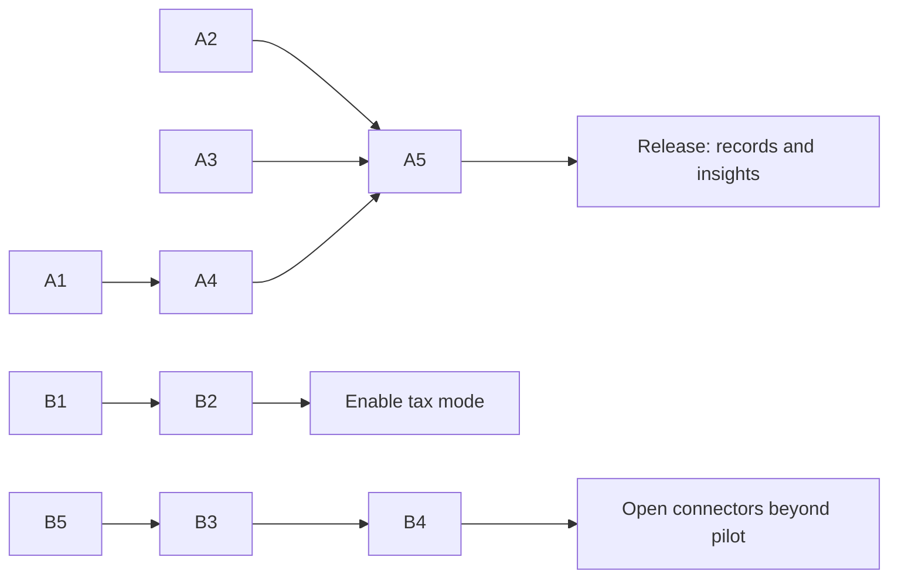

# Tax advisor finishing plan

Branch: `feat/tax-advisor`. Companion to [the implementation plan](tax-advisor-implementation-plan.md); this file tracks only what remains before release.

## Definition of done

1. Tax mode is either enabled with a reviewed corpus or visibly disabled with a reason before Send.
2. Every embedded provider and both external hosts passed one real-account check.
3. Typecheck, API and web unit tests, and advisor E2E specs are green.
4. `README.md`, `docs/specs/tax-advisor.md` and the implementation plan match what shipped.
5. A rollout and rollback runbook exists and was rehearsed on TEST.

## Track A: finish now

- [x] A1 Disable the tax choice when no reviewed sources cover the period (API readiness field, then UI). API half done: `GET /settings?period=YYYY-MM` adds `taxSourceCoverage { period, covered, sourceVersion }`; UI half pending.
- [x] A2 Close Phase 2 and 3 gate tests: corrections, mixed currencies, date boundaries, company/environment/user isolation.
- [x] A3 Security pass: credentials, MCP tokens, origin check, rate limits, prompt injection, source file size.
- [x] A4 Phase 4 UI gates: company switch clears content, VIEWER cannot write, keyboard, light/dark, 390px mobile (after A1).
- [x] A5 Deployment runbook: migration order, environment variables, proxy streaming, backup restore, feature-switch rollback.

## Track B: blocked on people or accounts

- [ ] B1 AI-driven (owner decision: no human reviewer; the review runner is pending, so not ticked). Name a source-refresh owner; AI models review `docs/specs/tax-advisor-corpus/sources.draft.json` and the evaluation set. API side done: AI-review metadata schema, disclaimer and provenance. Runner built; still needs `draftedBy` and `officialText` spans in the draft, review keys and a real run.
- [ ] B2 AI-driven (runner built 2026-10-31, `pnpm --filter @ksiegowy/api advisor:review-sources`; still needs a real run with provider keys, not ticked): the runner executes the Polish question set against real providers.
- [ ] B3 Deploy the OAuth issuer (Keycloak reference): PKCE S256, audience, exact redirects, user-ID mapping.
- [ ] B4 One real check per provider (OpenRouter, OpenAI, Anthropic, Ollama) and per host (ChatGPT, Claude).
- [ ] B5 Confirm Ollama location and connector eligibility on target accounts.

## Release order

## Out of scope for this branch

Phase 6 (tax profiles, PIT/CIT/ZUS scenarios, mutation proposals) needs product and tax inputs that do not exist yet.
