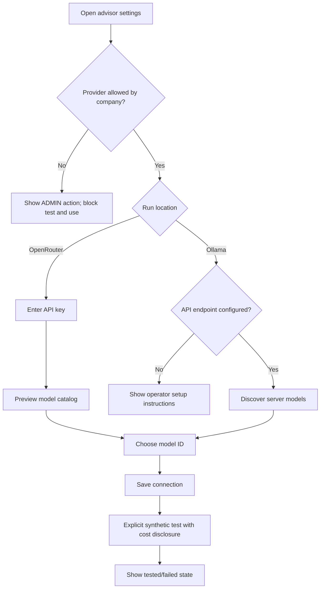
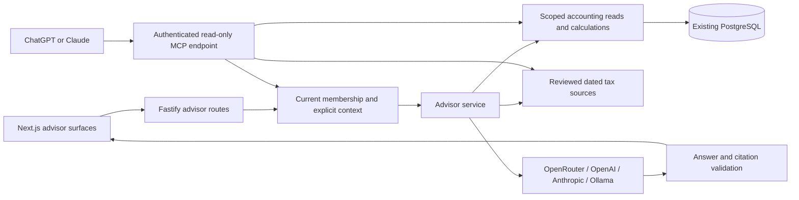
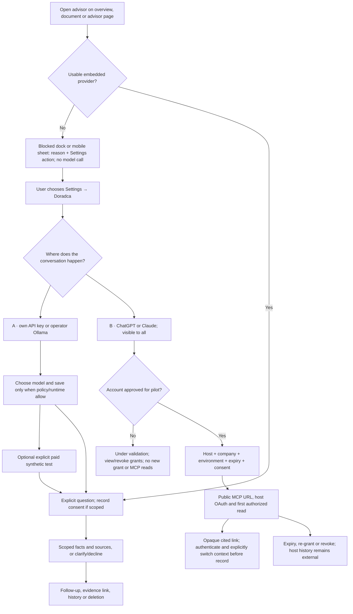

# Tax advisor implementation plan

Status: **implementation in progress on `feat/tax-advisor` — embedded advisor, model preview, connection settings, read-only MCP resource server and the approved four-state blocked-entry dock/sheet implemented; final real-app visual review, live issuer/host validation, reviewed tax corpus and deployment checks remain gates**. Updated: **2026-10-06**.

Tracking: [TRY-160 — Tax advisor epic](https://linear.app/trysoft/issue/TRY-160/epic-implement-the-contextual-tax-advisor), in the Trysoft / Księgowy Vibe project. Phase issues: TRY-161 through TRY-166. Additional tracking: TRY-167 (model preview), TRY-172/TRY-183 (connection design), TRY-173/TRY-177 (connector eligibility and live OAuth), TRY-174 (tax corpus review), TRY-175 (deployment checks), TRY-176 (contractor context and insights), TRY-178 (test gaps), TRY-179 (plan drift), TRY-181/TRY-182/TRY-184 (connector and connection delivery). Branch: `feat/tax-advisor` (local). The [Linear plan](https://linear.app/trysoft/document/tax-advisor-implementation-plan-d88af7b59f73) contains the original planning snapshot; this checklist and the [implemented specification](../docs/specs/tax-advisor.md) track delivery.

## 1. Outcome and delivery decisions

Add an advisor layer to the existing accounting workspace. Users can ask questions about their company, understand figures and documents, and receive Polish tax guidance supported by dated sources. The advisor prepares explanations and proposed next steps; existing accounting flows retain responsibility for changes and submissions.

Deliver two connection modes:

1. **Inside Księgowy Vibe:** embedded advisor using the user's OpenRouter, OpenAI API, Anthropic API, or an operator-configured Ollama instance.
2. **Inside ChatGPT or Claude:** an authenticated connector exposing selected Księgowy Vibe records and tax evidence to the user's existing assistant account. This addresses subscription use without treating a consumer subscription as an API key. Conversations in these products remain in those products.

Start with OpenRouter for the first working slice: the repository already uses the OpenAI SDK against OpenRouter. Add the other three embedded providers before calling provider support complete. Implement the subscription connector as a separate release milestone, not an optional replacement for the requested subscription path.

The first tax scope is Polish company VAT, invoice questions, and KSeF operational explanations. Income tax, ZUS, depreciation, tax-regime comparisons, and cash forecasts need additional facts and calculation support; their explicit follow-on milestone is below. Personal/household accounting remains outside this project increment.

Use the existing Fastify/TypeScript API, Next.js shell, PostgreSQL, and Prisma. No new microservice, agent framework, vector database, or message broker is needed for this scope.

## 2. Design evidence and scope mapping

The embedded advisor reference is Aurora Solid frames **15–19** in [the local redesign export](../docs/redesign/kv-redesign-platform-personal-1.html), with tokens in [the design-system export](../docs/redesign/kv-redesign-system-design.html) and [implemented token specification](../docs/specs/aurora-solid-tokens.md). These static mockups are **not** proof that the example tax claims or extra capabilities are implemented. The current Stitch project adds nine TRY-172 settings candidates (D1–D5/M1–M4) and generated variants of frames 15–19. Their coverage, contradictions and visual approval sequence are recorded in [§11](#11-customer-journey-and-pixel-perfect-design-gate).

| Reference | Required experience | Delivery |
|---|---|---|
| 15 — Advisor panel | Header trigger, Command/Ctrl+J, 400px desktop panel beside the 226px rail/content; visible page and period context; Escape to close | First embedded release |
| 16 — Answer card | Short answer, relevant figures, calculation breakdown, source links, assumptions, follow-up question | First embedded release, using available facts |
| 17 — Inline insights | At most one dismissible strip per view; explain a number; document evidence; explicit confirmation before changes | Explain links first; insights after core answers |
| 18 — Briefing | Advisor page, dated summary, prioritised tasks, history | On-demand briefing first; scheduled delivery later |
| 19 — Mobile advisor | Existing central bottom-navigation trigger opens a sheet; answer cards and source access | First embedded release |
| 20–37 — Personal mode | Household context and personal finance | Separate future product work |

Preserve opaque Aurora surfaces, Sora/IBM Plex Mono, tabular amounts, existing light/dark tokens, 60px desktop header, and mobile safe-area space. Use the shipped contrast-corrected tokens rather than copying low-contrast mock colours.

The mock contains illustrative business assertions, not approved tax logic. In particular, do not implement “fixing a rejected sales invoice lowers VAT”, “all unbooked purchase VAT is claimable”, a universal depreciation threshold answer, or mock offline deadlines as rules. KSeF acceptance, accounting inclusion, and tax liability are different facts that need explicit definitions and sources.

The historical Aurora frames establish the embedded advisor's visual vocabulary, not an approved provider or connector settings journey. Stitch's new TRY-172 screens are candidate compositions, not an automatic replacement for `docs/redesign/` or a product-contract authority. [The connection UX specification §0](../docs/specs/tax-advisor-connection-ux.md#0-design-evidence-and-approval-boundary) records the evidence hierarchy; §11 below defines the missing approvals and pixel-perfect gate. The provider setup below records the design and shipped implementation, not an outstanding generic-form rewrite.

### Provider setup design: OpenRouter and self-hosted Ollama

**Status: connection UX specified and implemented in Settings (TRY-172/TRY-182); customer-journey and visual reference approval remain open.** The full behavior contract is in [the connection UX specification](../docs/specs/tax-advisor-connection-ux.md). It covers mode A (embedded API providers) and mode B (ChatGPT/Claude read-only connector), including flows, desktop/mobile layouts, states, copy and accessibility. Mode B eligibility and live host behavior remain unverified on target accounts (TRY-173/TRY-177). The historical proposal and original gap audit below explain implementation decisions; they are not a current implementation checklist.

Open questions for TRY-173 (full list in §12 of the specification):

- Which ChatGPT and Claude plans can add a custom MCP connector, whether developer mode is required, and what workspace/organisation admins must enable.
- Current menu paths in both products, and whether a connector can be added from mobile apps.
- OAuth client registration: dynamic or pre-registered client IDs, and the exact callback URLs.
- What each host shows for an unreachable connector or a revoked/expired grant.
- Whether host answers render tool-result links to `/dashboard/invoices/:id`, and whether tools must return absolute URLs.
- Whether a per-grant `lastUsedAt` is needed for the "waiting for first host call" state, and whether expired grants should be returned rather than hidden.

The original proposal follows. Keep this flow under **Settings → Doradca**. Do not mix it with MCP subscription connectors. Company policy is ADMIN-owned; provider connections and API keys belong to the current user/company membership.

#### Historical implementation gap audit (before model preview and guided connection settings)

The following table records gaps observed before the model-preview and connection-settings changes. Consult [the implemented specification](../docs/specs/tax-advisor.md) and current routes for present behavior; do not treat these entries as an open checklist.

| Earlier behavior | User impact at the time |
|---|---|
| One provider dropdown and generic model/API-key form | Cloud-key and operator-hosted setup looked like the same task |
| Model ID was required before saving, while discovery required a saved connection | New users needed to know a model ID before discovery |
| Credentials/models were membership-scoped across TEST/PRODUCTION without explanation | Users could expect separate environment credentials |
| Ollama was selectable without an operator endpoint | Configuration failed after selection |
| Save, synthetic test and discovery used the same feedback | Success messages described the wrong operation |
| Company provider eligibility was visible only in ADMIN policy editing | Members could configure an unusable provider |
| Model listing did not establish structured-output compatibility | Listed models could fail the synthetic test |
| Ollama operator/network status was not explicit | Self-hosted setup was ambiguous |
| Advisor E2E coverage omitted provider-specific setup states | Setup regressions were not caught |

#### Proposed flow

1. Open **Settings → Doradca → Połączenie modelu**. Show the company-policy status separately from the user's connection: whether the advisor is enabled, which providers the ADMIN allows, and whether this membership already has a saved connection.
   Provider connection and model apply to this user's company membership in both TEST and PRODUCTION; switching KSeF environment does not create a separate provider setup.
2. Choose a run location using two large provider cards:
   - **OpenRouter — cloud, API key**. Explain that the member supplies their own key, provider/model charges may apply, and OpenRouter can route to upstream models.
   - **Ollama — self-hosted, no user API key**. Show whether `ADVISOR_OLLAMA_URL` is configured for the API runtime. Never offer a URL input to company users.
   Keep direct OpenAI API and Anthropic API under **Other API providers**; do not remove those supported modes or describe subscription connectors as embedded generation.
3. Configure the selected method:
   - **OpenRouter:** enter an API key; discover/search available model IDs; choose one; save the encrypted key and model to this user's company membership.
   - **Ollama:** require the operator endpoint to be configured; explicitly discover models from the API server; choose a model; save only the model (no user credential). Explain that `localhost` means the API container/host, not the user's browser.
4. Offer **Test connection** as a separate explicit action after save. Warn that it sends a synthetic completion request and may incur provider charges. It includes no company records. On success show the tested model and time; on failure retain the selected model and draft/key state and show an actionable error. A successful test is not a promise that later requests are free or that every model supports the required schema.
5. Enable chat only when the operator runtime is on, a connection exists, and the company policy allows that provider. When blocked, show the exact reason and who can resolve it (operator vs. company ADMIN), rather than letting the user enter a dead-end configuration flow.

The current model-discovery API requires a saved connection, while saving requires a model ID. Resolve this before implementing the guided discovery step: add an authenticated, rate-limited model-preview route that uses a submitted OpenRouter key transiently and never persists or logs it; for Ollama, query the operator-controlled endpoint without requiring a user connection. Keep the existing saved-connection model refresh route. Do not solve this by storing a fake/placeholder model. Discovery and the paid synthetic test must have different labels and feedback.

#### Screen sketch

Desktop, Settings content area:

```text
Doradca / Połączenie modelu
Company access: Enabled · OpenRouter allowed · Ollama allowed
My connection: Not configured

Choose where the model runs
┌──────────────────────────────┐  ┌──────────────────────────────┐
│ OpenRouter · Cloud            │  │ Ollama · Self-hosted         │
│ My API key · usage may cost   │  │ Runs on the API's network    │
│ [Configure OpenRouter]        │  │ Endpoint: Not configured     │
└──────────────────────────────┘  │ [Ask administrator]          │
                                  └──────────────────────────────┘

OpenRouter setup
API key       [••••••••••••••••] [Show]
Models        [Discover models] [Search model IDs                 v]
              [Enter model ID manually]
[Save connection]
After save: Saved · Not tested
[Test connection — may incur cost] [Refresh models] [Disconnect]
```

Ollama replaces the key field with a server status and a model catalog discovered through the API:

```text
Ollama endpoint: Configured for the API server · reachability not checked
[Discover server models]
Model           [Search available server models         v]
No user API key is needed. The API server must reach this endpoint; self-hosting can still incur infrastructure costs.
[Save model]
After save: Saved · Not tested
  [Test connection — uses configured server resources]
```

Mobile: stack the two provider cards and the selected setup form vertically; keep status and the primary action visible without horizontal scrolling. Inputs/buttons are full width with existing 44px minimum targets. Keep the company-policy settings in a separate section and do not place the API key in a subscription connector card.

#### Setup states and acceptance

| State | UI response |
|---|---|
| Company provider denied | Explain that an ADMIN must allow the provider; block discovery, save, test and use until the company enables it; retain existing connection status and allow disconnect |
| Ollama not configured | Show `ADVISOR_OLLAMA_URL` is missing and that an operator must configure API-to-Ollama network access; do not expose a dead Save action |
| Operator runtime disabled | Block discovery, save, test and chat until the operator enables `ADVISOR_ENABLED` and restarts the API; show the remedy without suggesting a key can be saved |
| Ollama configured but unreachable | Distinguish network reachability failure from a missing endpoint or empty model catalog; only an operator can repair network configuration |
| Model catalog loading/failed/empty | Announce progress; preserve entered values; distinguish network/auth failure from no installed Ollama models |
| Ollama has no installed models | Explain that an operator must install a model on the Ollama server, then allow model discovery to be retried |
| Credential/model saved, not tested | Show “Saved — not tested”; test remains an explicit opt-in action |
| Test running | Disable duplicate requests; announce status; allow leaving without auto-retrying |
| Test passed | Show provider, model, timestamp, and clear “ready for advisor questions” status |
| Test failed | Preserve the draft and show actionable key, reachability, quota, or unsupported structured-output guidance |
| Mobile settings | Provider options, current status, disclosure, and next action are all visible; no horizontal scrolling is required to find Ollama |



## 3. Repository findings that affect implementation

| Existing implementation | Reuse or constraint |
|---|---|
| `apps/web/src/components/organisms/DashboardShell.tsx` | Server-rendered shell hosts the advisor trigger and mobile sheet; keep advisor interaction in a client boundary |
| `AppHeader.tsx`, `DashboardNavigation.tsx` | Add the desktop trigger and eventual briefing navigation |
| `apps/web/src/components/atoms/NativeDialog.tsx` | Reuse for the mobile sheet; it already handles modal focus and Escape. Desktop docked panel remains non-modal |
| `apps/web/src/app/dashboard/settings/SettingsWorkspace.tsx` | Add an advisor settings section alongside existing company/KSeF settings |
| `apps/web/src/lib/api-client.ts`, `api-base.ts` | Browser calls Fastify directly with cookies; existing `clientFetch` consumes JSON and cannot read streaming responses |
| `apps/api/src/plugins/cors.ts` | Already allows credentials and `x-ksef-environment`; keep streaming compatible with this topology |
| `apps/api/src/app.ts` | Register advisor routes as another bounded module |
| `apps/api/src/services/ocr/openrouter*.ts` | Existing OpenAI SDK and OpenRouter usage; reuse the dependency, not OCR prompts or its deployment-wide secret |
| `packages/shared-utils/src/encryption.ts` | Existing AES-256-GCM secret storage; reuse for connection credentials |
| `apps/api/src/lib/ksef-environment.ts` | Explicit environment validation exists; require it for advisor requests that select financial context |
| `apps/api/prisma/schema.prisma` | Existing users, company memberships, roles, invoices, incoming documents and environment-specific KSeF state |
| `dashboard-summary.service.ts`, `contractor-financials.service.ts`, `routes/reports.ts` | Existing read models have different semantics; explain those distinctions and fix shared aggregation defects before reuse |

Specific data limitations:

- Dashboard sales totals include KSeF-accepted issued invoices. Contractor totals use issued invoices and exclude `FORMAL` corrections; the dashboard aggregation and VAT-register query currently lack that exclusion. Formal corrections can repeat original amounts. Do not promote these existing aggregates to a tax calculation without reconciliation.
- Aggregate totals must retain currency. The dashboard currently selects amounts without currency for its sales buckets. Separate currencies or use an explicit, sourced conversion rule; never silently sum unlike currencies.
- The VAT register is an outgoing-invoice report, not a complete VAT-return calculation. Incoming confirmation does not establish deductible VAT or its claim period.
- `paymentReceived` is cumulative; the schema has no payment-event ledger or bank feed. It cannot substantiate average payment delays, bank balance, or cash-flow forecasts from the mock.
- The company model has VAT status but lacks effective-dated income-tax regime, legal form, ZUS situation, fixed assets, and household finances.
- Some routes authorise using company claims in the access token. Advisor access must also check current database membership so removal/revocation applies to long-lived conversations and connectors.

## 4. Provider and subscription feasibility

Provider information is a research snapshot. Recheck supported authentication, account eligibility, model capabilities, and current secure SDK versions when implementing each integration; do not hard-code today's model ranking or pricing.

| Option | Authentication and billing | Planned support |
|---|---|---|
| OpenRouter | User API key and OpenRouter credits; multiple upstream providers | First embedded provider; reuse installed OpenAI SDK and its compatible endpoint ([documentation](https://openrouter.ai/docs/quickstart)) |
| OpenAI API | User API key, billed through the API account | Embedded provider. ChatGPT and API billing are separate ([documentation](https://help.openai.com/en/articles/9039756-managing-billing-for-chatgpt-and-the-api-platform)) |
| Anthropic API | Claude Console API credentials | Embedded provider via Messages API; native `fetch` is sufficient for the bounded request contract ([documentation](https://platform.claude.com/docs/en/api/overview)) |
| Ollama | Operator-approved endpoint and installed model; local execution has infrastructure cost | Embedded provider through OpenAI compatibility; validate actual model capabilities ([documentation](https://docs.ollama.com/api/openai-compatibility)) |
| ChatGPT subscription | User signs in to ChatGPT; the ChatGPT app authenticates to our MCP resource | External conversation mode. This app authorizes reads of its records; it does not use ChatGPT subscription credentials for embedded inference ([MCP apps](https://help.openai.com/en/articles/12584461-developer-mode-and-mcp-apps)) |
| Claude subscription | User signs in to Claude; Claude authenticates to our remote MCP connector | External conversation mode, subject to account/admin availability ([connector documentation](https://support.claude.com/en/articles/11175166-get-started-with-custom-connectors-using-remote-mcp)) |
| Other providers | Initially choose their available models through OpenRouter | Dedicated Gemini, Azure, Bedrock, or arbitrary compatible endpoints only when deployment/customer requirements justify them |

**Subscription qualification:** ChatGPT subscription authentication is product-specific (for example, Codex); it is not a general-purpose API credential for embedding this advisor. Claude's plan usage is intended for its native applications and supported third-party tools; Anthropic directs products built for other users to API-key authentication and prohibits misrepresenting client identity. Do not use either subscription OAuth token for embedded model calls. Offer subscriptions through the host's official ChatGPT/Claude MCP connector flow only. Sources: [ChatGPT/API billing separation](https://help.openai.com/en/articles/9039756-managing-billing-for-chatgpt-and-the-api-platform), [Claude subscription login and third-party tool policy](https://support.claude.com/en/articles/13189465-log-in-to-your-claude-account).

Connection settings must show the actual execution location and billing mode. Never silently move a conversation to a different provider. OpenRouter can route through upstream providers, so disclose that and enforce the user's permitted data-handling policy; routing availability must fail closed if the selected policy cannot be met. See [OpenRouter privacy](https://openrouter.ai/docs/guides/privacy/data-collection).

“Local Ollama” means local to the configured runtime, not automatically the browser user's laptop. A hosted API cannot reach a laptop's `localhost`. Support co-located Docker/service networking and explicitly configured private endpoints first. For a genuinely local-only setup, disable cloud features and select locally installed models; Ollama also supports cloud features. See [Ollama deployment and cloud controls](https://docs.ollama.com/faq).

## 5. Product contracts

### Setup and daily use

1. Open Advisor from the header, mobile centre button, or an “Explain” link.
2. Settings shows the two connection locations separately: **Use in Księgowy Vibe** (API key and separate API billing) or **Use subscription in ChatGPT/Claude** (the user signs in in the provider's own app; only read-only company data is authorized here).
3. Select an API provider and model, test with a synthetic prompt, and show the result. A test may incur a small API charge and sends no company documents. Subscription users grant a company/environment scope, add the displayed MCP URL in the host app, then sign in there; account eligibility and operator OAuth setup apply.
4. Before first company-data transmission, show company, environment, provider, selected period/document scope, and the categories being shared. Allow excluding documents or using general guidance with no company records.
5. Ask a question. Show bounded progress, cancel, then a validated answer card. Show clarification questions when needed rather than guessing missing tax facts.
6. “Show working” opens input facts, deterministic calculations, and cited records. “Sources” separately lists legal sources, publication/effective dates, and verification date.
7. Proposed actions initially link to existing invoice/review/settings flows. The advisor itself cannot issue, book, pay, send, or file anything.

Conversation history is private to the initiating user within a company and KSeF environment. Credentials belong to that user's connection in that company. An administrator controls whether external advisor processing is allowed for company data; members manage their own credentials. Shared company-paid credentials can be added later if requested.

Keep context stable for a turn. The server derives facts from authorised identifiers and filters, never from browser-provided totals or a page DOM dump. Company/environment switches cancel the active request and clear visible old-company state. A provider change starts a fresh conversation or explicitly asks to resend selected history to the new provider. A page/period change displays the new scope before it is used.

### Answer shape

Define the shared contract in `packages/types/src/advisor.ts`, with runtime validation in the API:

- `status`: answered, needs clarification, insufficient evidence, declined (out of scope; implemented, see the specification), or unavailable.
- Short answer and explanation; explicit assumptions and unanswered questions.
- Calculation rows with decimal-string amounts, currency, named inputs, and inclusion rules.
- Record evidence identifiers with server-resolved links and retrieval timestamps.
- Tax-source identifiers with article/section, jurisdiction, effective interval, verification date, and reviewed excerpt.
- Suggested next steps from an allowlisted set of existing application destinations.
- Provenance: company/environment, period, provider/model, generation time, source-set version, and context freshness.

Replace model-invented “high confidence” percentages with evidence states such as “Calculated from records”, “Source verified for this period”, and “Missing information”. They describe evidence quality, not a guarantee of legal correctness. “Show working” exposes calculations and assumptions, not private model reasoning.

Do not render arbitrary model HTML or unvalidated navigation URLs. Structured cards can use React text rendering and existing components without adding a Markdown library.

### UI states and accessibility

Include unconfigured, connection testing, empty conversation, loading, cancelled, provider unavailable, invalid credentials, quota exceeded, malformed answer, missing source, stale source, permission revoked, and deleted-document states. Provide retry only when appropriate and preserve the user's draft.

Desktop: a docked 400px panel where space permits, collapsing to a modal sheet on narrower screens. Keep the page usable and restore focus to the trigger on close. Mobile: reuse `NativeDialog` bottom-sheet behaviour, visible close button, keyboard-safe composer, at least 44px targets, safe-area padding, and 16px side margins. Command/Ctrl+J is an enhancement; a visible button is always available. Announce completion/errors without reading every streamed token.

## 6. Application architecture and storage



Keep accounting access, evidence selection, and provider transport separate because they have distinct security and correctness responsibilities. A small set of provider functions and a discriminated provider type is enough. No general agent runtime or provider class hierarchy is required.

Implemented persistence (see `docs/data-model.md`):

| Record | Responsibility |
|---|---|
| `AdvisorConnection` | Membership/provider credential and model selection, with encrypted secrets where needed |
| `AdvisorConversation` | User, company, environment, connection reference and retention scope |
| `AdvisorTurn` | Conversation turn, request identifier, lifecycle status, validated answer, bounded evidence, provider/model and usage |
| `CompanyAdvisorPolicy` | Company opt-in, provider/data-category permissions and retention |

Turn metadata carries request outcome, usage and evidence rather than a separate run table. Unique client request identifiers prevent duplicate paid requests across processes. Conversations survive disconnected credentials as private history.

Start tax sources as a small versioned, reviewed repository corpus with metadata and excerpts, loaded by the API. Topic/period filtering suffices initially. Add PostgreSQL full-text search only when corpus size requires it; embeddings need a demonstrated retrieval problem.

Retention proposal: 30 days for conversations/evidence, configurable downward by the operator; explicit delete immediately removes active records. Purge on a scheduled task using the existing scheduling pattern. Document that database backups and upstream provider retention have separate expiry/deletion behaviour. Do not promise upstream deletion simply because a local conversation was removed.

### Proposed API surface

All paths below are under `/companies/:companyId/advisor`. Schema validation, authenticated user ownership, current membership, and company policy apply throughout.

| Method/path | Purpose |
|---|---|
| `GET /settings` | Policy, user's masked connections, available provider modes |
| `PATCH /policy` | Administrator changes company processing/retention policy |
| `PUT /connections/:provider` | Save user's encrypted credentials/model/approved endpoint selection |
| `POST /connections/:provider/test` | Bounded synthetic connectivity and capability test |
| `DELETE /connections/:provider` | Revoke/delete user's saved credentials |
| `GET /connections/:provider/models` | Server-side permitted model discovery; explicit model identifier fallback where discovery is unavailable |
| `POST /connections/:provider/model-preview` | **Implemented (TRY-167).** Discovery before save; transient key, per-user ten-second throttle plus DB-backed daily caps (30 per user, 100 per company per UTC day; `429 DAILY_LIMIT_REACHED` with `Retry-After`; table `AdvisorModelPreviewUsage`, migration `20261001090000_advisor_model_preview_usage`), Ollama uses only `ADVISOR_OLLAMA_URL`. Ollama codes `OLLAMA_NOT_CONFIGURED`, `OLLAMA_UNREACHABLE`, `OLLAMA_NO_MODELS` (TRY-181) |
| MCP `/advisor/mcp` | **Hardened (security review).** 60 calls/min/grant (429 + `Retry-After`), 20 s tool timeout, 100 KB result cap, throttled `lastUsedAt` written only after the final recheck; grant/regrant/revoke logged as `advisor.connector.*` |
| `PUT /connections/:provider`, `PUT /connectors/:client` | **Hardened.** Require operator enablement (and provider policy for connections); DELETE routes stay ungated. Upstream parse failures map to 502 |
| `GET /connectors` | **Updated (TRY-181).** Grants include `status` (`WAITING`/`ACTIVE`/`EXPIRED`/`REVOKED`), `lastUsedAt`, `revokedAt`; revoked/expired grants retained 30 days; `DELETE /connectors/:client` revokes |
| `GET /conversations` | User's history in the explicitly selected environment |
| `POST /conversations` | Create conversation with fixed user/company/environment/provider scope |
| `GET /conversations/:conversationId` | Load authorised messages and provenance |
| `DELETE /conversations/:conversationId` | Delete local conversation and evidence |
| `POST /conversations/:conversationId/messages` | Submit question/context identifiers and client request identifier; return streamed status and final validated answer |

Use `fetch` streaming with an explicit `x-ksef-environment` header and included cookies. Add an advisor-specific transport beside `clientFetch`; do not change the existing JSON callers. A `text/event-stream` response can emit `status`, `answer`, `error`, and `done`; only expose a completed validated card. This avoids leaking incomplete tax claims while still providing progress. Implement bounded event parsing and cancellation through `AbortController` to the upstream request.

Persist the pending message before calling the provider, then atomically finalise its result. On disconnection, cancellation, or server restart, distinguish an interrupted request from a completed answer. A retry with the same request identifier returns the known result/status and does not automatically charge again. Do not claim upstream cancellation guarantees no billing. Do not auto-replay a paid generation after an ambiguous timeout.

## 7. Tax grounding, correctness, and data access

The model explains supplied evidence; the API computes amounts. Use Prisma Decimal and explicit currency throughout. Use a small, bounded set of read operations for company facts, selected invoices, incoming review status, contractor balances, and defined period summaries. Batch document selection and aggregation; do not fetch every invoice individually or send the entire company archive with each question.

For tax guidance, collect the jurisdiction, relevant tax year/transaction date, entity/regime where required, VAT situation, business/private use, and transaction circumstances. Known company facts can prefill questions, but missing facts stay unknown. Facts provided in chat are marked as user assumptions and do not silently update company records.

Source acquisition starts from Ministry of Finance guidance on [podatki.gov.pl](https://www.podatki.gov.pl/), enacted legal texts, and relevant official interpretations. The enacted-text retrieval endpoint and its update mechanism still need an implementation spike; ELI endpoints could not be fetched during this review. An interpretation's factual scope must be preserved, not presented as a rule for every taxpayer.

Each source needs a stable identifier, canonical URL, title, authority, article/section, effective dates, retrieval/review date, bounded excerpt, and checksum/version. Reviewer-approved sources for the pilot topics must exist before the product presents tax conclusions. A scheduled freshness check flags changed or expired entries; it cannot automatically certify legal correctness. No applicable reviewed source means a clear limitation and a request for accountant review, not an answer from model memory.

Validate that every displayed citation resolves to supplied evidence and supports the referenced claim. Schema validation alone cannot prove legal correctness: the release gate includes human review of representative answers. Current-year material must not silently answer historical-period questions. Do not infer filing deadlines from the shell's simple 25th-of-month widget; add a separately reviewed calendar rule before providing personalised deadlines.

Security boundaries required for this feature:

- Recheck database membership and policy on every request and connector tool call; validate nested conversation/document ownership and exact environment. Bind evidence retrieval to the same scope. Recheck before releasing a final answer; deny subsequent access after revocation.
- Browser clients never receive decrypted credentials. Use existing encryption, redact request secrets, and omit prompt/document contents from logs. Check Origin for cookie-authenticated mutations; retain the current restricted CORS policy.
- Allow cloud providers only at fixed destinations. Ollama endpoints come from an operator-controlled allowlist; company users select a registered endpoint rather than submitting arbitrary URLs. Prevent redirect/DNS tricks and metadata-service access. Local networking exceptions are explicit and deployment-specific.
- Send the minimum useful fields. Exclude national identifiers, full bank details, addresses, raw attachments, and free-text notes unless a question requires them and sharing is allowed.
- Treat user text, invoice descriptions, OCR, and retrieved documents as untrusted data. They cannot change permissions, provider selection, source policy, or available actions. No model-generated SQL, shell commands, or unrestricted network requests.
- Bound message/history size, context documents, output, duration, concurrent requests, and per-user/company request rate. Record token usage when available; show unknown cost when pricing/usage is unavailable rather than zero. Enforce provider-side spend limits where supported.

## 8. Implementation backlog and acceptance gates

The checklist records implementation separately from release gates. Checked items do not imply real-account, live-provider or tax-review sign-off.

### Phase 1 — Contracts and missing design states

- [x] Add provider setup, disclosure, context selection, source drawer, history, and error-state specifications matching screens 15–19.
- [x] Finalise shared answer/request contracts and current-membership checks, using existing role names.
- [ ] Define the initial reviewed VAT/invoice question set and expected evidence, including questions the advisor must decline or clarify.
- [ ] Confirm connector eligibility on target ChatGPT/Claude accounts and capture current authentication requirements. This feasibility check starts early; external integration ships in phase 5.

**Gate:** a complete first-use-to-answer flow is specified for desktop/mobile, including both subscription and API modes. No connection label promises unsupported billing.

### Phase 2 — Authorised records and reliable calculations

- [x] Add scoped accounting reads in `apps/api/src/services/advisor/`, reusing public services where their semantics match.
- [x] Reconcile correction and currency handling in affected shared read models; make any changed totals visible in their existing docs/tests. Keep accepted-sales and all-issued totals separately named.
- [x] Add bounded source metadata loading, effective-period/current-review selection, corpus provenance, and fail-closed missing/stale-source behavior.
- [ ] Populate an accountant-reviewed source corpus and designate review ownership. Topic retrieval beyond the first eight is implemented (deterministic keyword topics plus period ranking, see docs/specs/tax-advisor.md); the corpus and reviewer remain open.
- [x] Define bounded context snapshots, exclusion rules, source links, and provenance.

**Gate:** deterministic totals reconcile to synthetic invoice fixtures, formal/cancellation corrections behave correctly, mixed currencies remain separate, and no cross-company/environment record can enter a context. Tax answers have period-appropriate reviewed evidence.

### Phase 3 — First embedded slice, then provider parity

- [x] Add the initial Prisma models/migration, encrypted settings routes, retention cleanup, and feature switch.
- [x] Implement OpenRouter transport and validated answer orchestration; keep OCR configuration independent.
- [x] Add the shell client boundary, panel/sheet, composer, answer cards, source display, and settings section. Files should follow existing components and `translations.ts` conventions.
- [x] Add conversation history, cancellation, idempotent request handling, limits, and actionable failure states.
- [x] Add OpenAI API, Anthropic API, and Ollama using the same application contract. Test provider/model structured-response capability and provide an unsupported-model state.
- [x] Implement provider-specific OpenRouter/Ollama setup: company-policy status, server-side Ollama availability, model selection, explicit save/test states, and actionable errors.
- [x] Allow bounded model preview before saving a connection, using a transient OpenRouter key or operator-configured Ollama endpoint.
- [x] Add desktop/mobile E2E coverage for advisor connection settings; live provider checks remain on TRY-175.

**Gate:** a user connects each provider type, asks a supported Polish VAT/invoice question, sees correct company facts and citations, follows up, cancels, reconnects, and deletes history. Opening the advisor or changing pages causes no automatic paid model call. Secret values never appear in returned settings or browser storage.

### Phase 4 — Contextual entry points and briefing

- [x] Add dashboard briefing and document Explain entry points, including the document issue month.
- [x] Add contractor-scoped invoice balance explanations with evidence and explicit cumulative-payment limitations; this does not reconcile the separate contractor/report read models.
- [x] Add one dismissible insight strip per supported view using deterministic attention facts; persist dismissal by membership, environment, insight key and version.
- [x] Add `/dashboard/advisor` with an on-demand dated briefing and history, reusing the answer-generation path. Exclude unavailable bank, forecast, and filing figures.
- [x] Link proposed actions to existing review/edit flows, respecting the user's current role. “Open invoice” and “Review incoming” are safe first actions; no autonomous writes.

**Gate:** context comes from the actual selected record/period, old-company content disappears on switching, insights carry evidence, and VIEWER users cannot cause writes through advisor suggestions.

### Phase 5 — ChatGPT and Claude subscription connectors

- [x] Expose a read-only MCP endpoint in Fastify backed by the same authorised facts and tax-source selection. Start with `get_company_context`, `get_invoice_evidence`, `get_period_summary`, and `get_tax_sources`; explicit company/environment parameters are checked against grants.
- [x] Implement protected-resource metadata and signed JWT validation with the maintained MCP SDK and JOSE; bind consent to the issuer/client/current membership.
- [ ] Configure and demonstrate the external maintained OAuth authorisation server (reference: Keycloak): resource metadata, authorisation-code flow with PKCE, audience/scopes, exact redirects, expiring tokens and revocation. Existing Google OAuth is a sign-in client, not an MCP authorisation server. Select a maintained OAuth implementation during the feasibility spike rather than hand-writing the protocol. Follow [MCP authorisation](https://modelcontextprotocol.io/specification/2025-11-25/basic/authorization).
- [x] Store a connector grant binding user, company, environment, scopes, client, expiry and revocation. Consent occurs in our signed-in app. Do not reuse browser session cookies, Google access tokens, or another user's grant as connector credentials.
- [x] Add setup/status/revoke UX for each external product, including account/admin restrictions and the HTTPS reachability requirement for a self-hosted installation.
- [ ] Validate each integration in the real ChatGPT/Claude client. Provide instructions for starting there and returning to a cited invoice in Księgowy Vibe.

**Gate:** both external products read only explicitly authorised data, and revocation/company removal takes effect on the next tool request. No provider subscription token is collected by Księgowy Vibe. Clearly disclose that external conversation storage and answer rendering belong to the host product; local answer validation cannot control every statement that host adds. Subscription support is complete only when both target integrations are demonstrated.

### Phase 6 — Wider tax advice and reviewed actions

- [ ] Add effective-dated tax facts only for approved use cases: legal form, income-tax regime, VAT settlement method, ZUS situation and asset details. Prefer a dedicated versioned tax profile over adding unrelated fields to `Company`; do not duplicate existing VAT status.
- [ ] Add reviewed, deterministic scenario calculations for the chosen PIT/CIT/ZUS/depreciation questions, with source/rule versions, decimal inputs, explicit assumptions and a comparison card.
- [ ] Add proposal preview/confirm only for a selected supported accounting action. Reuse existing mutation services and role/environment checks; include stale-record detection, single-use confirmation and audit outcome. No generic model-selected command endpoint.
- [ ] Schedule briefings or accountant delivery only after per-user opt-in, recipients, and retention are specified. Bank forecasting requires a separate bank/payment-ledger project first.

**Gate:** each new tax topic has an explicit supported scope and accountant-reviewed evaluation cases. Each write requires a user-reviewed proposal and cannot execute twice or after underlying facts change.

## 9. Verification, release, and rollback

Use existing Vitest and Playwright infrastructure. Cover public routes/services with focused cases, local mocks, full payload assertions, and the repository's naming rules. `builder-pattern` 2.2.0 is now pinned in the API test dependencies. Do not add a second test framework.

Minimum automated coverage:

- Public API isolation: a different company, environment, user, revoked membership, or denied processing policy cannot access settings/history/evidence or initiate a call.
- One successful structured answer per transport family plus invalid credentials, quota/timeout, malformed output and unsupported model. Provider tests use mocked network responses; live paid checks are explicit release checks.
- Deterministic calculations: formal correction, cancellation, partial payment, unconfirmed incoming invoice, mixed currencies, and date boundaries.
- Grounding: fabricated source identifiers, stale sources, missing tax regime and hostile invoice instructions fail safely. Validate historical-date selection.
- Lifecycle: duplicate submission, disconnect/cancel, expired session, process restart and retention/deletion; no silent resend to another provider.
- UI: connection setup, panel/sheet keyboard use, answer/source expansion, context switching during generation, useful errors, light/dark, mobile keyboard and safe areas.
- Connector: consent, insufficient scope, audience mismatch, expiry, revocation and company removal, followed by a real-client check for both products.

Run focused checks from each package directory via `pnpm --dir`; `pnpm --filter ... test -- <path>` can pass `--` through to Vitest and select the full suite instead of the named file.

```bash
pnpm --dir apps/api exec vitest run src/routes/advisor.test.ts
pnpm --dir apps/api exec vitest run src/services/advisor/advisor.service.test.ts
pnpm --filter @ksiegowy/api typecheck
pnpm --filter @ksiegowy/web typecheck
pnpm --dir apps/e2e exec playwright test tests/advisor.spec.ts tests/advisor-settings.spec.ts
pnpm audit --audit-level=high
```

Evaluate a compact Polish question set with a qualified tax reviewer before enabling tax guidance: invoice explanation, apparent VAT discrepancy, deduction with missing facts, historical tax period, rejected KSeF document, unsupported depreciation comparison, and unavailable cash forecast. Require correct deterministic numbers, valid citations, appropriate clarification/abstention, no leaked records, and no automatic actions. Model upgrades rerun this set; provider API compatibility alone is insufficient.

Roll out behind an advisor feature switch and company opt-in, beginning with synthetic TEST data. TEST/PRODUCTION selects accounting records; it does **not** make LLM requests free. Validate migration/backup restoration, credential encryption, streaming through the deployed proxy, mobile interaction and a live request for each enabled provider before expanding to production companies.

Observe request count, first-progress/total latency, cancellation, provider failures, invalid answers, missing evidence and available token usage. Logs contain operation/request identifiers and sanitised errors, not prompts or documents. Start/end/error logs suffice.

Rollback disables advisor routes/entry points, stops scheduled advisor work, and revokes connector grants; accounting flows continue normally. Keep additive tables until retention/export obligations are handled. A failed rollout must not require destructive invoice migrations.

Documentation to update during delivery: `README.md`, `docs/architecture.md`, `docs/data-model.md`, `docs/infrastructure.md`, `docs/development-run-modes.md`, affected dashboard/report specs, and a new `docs/specs/tax-advisor.md`. Keep this checklist accurate after each phase.

## 10. Remaining decisions and release dependencies

- **Default adopted:** company workspace first; user-owned provider credentials; private history; read-only first release; OpenRouter first; all four embedded providers and both subscription connectors are explicit milestones.
- **Account eligibility:** demonstrate the current ChatGPT/Claude connector flow on target accounts; provider plans and administrative controls can change.
- **Source maintenance:** designate a tax reviewer and source-refresh owner before presenting tax conclusions. Choose and prove the enacted-law retrieval mechanism during phase 2.
- **Deployment:** confirm whether Ollama runs alongside the API or on an approved private host. A bridge to arbitrary user laptops is a separate feature.
- **OAuth:** the resource server uses `@modelcontextprotocol/sdk` 1.30.0 and `jose` 6.2.12. Use an external maintained issuer, with Keycloak as the documented reference. Real deployment must prove host callback registration, S256 PKCE, resource audience, and the administrator-managed user-ID mapping. No custom token/authorisation server is included.
- **Expanded tax scope:** phase 6 needs concrete taxpayer regimes and use cases; missing cash/bank/asset data cannot be substituted with model predictions.

Implementation evidence is recorded in [the advisor specification](../docs/specs/tax-advisor.md). API/unit and desktop/mobile browser checks use synthetic data and mocked providers. Prisma Client and an additive SQL migration are generated; no existing database was migrated and no paid provider call was made.

### Delivery notes

- Phase 3 implementation is present; its real-provider and reviewed-tax-question release gate is still open.
- Phase 2 shares correction semantics with the dashboard and keeps currencies separate; the dashboard's PLN-labelled sales buckets now explicitly exclude other currencies. Contractor/report reconciliation remains outside this slice.
- Phase 4 includes the conversation/briefing page, safe evidence links, contractor-scoped Explain and persisted inline insights. Recorded payments are cumulative invoice fields, not a historical payment ledger.
- Phase 5 includes four read-only tools, an OAuth resource server, grant consent/expiry/revoke UX and signed-token checks. It is **not yet verified in real ChatGPT/Claude accounts**; external issuer deployment and account eligibility remain on TRY-165.
- Phase 6 remains open: taxpayer regimes, reviewed tax rules and mutation proposals require the planned product/tax inputs. No unsupported figures are generated as placeholders.

## 11. Customer journey and pixel-perfect design gate

**Status: behavior choices recorded; read-only per-state visual-reference and copy review authorized 2026-10-04. No Stitch creation/editing or advisor UI/API implementation is approved by this section.** Inspect existing references with the customer one state at a time, retaining host-specific screens as provisional until deployed issuer and real-account proof. Functional implementation is not visual sign-off, and a generated screenshot is not a product requirement. Source precedence until approval: authorization/data contracts and reviewed tax scope → agreed customer journey → approved screen/state reference → Aurora tokens and responsive/accessibility constraints. `docs/redesign/` is a measurable baseline, not an automatically approved replacement for newer Stitch candidates.

### 11.1 Evidence inventory and comparison

The local `docs/redesign/kv-redesign-platform-personal-1.html` covers the embedded advisor in frames 15–19: a 400px contextual desktop dock, 780px answer overlay, inline insight patterns, briefing and three 390px mobile examples. `docs/redesign/kv-redesign-system-design.html` defines the dark Aurora palette and type. **Neither contains the first-use provider settings or external-connector flow.** The Stitch project `12153636040275536997` now has **80 records** (including reference records and unrelated screens); the following nine TRY-172 settings candidates were inspected with `get_screen`, their HTML and representative screenshot previews. The generated KV-REDESIGN 15–19 Stitch variants are separate reinterpretations of the historical frames, not byte-identical visual exports. The project-level light “KSeF Modern Ledger” theme (Plus Jakarta/Inter and 260px rail) conflicts with the dark Aurora-like individual screens (Sora/IBM Plex Mono); never apply project-level theme metadata globally.

| Journey segment | Stitch screen IDs (prefix `projects/12153636040275536997/screens/`) | Existing `docs/redesign/` counterpart | Present disposition |
|---|---|---|---|
| A: entry, OpenRouter first configuration | D1 `fe92620179ae45f2904f2806a19b19f0` | None; frame 12 is KSeF/team settings | Candidate. Its server is disabled while its model count is populated: distinguish illustrative states from a valid simultaneous state. |
| A: saved, paid test, pass/fail, disconnect | D2 `b404d78f4d1c42718fcef221dbc79c19` | None | Candidate state board, not a single live view. Saved ≠ tested ≠ ready; cost warning before explicit test. |
| A: Ollama, policy/server/catalog blockers | D3 `0423846f2cb9414399c5f6472611d847` | None | Candidate state board. Remove unsupported “automatic accounting” promise and unverified model suitability recommendation; do not show an enabled Save for no-model state. |
| B: host, scoped consent, address and grants | D4 `a8952846385142f7987e468f0b4595c8` | None | Candidate, marked provisional. Host menu paths, “official” connector claim, account entitlement, OAuth and first use require target-account proof. |
| B: blocked/revoked/expiring and external invoice return | D5 `c719a920d9e147c9850441fa0bddd426` | None | Candidate state board, provisional. Do not render buyer/date on the wrong-environment pre-switch view; do not claim the host's token is revoked there or that KSeF credentials control local invoice detail. |
| A: mobile saved and blocked | M1 `71e22d2f85f540259d3e2d6b05f24093`, M2 `e4199d2e2f5e4eec87a2ef75ea419705` | No provider settings | Candidates. Remove `maximum-scale=1, user-scalable=no` from deliverable mobile HTML; test actual 390px CSS viewport, not full 2560px screenshot canvas. |
| B: mobile consent and grant lifecycle | M3 `ec44e06b1dd449658706bf2f6bc84cc0`, M4 `bc091033e88a409580744627c3b30830` | No connector settings | Candidates, provisional. M3 asserts account/admin constraints not demonstrated on target accounts; M4 also disables zoom. |
| Embedded panel, answer, insight, briefing, mobile | Stitch `ca7084af1dc54731998c0ccacacb2cbf`, `d79345a424424d6e93534bb628010281` (also `73a8a827c82b41f8b7bc31e947554546`), `fbb845d9e2fe4c8db2e800d5f129d56f`, `7e5aa60edbfb49deb17df32a40dbe274`, `43d4bd016005482db391ca2eda175699` | Frames 15–19 | Use Aurora layout/tokens as the initial comparison, not Stitch-generated numbers or tax copy. Stitch answer/briefing examples assert unavailable bank forecasts, VAT timing or filing outcomes. None is an approved calculation. |

**Screen format warning:** Stitch `list_screens` reports screenshots such as 2560×2096 (D1) or 2560×3278 (M3), with `deviceType: DESKTOP` even for a 390px mobile composition. Frame titles say 1440/390 and the HTML viewport settings differ. Do not treat the screenshot's outer canvas dimensions as the application viewport or compute a raw full-image diff against a 1440/390 browser screenshot. Crop to the actual UI frame and verify rendered CSS geometry first.

**Read-only visual-reference review 1 — blocked first opening (2026-10-04):** the historical Aurora frame 15 establishes a 400px desktop dock and frame 19 a 390px/26px-radius mobile sheet; Stitch variants `ca7084af1dc54731998c0ccacacb2cbf` and `43d4bd016005482db391ca2eda175699` reinterpret those shells, but both show answers/content we cannot claim. D3 `0423846f2cb9414399c5f6472611d847` shows blocked **Settings** cards, not the first-open dock/sheet. The shipped `DashboardShell` already uses a 400px dock and `NativeDialog` provides the 26px sheet. **No inspected reference depicts the approved blocked entry** (exact operator/company/provider reason, Settings → Doradca action, disabled/noneditable composer and no paid call) at desktop and mobile, in either theme. The shell choice is recorded below; blocked content still requires separate visual review. No sample cash, VAT, model endorsement, proactive answer or automatic action from these references may cross into the new state. Design creation/editing remains unauthorized during this review.

**Visual choice 1a approved 2026-10-04 — shipped Aurora shell:** anchor the blocked **desktop** entry to the existing 400px `DashboardShell`/`AdvisorPanel` dock and the blocked **mobile** entry to the existing `NativeDialog` bottom sheet with its 26px top radius. Historical frames 15/19 corroborate geometry; generated Stitch 15/19 may inform comparison but are **not** the shell target and their proactive content is invalid. Retain existing light/dark tokens, focus/close semantics and scroll behavior. This selects shell geometry only; the actual blocker card, owner/remedy wording, Settings CTA and unavailable composer have no approved pixel reference. Do not create or edit a Stitch screen on this approval.

**Visual choices 1b–1c approved 2026-10-04 — blocker card near top, one reason and owner:** directly beneath the advisor header and current company/environment context, place a compact status card containing **only the highest-priority current blocker** (operator runtime → company policy → conversation-selected provider → no saved connection), who can resolve it and the explicit Settings → Doradca action. Other gate diagnostics remain in Settings; no four-row readiness checklist or raw environment-variable names in customer copy. The remedy stays above the fold at 1440 and 390. Keep the composer visibly at the bottom but noneditable with Send unavailable and a reason; no fake answer, loading or paid request. Use shipped status surfaces, not D3's full Settings board. **All four blocker copy sets are approved below;** card spacing and dark/light pixel references remain open. This approval does not authorize a Stitch edit.

**Blocked-panel copy 1 approved 2026-10-04 — operator runtime off:** reason “Doradca jest wyłączony na serwerze.”; owner “Może go włączyć operator usługi.”; action “Otwórz ustawienia Doradcy” (routes to Settings → Doradca without implying the member can change the server); disabled-composer hint “Nie możesz wysłać pytania, dopóki operator nie włączy doradcy.” The composer stays noneditable with Send unavailable. Do not expose `ADVISOR_ENABLED` or restart instructions in this customer state. This is copy approval, not a pixel reference or implementation authorization.

**Blocked-panel copy 2 approved 2026-10-04 — company policy off:** reason “Doradca jest wyłączony dla tej firmy.”; owner “Może go włączyć administrator firmy.”; action “Otwórz ustawienia Doradcy”; disabled-composer hint “Nie możesz wysłać pytania, dopóki administrator firmy nie włączy doradcy.” Show this only when the operator runtime is enabled and company policy is off, ahead of provider-denial and missing-connection states. Every member can open Settings → Doradca; only the company ADMIN can change the policy. Keep the composer noneditable and Send unavailable. Copy approval does not supply an exact pixel reference or authorize implementation or Stitch edits.

**Blocked-panel copy 3 approved 2026-10-04 — conversation-selected provider denied:** reason “Dostawca {provider} nie jest dozwolony w tej firmie.”; owner “Może go dopuścić administrator firmy.”; action “Otwórz ustawienia Doradcy”; disabled-composer hint “Nie możesz wysłać pytania przez {provider}, dopóki administrator firmy nie zezwoli na tego dostawcę.” Use the conversation-selected provider's display name, not the provider last displayed in Settings. This state follows operator and company-policy gates and takes priority over a missing connection; another eligible provider does not hide it. Members can open Settings; only the company ADMIN can change allowed providers. Keep the composer noneditable and Send unavailable. Copy approval does not authorize Stitch or application edits.

**Blocked-panel copy 4 approved 2026-10-04 — no saved connection for conversation-selected provider:** reason “Nie masz jeszcze zapisanego połączenia z {provider}.”; owner “Możesz je zapisać dla swojego konta w tej firmie.”; action “Otwórz ustawienia Doradcy”; disabled-composer hint “Nie możesz wysłać pytania przez {provider}, dopóki nie zapiszesz połączenia.” Use the conversation-selected provider's display name and this member's company-scoped connection; show only after the operator, company policy and selected-provider gates pass. Settings may disclose additional operator-dependent Ollama setup requirements; saving does not prove reachability or tax-answer readiness. Keep the composer noneditable and Send unavailable. Copy approval does not authorize implementation or Stitch edits.

**Read-only blocked-entry pixel-reference inventory (2026-10-04):** the copy for all four states is approved, but there is still no exact blocked dock/sheet reference. Aurora frames 15/19 and shipped `DashboardShell`/`AdvisorWorkspace`/`NativeDialog` establish the 400px dock, 26px-radius mobile sheet, focus/close behavior and tokens; their content depicts an answer, not a blocked entry. D3 depicts blocked Settings, not the dock/sheet. The current `AdvisorConversation` shows a generic company-off/no-connection card and still leaves its textarea editable; operator-off and selected-provider-denied cards are absent. A truthful reference must show the same shell and one top card plus Settings action and a disabled composer for each of these fixtures: (1) runtime off, even if company/provider/connection are also blocked; (2) runtime on, company off; (3) runtime/company on, conversation provider **Anthropic API** denied even if another provider is connected; (4) runtime/company/provider allowed, no saved connection for that member/provider. Capture each fixture at 1440×900 desktop and 390×844 mobile in both light and dark themes, including a long provider name and the above-the-fold action/footer. This is a reference brief, **not** a signed-off pixel design or permission to generate/edit Stitch or implement the UI.

**Visual consistency correction 2026-10-06 — previous Stitch matrix rejected.** I inspected **all 16** generated desktop/mobile, light/dark blocked-entry screens. Matching copy did **not** make their styles match: within the same theme, the top bar, navigation, canvas fill, sheet/header offsets, card treatment, text scale and composer geometry varied; some exports added unsupported state or decorative readiness cues. Stitch edits did not reliably persist, mobile exports identified themselves as `DESKTOP`, and its outer screenshot canvas was not the requested viewport. Do not implement from **any** of the former blocked-entry Stitch screen IDs in project `12153636040275536997`; they remain historical drafts only.

**Canonical review surface — one template, sixteen states.** The tracked [blocked-entry HTML reference](../docs/specs/tax-advisor-blocked-entry-reference.html) has **one DOM and one stylesheet**; query parameters change only approved blocker copy/provider, Aurora light/dark tokens, and desktop dock versus mobile sheet geometry. Serve the repository root with `python3 -m http.server 8765` and open the links below at **1440×900** for desktop or **390×844** for mobile. Operator-off shows OpenRouter; all other fixtures use `Anthropic API` as the conversation-selected/inert provider. The link `/dashboard/settings?section=advisor` is the intended app destination; serving the standalone file does not implement that route. The page never requests a model.

| Blocker | Desktop dark | Mobile dark | Desktop light | Mobile light |
|---|---|---|---|---|
| Operator runtime off | [View](../docs/specs/tax-advisor-blocked-entry-reference.html?state=operator&theme=dark&size=desktop) | [View](../docs/specs/tax-advisor-blocked-entry-reference.html?state=operator&theme=dark&size=mobile) | [View](../docs/specs/tax-advisor-blocked-entry-reference.html?state=operator&theme=light&size=desktop) | [View](../docs/specs/tax-advisor-blocked-entry-reference.html?state=operator&theme=light&size=mobile) |
| Company policy off | [View](../docs/specs/tax-advisor-blocked-entry-reference.html?state=company&theme=dark&size=desktop) | [View](../docs/specs/tax-advisor-blocked-entry-reference.html?state=company&theme=dark&size=mobile) | [View](../docs/specs/tax-advisor-blocked-entry-reference.html?state=company&theme=light&size=desktop) | [View](../docs/specs/tax-advisor-blocked-entry-reference.html?state=company&theme=light&size=mobile) |
| Conversation-selected provider denied | [View](../docs/specs/tax-advisor-blocked-entry-reference.html?state=provider&theme=dark&size=desktop) | [View](../docs/specs/tax-advisor-blocked-entry-reference.html?state=provider&theme=dark&size=mobile) | [View](../docs/specs/tax-advisor-blocked-entry-reference.html?state=provider&theme=light&size=desktop) | [View](../docs/specs/tax-advisor-blocked-entry-reference.html?state=provider&theme=light&size=mobile) |
| No saved member connection | [View](../docs/specs/tax-advisor-blocked-entry-reference.html?state=connection&theme=dark&size=desktop) | [View](../docs/specs/tax-advisor-blocked-entry-reference.html?state=connection&theme=dark&size=mobile) | [View](../docs/specs/tax-advisor-blocked-entry-reference.html?state=connection&theme=light&size=desktop) | [View](../docs/specs/tax-advisor-blocked-entry-reference.html?state=connection&theme=light&size=mobile) |

**Observed browser QA:** rendered and visually inspected all 16 at their stated CSS viewports. Within each size/theme, every state has the same measured dock/sheet size, card x/y/width and top context, 3px warning rail, 44px Settings CTA and close/expand controls, and a disabled/noneditable textarea and Send anchored at the viewport bottom. No horizontal or page-level overflow at 1440×900 or 390×844; the longest `Anthropic API` hint wraps visibly. Desktop dock x=1040, width=400, y=60; mobile sheet width=390, 26px top radius, bottom=844, height≈760 (the shipped `NativeDialog` 90dvh cap). Close/reopen and expand on the standalone preview were exercised. This is **a consistent design candidate, not pixel approval or application verification**: compare it with the real Aurora shell, confirm contrast and focus/scroll in the app, confirm Mode A navigation and zero paid calls, then obtain customer visual sign-off before implementation. No application code changed.

**Application cutover 2026-10-06 — customer chose the canonical design:** `AdvisorConversation` now maps current settings to exactly one reason (operator runtime → company policy → conversation-selected provider → that member's saved connection), the approved Polish copy and a Settings action. A blocked composer is disabled and `sendQuestion()` guards against programmatic submission. `AdvisorWorkspace` keeps the shipped desktop grid dock and mobile native sheet, with an independently scrollable body and bottom composer. `AdvisorSettings` starts Mode A on every mount without device persistence. New browser fixtures cover desktop/mobile and both themes, state collisions and absence of advisor POSTs. This approval applies to this blocked-entry design; it does **not** approve unrelated Stitch provider/connector screens, live integrations, or a pixel-perfect release claim.

**Read-only visual-reference review 2 — Settings Mode A first configuration (2026-10-04):** inspected D1 `fe92620179ae45f2904f2806a19b19f0` (desktop first-time OpenRouter) and M1 `71e22d2f85f540259d3e2d6b05f24093` (mobile **saved** OpenRouter), alongside the shipped `AdvisorSettings` layout. D1 depicts a disabled server and a populated model catalog simultaneously; do not copy that fixture as a valid first-use state. M1 shows a saved connection, not a mobile unsaved/consent-first counterpart. Both illustrate mode switch, compact readiness and provider-card order, but their readiness words are not approved and mobile HTML's zoom behavior requires correction. **Visual structure approved 2026-10-04 — “Stitch D1/M1 structure”:** use those three areas and order as the layout baseline while retaining Aurora tokens, current accessible components and truthful state data. This is not approval of the impossible fixture or exact copy; a valid 1440/390 dark/light first-configuration reference still needs approval. No Stitch edit is authorized.

**Read-only visual-reference review 3 — saved connection and blockers (2026-10-04):** D2 `b404d78f4d1c42718fcef221dbc79c19` depicts a saved OpenRouter connection and its disconnect confirmation; M2 `e4199d2e2f5e4eec87a2ef75ea419705` depicts mobile policy/server/Ollama blockers rather than a saved/mobile test state. **Visual hierarchy approved — “Status first; test secondary”:** lead with the saved model and precise connection state; keep the optional paid synthetic test secondary with a cost notice, and Disconnect separate with confirmation. The shipped `AdvisorProviderConnection` already follows that action hierarchy and hides verification until a connection exists. Do not copy D2's blanket “Gotowe” without independent gate and source checks or M2's raw `ADVISOR_ENABLED`/`ADVISOR_OLLAMA_URL` customer copy. Exact Polish wording and a 390px/dark/light saved/test/disconnect reference remain open. No Stitch edit authorized.

**Read-only visual-reference review 4 — blocked Settings (2026-10-04):** D3 `0423846f2cb9414399c5f6472611d847` is a **stacked comparison of different Ollama/operator/policy states**, not one simultaneous account state; M2 is a narrow example where more than one gate is closed. Both can inform card/badge geometry but their raw operator variable names and accumulated red banners are not approved customer copy. **Visual hierarchy approved — “Three rows plus one action blocker”:** retain the shipped three-row readiness summary with distinct company/server/connection reasons; next to disabled Save/Test, emphasize only the highest-priority blocker for the currently selected provider (operator runtime → company policy → provider denial → provider setup). Keep other gate details in the summary rather than repeating banners. The dock/sheet separately shows only one blocker. The current `AdvisorProviderConnection` maps all runtime/policy/provider blockers into form banners and does not yet follow this visual hierarchy; provider selection updates A status, not the conversation's provider. No composite D3 screenshot should be copied as a runnable fixture; exact copy and state-specific pixels remain open. No Stitch edit authorized.

**Read-only visual-reference review 5 — Mode B first use (2026-10-04):** D4 `a8952846385142f7987e468f0b4595c8` and M3 `ec44e06b1dd449658706bf2f6bc84cc0` show host cards, scoped consent, copied MCP address and an ordered host checklist, but neither proves live ChatGPT/Claude eligibility or issuer behavior. D4 leads with readiness before the explainer; M3 leads with the explainer and omits equivalent readiness above host choice. **Visual hierarchy approved — “Status, then explainer”:** immediately after the mode switch, show concise Mode B endpoint/pilot/observed-grant status on desktop and mobile; follow with ownership/privacy/billing explanation, host choice, pilot-only consent/setup and grants/history. Nonpilots may inspect prior grants and revoke them, but cannot Grant/re-grant/Open-host. WAITING means grant issued without an authorized host read, not a connected host. The shipped `AdvisorConnectors` currently puts the explainer first, has no server-enforced pilot gate and elsewhere counts WAITING as active; implementation alignment remains open. Citation return cannot be advertised before opaque-link implementation and real target-host proof. Exact Polish copy and dark/light pixels remain open; no Stitch edit authorized.

**Read-only visual-reference review 6 — Mode B grant history (2026-10-04):** D5 `c719a920d9e147c9850441fa0bddd426` stacks WAITING/denied/expired states with a desktop revoke confirmation and an unsafe pre-switch document preview; M4 `bc091033e88a409580744627c3b30830` shows mobile grant cards and a bottom-sheet confirmation. **Visual density approved — “All grant cards visible”:** render every grant returned for this member (at most four host × environment records) at 390px, each with host/environment, observed status, expiry or last-used evidence and its available action; do not hide EXPIRED/REVOKED behind History. Retain confirmed Revoke for nonpilots; re-grant remains pilot-only and never fires from a history-row click. The GET route returns expired/revoked grants within its retention window, not indefinitely; do not fabricate missing history. Shipped `AdvisorConnectorGrants` already renders all returned grants in one responsive list with confirmation, but pilot restriction for re-grant still needs enforcement. D5's host-link preview and any implication of live host integration remain excluded. Exact copy and dark/light pixel references remain open; no Stitch edit authorized.

### 11.2 Proposed complete journey — each row needs behavioral approval



| Step to review in order | Contract and visible outcome | Current implementation / unresolved decision | Screen coverage after review |
|---|---|---|---|
| **1. Entry and unavailable state — approved behavior** | Desktop header/Ctrl+J and contextual Explain open a 400px dock; mobile nav opens a sheet; settings deep link opens Doradca. Opening makes **no paid call**. If the operator runtime is off or the company policy/provider is denied, show the exact blocker and who can fix it. **Do not allow a new or replacement provider configuration to be saved until both are enabled.** Existing saved status remains visible and disconnect remains available. | **Customer decision 2026-10-04: block save until enabled.** The API PUT already enforces this through `requireAdvisorPolicy`; the UI still leaves Save enabled and its copy promises save-while-blocked. Planned implementation: gate Save and discovery/test by operator and selected-provider policy, explain the reason adjacent to the control, avoid dead-end submissions, keep access to provider choice and existing connection removal. | Historical 15/19, Stitch D1/M2 are provisional; polish their blocked state on desktop/mobile after the journey is agreed. |
| **2. Choose A or B — Mode A default implemented** | Embedded API billing and external host subscriptions coexist. **Every entry** to Settings → Doradca starts in embedded Mode A, including the blocked-panel link and direct visits; Mode B remains one visible switch away for that visit. Switching does not change TEST/PRODUCTION accounting context. | `AdvisorSettings` uses local component state initialized to A and no longer reads/writes the device-wide mode preference or module fallback. The section-only link `/dashboard/settings?section=advisor` remains; no `mode=embedded` query. Separate mode-choice status wording remains undecided. | D1/D4/M1/M3 are candidates for Settings, not approved light counterparts; the approved blocked dock/sheet reference is separate. |
| **3. A: connect and verify** | Show OpenRouter/Ollama first, direct OpenAI/Anthropic as supported; scoped membership across TEST and PRODUCTION; operator-only Ollama URL; transient discovery, manual model ID, save with no secret echo **only when runtime and provider policy permit**, then an **explicit** synthetic test and disconnect confirmation. | Implemented states exist; UI blocked-save and its regression coverage must be aligned with step 1's approved API contract. Readiness must distinguish provider saved, synthetic-tested, policy/runtime usable, and reviewed tax-source availability. Do not say “ready for tax advice” on test success alone. | D1–D3/M1–M2. Missing a single state-approved mobile test failure/disconnect sequence and actual light-theme reference. |
| **4. B: grant and host onboarding** | Select host, current company, TEST or PRODUCTION, 7/30 days; explicit read-only consent bound to all choices; public HTTPS `/mcp` address, OAuth in the host, first authorized call; re-grant never bypasses consent. No host credentials are entered in our UI. | Grant/setup/revoke UI and read-only server exist, but real ChatGPT/Claude account eligibility, deployed issuer/callback and first call remain release gates. Endpoint configured ≠ host usable. Current readiness counts WAITING as “active”; policy row is absent. Keep host-specific steps **provisional** until actual target-account proof. | D4–D5/M3–M4 provisional. Missing validated first-call/failed-OAuth recovery state per host. |
| **5. Ask, answer and review** | Desktop dock or page/mobile sheet sends only on explicit submit; record context inclusion is a deliberate consent; answer distinguishes deterministic invoice facts, supported dated-source tax guidance, clarification, decline and unavailable sources. Show evidence before proposing an existing review link; history can be deleted. | Conversation/answer/insight/on-demand briefing exist. Record inclusion is unchecked inside “Zmień”, so a contextual Explain may submit without the record unless the user finds it. Tax question selection is available with zero reviewed sources, then fails closed. Agree on that pre-submit path, not on fabricated example numbers. | Frames 15–19; Stitch 15–19 are conceptual variants. Missing approved empty/loading/declined/error/source-expanded states in dark/light at desktop/mobile. |
| **6. Follow citation and leave safely — behavior approved** | In-app evidence links resolve only after authorized company/environment checks. A host citation, once implemented, enters through an opaque app link; sign-in and membership/record checks happen **before** any record metadata, followed by an explicit company/environment switch if needed and a second access check before opening. Revoked host grants stop future MCP reads but do not erase provider history or revoke the customer's separate app membership. | **Approved 2026-10-04: safe return required before Mode B can be called complete.** MCP tools currently return facts but no app URLs. Opaque link generation, entry, verified switch and inaccessible/gone states are missing. Do not ship D5's sample pre-switch invoice details or claim a working host citation until a real target host preserves and opens the link. | Replace unsafe D5; desktop/mobile and light/dark signed-out, same-scope, switch, cancel and no-access states required. |

**Mode-switch status surface approved 2026-10-04:** show a short, independent state line on **both** A and B choices while either mode is selected, including their loading/failure states when snapshots cannot be read. Derive it from the current settings and connector data, not a cached device preference or optimistic action. The current switch shows descriptions only; D1/D4/M1/M3 demonstrate status placement but their copy is unapproved. Do not equate saved with tested, WAITING with ACTIVE, configured endpoint with host integration, or any connectivity with legally reviewed tax guidance. **Mode A tested claim approved:** after a passing synthetic test with runtime and provider policy enabled, say **“Connection tested”** (Polish candidate: “Połączenie przetestowane”), not “ready for tax advice” or a guarantee that every question will succeed. **Blocked status approved:** if access is disabled, lead with the present operator/company/provider blocker even if a connection was previously tested; retain saved/tested history in the detail view. **Selected-provider scope approved:** the A choice describes the provider currently selected in Settings and changes with that selection, even if another provider is usable; it does not silently select a different provider or change the separate conversation's provider. Other A labels and B labels remain to decide.

**Mode B scope approved 2026-10-04:** its choice summarizes grant states across **the current user's membership in the selected company**, all hosts and TEST/PRODUCTION environments—not just the host/environment last chosen inside B. Keep WAITING and ACTIVE distinct; endpoint/company-wide policy blockers take precedence over an apparent success. The API `GET /connectors` filters by `membershipId`, not every company member's grants; `ACTIVE` currently means `lastUsedAt` exists after an authorized call, not a proven live ChatGPT/Claude account integration. **Mixed hosts approved:** when one host has an ACTIVE grant and another is denied, the same status line conveys **both** the working authorized-read history and the policy restriction. Count only policy-allowed grants as currently eligible; a denied host's old ACTIVE record remains historical detail, not a usable grant. Exact localized copy and EXPIRED/REVOKED headline still need review.

**Mode B grant wording approved 2026-10-04:** WAITING means **“Grant issued · no authorized read yet”**; ACTIVE means **“Authorized read recorded.”** For multiple grants, use concise counts with those same meanings, not “ChatGPT connected” or “Claude connected.” Polish candidates: “Udzielono zgody · bez autoryzowanego odczytu” and “Odnotowano autoryzowany odczyt”; exact localized copy/layout remains for review. The existing `grantsActive` summary combines WAITING and ACTIVE, and the detail chip currently says “Aktywna”; aligning these surfaces is planned, not implemented. Neither state proves live target-account eligibility.

**Mode B inactive-only headline approved 2026-10-04:** if this member's retained grants are **all EXPIRED or REVOKED**, say **“No current access”** and give the separate expiry/revocation counts or reasons on the choice (e.g. “No current access · 1 expired, 1 revoked”). Preserve each row's history and re-grant route inside B; a deliberate revocation must not look like a temporary connection error. This is distinct from never having granted access or having a current grant denied by policy. Polish candidate: “Brak bieżącego dostępu · 1 wygasła, 1 cofnięta”; exact copy still needs visual review.

**First-use entry implemented 2026-10-06:** the advisor trigger opens the current-page 400px dock (desktop) or mobile sheet, not an automatic redirect or embedded setup form. When unavailable, `AdvisorConversation` shows a single specific blocker and owner in precedence order (operator, company, selected provider, member connection) with the explicit **Settings → Doradca** action and a bottom-anchored, noneditable composer. Send and direct submission are guarded; opening does not request a model. The approved [single-source blocked-entry design](../docs/specs/tax-advisor-blocked-entry-reference.html) supersedes the old first-use Stitch candidates. Saved-but-untested connections remain eligible for an explicitly sent question; other consent/readiness gates below are separate unfinished work.

**First tax question without a corpus approved 2026-10-04:** if `/advisor/settings` reports `reviewedSourceCount === 0`, disable the **tax** question choice before Send and explain that reviewed sources are unavailable; keep **records** questions available. The UI currently leaves tax selectable and relies on `TAX_SOURCES_UNAVAILABLE` after submission, although the API rejects before a paid model call. A positive total does **not** prove coverage for the chosen period/question; retain the server's period/topic-specific check and surface that error truthfully rather than claim the corpus covers everything. No new preview endpoint or guessed coverage. Regression: at 1440/390 with a zero-count fixture, tax is visibly unavailable with its reason and produces no conversation or answer request; records remain selectable. Retain the API's unsupported-period/topic rejection test.

**Tax sources present but period/topic uncovered — approved 2026-10-04:** do not add a coverage preflight or infer coverage from a nonzero total. Allow explicit Send; the existing server check returns `TAX_SOURCES_UNAVAILABLE` **before reserving a paid provider request**. Keep the user's question and selected month intact, show the absence of reviewed evidence beside the composer and provide clear actions to ask about records or change the month. The current client preserves the draft/period on catch but shows a generic period-only translation above the conversation; align the location and wording so a topic miss is not mislabeled as a period miss. A conversation may already have been created by the time streaming fails; do not represent it as a successful answer. Regression: unsupported period and unsupported topic preserve the draft/month, show a truthful reason and next actions, and trigger no provider call.

**Contextual Explain consent approved 2026-10-04:** when a document or contractor opens an Explain seed, show the selected record and an **unchecked** inclusion control beside the composer. Contextual Send stays disabled until the user explicitly chooses **include the selected record** or **ask without it**. If they choose **without**, immediately clear the record-specific seeded question, show a short “No record will be included” explanation and focus an empty composer for their general question. Send `includeRecords: false` with no document/contractor scope ID. Do not auto-submit or substitute a fabricated general question. Clicking Explain alone does not authorize disclosure. Reset the choice for each new seed and company/environment change; unseeded questions keep their optional record-consent behavior. The current checkbox is hidden under “Zmień” and Send can silently omit the selected record. Regression at 1440/390: no contextual conversation/answer POST before choice; include sends only the selected, scoped ID; without clears the seed, focuses the composer and sends no scoped ID; reset on changed seed/context.

**Untested provider at first question — approved 2026-10-04:** a saved provider with operator runtime and company/provider policy enabled may receive an **explicitly submitted** question without first passing the separate synthetic test. The test is optional and can incur an extra paid request; saving or opening the panel does not run it. When the **conversation's selected provider** has `testedAt: null`, show an “untested connection” warning beside Send that the question may fail and that the cloud provider may charge for the request (Ollama uses operator resources). Do not call the path “connection tested” or “tax guidance ready.” Existing `answerAdvisorQuestion()` requires policy and a connection but not `testedAt`; the UI has no such warning yet. Regression at 1440/390: no automatic test call, warning with saved/untested connection, explicit Send only; tested connection does not show an untested warning; operator/policy blockers still prevent Send.

**Mode B pre-validation exposure approved 2026-10-04:** keep the A/B choice visible to non-pilots with a truthful “under validation” explanation and current member-scoped grant history/status. Until the deployed OAuth issuer and **both target host account journeys** are proved, only operator-approved **pilot accounts** can issue/reissue grants or use the Open-host onboarding action; non-pilots still can view and revoke prior grants. Gate grant/re-grant **on the API for the authenticated membership**, not solely by disabling browser buttons; the Open-host link is client navigation, so hide/disable that onboarding affordance for non-pilots rather than claiming server enforcement of a link. **Pilot removal decision:** suspend subsequent MCP reads immediately on the server, without revoking or extending the grant. Keep its last WAITING/ACTIVE event as history and show the pilot blocker as the current effective state; Revoke remains possible. If pilot approval returns before the original expiry and the grant was not revoked, reads may resume without a new grant. The MCP `requireAdvisorConnectorGrant()` currently checks runtime, company policy and grant validity but not pilot approval; align it with PUT and `GET /connectors` state. Keep host-specific instructions provisional, and do not call endpoint configuration a successful host connection. Plan desktop/mobile fixtures for pilot vs non-pilot, including direct PUT denial, direct MCP denial after pilot removal, preserved status/history and successful revoke.

**Mode B first-use recovery approved 2026-10-04:** for a pilot's unexpired grant with `lastUsedAt: null`, show **“No authorized read yet”** and a concise troubleshooting checklist (host account/plan and workspace-admin eligibility, host-side OAuth sign-in, public HTTPS MCP and issuer reachability, retry the host connection/action). Do not label external OAuth as failed or assert that the host is connected: the app observes only a grant and successful MCP reads, not the host's login error. Keep selected company/environment/host/expiry visible. Retrying inside the host does not require a new grant while it remains valid; expiry/revocation requires fresh explicit consent. Pilot restriction takes precedence; no troubleshooting step overrides it. Host-specific menu paths and error copy remain provisional until real ChatGPT/Claude proof. Add 1440/390 WAITING with checklist, real authorized read, pilot-suspended historical read, and expired/revoked retry fixtures without inventing an OAuth callback.

**Answer citation presentation approved 2026-10-04:** directly beneath any answer with returned document evidence or reviewed legal sources, show a **compact visible reference summary** (document label/count and first reviewed-source title/effective dates plus remaining count). Keep complete document links/amounts and source excerpts/dates in separate expandable details. Do not manufacture citations or show empty source/evidence sections when the respective lists are empty, including a citation-free clarification; a decline has none. A reference is not a guarantee of legal correctness. Use only the server-returned, authorized company/environment evidence and applicable legal sources. The current `AdvisorAnswerCard` renders both citation groups only inside closed `<details>`; align desktop dock, page, mobile sheet and reloaded history, including long titles and truncation at 1440/390. D5's external pre-switch metadata remains disallowed.

**Clarification reply approved 2026-10-04:** for `needs_clarification`, show the question(s) above an editable reply in the same pinned-provider conversation. Send only when the user explicitly submits. Add a bounded `replyToTurnId` to the message contract; server resolves a **completed clarification turn in the same member/company/environment/conversation**, checks stored turn scope (period, question kind and selected-record context) against the new request, and gives the model only its prior user question + clarification prompt(s) alongside the current user reply and freshly authorized current context. Never auto-submit, include unrelated turns/whole prior model answer, or replay old evidence without per-turn record consent. Persist the association so request-ID retries compare reply target as well as question/scope and history replay can show the question/reply pairing; existing `AdvisorTurn.scope` stores per-turn context, but the route currently accepts only `{ requestId, question, scope }`, returns no reply association and `generateAdvisorAnswer()` passes only previous user question texts (only with record consent). A new backend contract/persistence change is required. Scope changes invalidate the reply path rather than silently sending stale context; preserve the typed draft. Verify short “yes/no” factual reply in the same context, explicit Submit, consent off/on, cross-context rejection and retry idempotency at desktop/mobile sizes.

**Conversation reopening approved 2026-10-04:** while the advisor remains mounted on the **same page visit**, closing and reopening its dock/sheet retains the current conversation and unsent draft, with no automatic provider call. A fresh navigation/visit starts with a blank conversation, not the latest stored answer; History offers deliberate access to that member's unexpired company/environment threads. A new contextual Explain seed starts its new scoped flow as approved. Changing selected company or TEST/PRODUCTION must clear the on-screen thread, history list and any scoped draft/record-consent state before showing another company's data; `AdvisorWorkspace` already keys its mounted provider/panel by `${companyId}:${environment}`, so retain and verify that remount boundary rather than adding a duplicate reset effect. Closing during an active request aborts that request rather than generating silently; show its stopped state on reopening and preserve only the typed draft. Verify same-visit close/reopen, fresh remount, new Explain seed and account/environment switch at desktop/mobile sizes.

**History deletion approved 2026-10-04:** offer deletion of the **selected conversation only**, with explicit confirmation naming the thread and explaining that this removes Księgowy Vibe's accessible conversation/turn history, not provider-owned logs or backups governed by their own retention. No bulk-delete or Undo in this journey. Cancel leaves the thread, reply and draft untouched; on successful DELETE clear the displayed thread and any pending clarification/draft bound to it, refresh scoped History, and leave a blank conversation. On failure keep the thread visible and explain the error. The existing API `DELETE /conversations/:conversationId` already enforces membership/environment and hard-deletes the selected thread; `AdvisorConversation` currently uses `window.confirm`, which needs an accessible, theme-matched dialog for pixel-perfect desktop/mobile work. Verify cancel/success/failure, another membership's ID denial, no provider-log deletion claim and History refresh.

**Insight strip action approved 2026-10-04:** keep it deterministic and evidence-first: show the factual observation, authorized evidence links and per-member/environment Dismiss only. No “Ask advisor” CTA on the strip, no constructed multi-document chat scope and no paid model request on view/dismiss. A customer wanting explanation can follow one authorized document link and deliberately use its Explain action (with explicit record inclusion). `AdvisorInsightStrip` already links evidence and dismisses; preserve the null/no-strip case. In the screen matrix, depict a factual strip with an evidence link, the separately opened document's Explain entry and dismissed/empty states; never show a fake automatic tax assessment.

**Monthly briefing approved 2026-10-04:** “Podsumowanie okresu” pre-fills an editable period-summary question with the chosen company/environment/month visibly beside the composer and a **fresh unchecked** include-this-month's-records choice. It is a draft, not an automatic provider call. The preset Send is disabled until the user explicitly opts in to records; choosing without clears the preset, states no records will be included and focuses an empty general question instead. A new preset or month/company/environment change resets that consent; previous unseeded consent does not carry into this summary. Explicit Send then uses `questionKind: 'records'`, `includeRecords: true`, no scoped document/contractor ID; show independently calculated currencies and bounded evidence, never tax liability or fabricated cashflow. The current CTA sets `briefingQuestion` but leaves Send available when `includeRecords` is false; the server correctly returns an empty accounting context in that case, so the UI can waste a paid call. Add 1440/390 draft/consent/decline/Send fixtures for dock, sheet and full page.

**Empty-month briefing approved 2026-10-04:** after explicit Send with records included, `generateAdvisorAnswer()` already builds month-scoped context **before** reserving the provider. For an unscoped records question with **no calculations and no document evidence**, reject there with `RECORDS_UNAVAILABLE` (422), before model reservation or generation; no separate month-availability preflight or early disabled Send. Keep the draft/month and show the truthful empty-month reason plus **Change month** beside the composer. Reset record inclusion on month change. Do not mislabel it as missing legal sources or generate a paid summary of nonexistent documents. The current service has no such guard; add a public-path test asserting no provider request reservation when empty, plus a UI state fixture for Send-time failure at 1440/390.

**Mode B citation return required — approved 2026-10-04:** make the external-host-to-document path a release/completion gate, not aspirational D5 copy. After an authorized MCP result, emit only an opaque application citation reference (no invoice number, amount or company label in URL), and validate host rendering on actual target ChatGPT and Claude accounts. The return entry first authenticates, resolves reference and checks current membership + record access; invalid/unauthorized/deleted links share a generic unavailable state. If already in the right company and TEST/PRODUCTION environment, open the authorized document. Otherwise show a metadata-free access prompt, require explicit switch (or Cancel), then recheck authorization and open; no automatic switch or pre-switch invoice fields. The app's document permission remains separate from the external grant: revocation blocks further tool calls but cannot erase the host's old message or remove a signed-in member's own document access. `advisor-mcp.ts` currently returns IDs/titles and totals but no application URLs; there is no opaque-entry route. Add contract/security tests for tampering, signed-out continuation, cross-company/environment membership, switch/cancel, deleted/unauthorized equality and revoked grant vs app permission, then verify both hosts' actual clickable citations at 1440/390 before marking B complete. D5 must be redesigned, not reused.

### 11.3 Polish backlog after behavioral decisions, before any new design

1. **Safety and truthfulness (blocking):** remove D3 automatic-posting implication and model endorsement; replace D5 pre-switch invoice metadata with an opaque access prompt; correct D4/M3 host/plan/admin claims against TRY-173 account evidence; treat the historical frame 15 VAT outcome and Stitch 16/18 cash, ZUS, deadline and tax calculations as illustrative only. Never copy them into product strings.
2. **Consistency of existing candidates:** reconcile D1's impossible disabled-server + successful discovery fixture, D2/D3 state-board composition vs actual single states, D4 “waiting” vs “active”, labels/step numbering, provider chip meaning, dialog focus and mode-switch statuses. Confirm one actual 1440 desktop and 390 mobile screen per approved state rather than treating a collage as a runnable page.
3. **Mobile accessibility:** remove zoom-disabling viewport settings on M1/M2/M4, verify 320/360/390/430 CSS px, 44px touch targets, focus/keyboard order, bottom-sheet scroll, safe area, long model identifiers and URL wrapping. M3's centered 390px layout must be compared at its inner viewport, not the 2560px canvas.
4. **Uncovered surfaces:** after the corresponding step is approved, polish an existing matching design where possible; only then propose a genuinely missing state design for approval. Highest gaps: first-use blocked entry, light theme, tax-source unavailable/decline, loading/error/retry, expanded citations, OAuth recovery and a secure external-return state. Do not generate any screen during journey review.

### 11.4 Pixel-perfect implementation and sign-off protocol

1. **Approve a reference per state** (historical Aurora frame, specific Stitch screen revision, or subsequently agreed design), exact copy/data fixture, viewport, theme and expected interactive transition. Approval is per desktop/mobile state; neither an unreviewed design nor the project-level Stitch theme overrides the shipped product contract.
2. **Measure the reference**, not its surrounding canvas: dark Aurora page `#060710`, chrome/rail `#0a0c18`, card `#10132a`, inset `#171b36`, accent `#a78bfa`, Sora/IBM Plex Mono, 60px chrome, 226px rail, 400px dock, 780px answer card, 26px top sheet radius, 3px state rail. Use `docs/specs/aurora-solid-tokens.md` and `apps/web/src/app/globals.css` for accessible light/dark mappings and contrast-corrected muted text; 44px controls and legible 14px buttons override tiny mock text.
3. **Implement only approved states/transitions** using current components and actual backend status; no hardcoded screenshot balances, filing claims or placeholder “success”. Match grid/spacing/type hierarchy/radii/colour first, then icons/hover/focus/disabled/loading/overlay and responsive order. Preserve native input zoom and screen-reader names.
4. **Capture actual UI** at matched 1440×900 desktop and 390×844 mobile CSS viewports (plus 1280/1024 and 320/360/430 regression widths), fixed device scale, font loading, browser and dark/light scheme; use deterministic, authorized fixtures. Capture each scrollable section at its top and action/footer, not just the shell viewport. Crop the approved reference's inner application frame. Overlay and inspect raster difference plus measured bounding boxes: shell, dock/sheet, card, text baseline, wrapping, fold and scroll; record each accepted accessibility/contrast deviation explicitly rather than forcing a misleading zero-diff score.
5. **Walk the complete interaction** for both modes with keyboard/touch: first open → blocker or choice → save/test or consent/host setup → answer or first host call → citation return → disconnect/revoke. Verify no automatic paid call, no leaked secrets/cross-scope document metadata, preserved focus, no horizontal overflow and truthful recovery. Playwright snapshots are regression evidence; live paid-provider, reviewed tax and real host OAuth checks remain separate release gates (§8–9).

### 11.5 Customer approval ledger

| Order | Decision to confirm with the customer | Status / approved visual reference |
|---|---|---|
| 1 | Block provider save when the operator runtime is off, the company policy is off, or the selected provider is denied. Keep existing connection status and disconnect available; explain the owner of each blocker. | **Approved 2026-10-04 — “Block save until enabled.”** API already rejects; UI/spec regression and desktop/mobile blocked references require correction. No approved pixel reference yet. |
| 2a | Open advisor without a usable provider on the current page: show a blocked desktop dock/mobile sheet with reason and an explicit Settings action; no auto-navigation, inline provider form or model call. | **Implemented from the chosen 2026-10-06 single-source blocked-entry design** in `AdvisorConversation`/`AdvisorWorkspace`. The four exact approved blocker texts, one highest-priority owner/card, 400px dock or 26px sheet, and noneditable bottom composer are covered by desktop/mobile light/dark browser fixtures. Customer visual sign-off against the running application remains distinct from choosing this reference. |
| 2b | Following the blocked-panel Settings action opens **Mode A**; Mode B remains one visible switch away. | **Implemented 2026-10-06:** the blocked card links to `/dashboard/settings?section=advisor`; `AdvisorSettings` initializes Mode A on mount. The D1/M1 Settings structure is a separate visual candidate, not an approved exact-state screenshot; dark/light first-use Settings pixel review remains open. |
| 2c | Every direct or subsequent Settings → Doradca entry starts in **Mode A**, even after B was previously selected. No stored mode preference. | **Implemented 2026-10-06:** the A/B switch is local to a Settings visit; no global/device mode state remains. |
| 2d | Show a concise, independently derived status on **both** A and B mode choices, visible before switching. Do not call merely configured or waiting paths ready. | **Approved 2026-10-04 — “Show a concise status on both modes.”** Current buttons show descriptions only; D1/D4/M1/M3 are visual candidates, not approved labels. |
| 2e | What should Mode A's concise status mean across blocked, not configured, saved-not-tested, synthetic-tested and unavailable tax sources? | **Partly approved 2026-10-04:** say **“Connection tested”** after a passing synthetic test with gates open; Polish candidate “Połączenie przetestowane.” This verifies only the connection, not tax advice. **“Current blocker first”** when operator/company/provider disables access; show prior test history inside A, not as the mode-choice status. **“Selected provider”** determines the A status; switching providers updates it, and another working provider does not hide a blocker on the selected one. The provider chosen in the conversation is unaffected. Other labels/copy still open. |
| 2f | What should Mode B's concise status mean across endpoint missing, no grant, waiting for first host call, active, expired or revoked, given unverified real-host eligibility? | **Behavior approved 2026-10-04:** **“Aggregate grant states”** for this member across hosts/environments; endpoint/company-wide policy blocker takes precedence. **“Show both facts”** for a mixed case: an allowed host's authorized read and another host's policy restriction; denied grants are historical, not currently eligible. **“Describe observed events”**: WAITING = “Grant issued · no authorized read yet,” ACTIVE = “Authorized read recorded”; never assert a real host account connected. **“No current access + reasons”** when only EXPIRED/REVOKED grants remain, with separate expiry/revocation counts; never-granted is a different state. The UI currently counts WAITING as active; exact Polish wording and target-account validation remain open. |
| 2g | Once Mode A has a saved connection, how should status, optional paid test and disconnect be prioritized? | **Visual hierarchy approved 2026-10-04 — “Status first; test secondary.”** Show the saved model and precise connection state first, then a secondary test with its cost notice; separate Disconnect and confirm it. No automatic test, and no implication that passing the test approves tax guidance. Shipped `AdvisorProviderConnection` already has this action order; D2 is a candidate, M2 is a blocked mobile state, not a saved-state reference. Exact copy and 390px/dark/light visual sign-off remain open. |
| 2h | When several Mode A gates are closed, how much diagnostic detail appears in Settings? | **Visual hierarchy approved 2026-10-04 — “Three rows plus one action blocker.”** Keep three readiness rows with distinct reasons; near the selected provider's disabled Save/Test, show only its highest-priority actionable blocker. Other gate diagnostics remain in the summary, not duplicated in a stack of banners. D3 is a multi-state board and M2 is a blocked mobile candidate, neither an approved literal screenshot. The shipped form currently repeats all blockers; exact wording and pixels remain open. |
| 2i | What leads Mode B first-use Settings on desktop and mobile? | **Visual hierarchy approved 2026-10-04 — “Status, then explainer.”** Mode switch → concise endpoint/pilot/grant status → ownership/privacy/billing explanation → host choice → pilot-only scoped consent/setup → grants/history. The status reports observed reads, not a host-account connection. Nonpilots retain history and Revoke but cannot Grant/re-grant/Open-host. D4/M3 are provisional and cannot imply live OAuth or working citation return; exact copy and pixels remain open. |
| 2j | Should mobile Mode B grant history show all returned current and historical grants or collapse past grants? | **Visual density approved 2026-10-04 — “All grant cards visible.”** At most four returned host × environment records; show each with host/environment, observed status, expiry/last-use and its available action. Expired/revoked grants remain visible only within the API's retention window, not invented later. Revoke is available to nonpilots; re-grant is pilot-only. Current responsive list already shows all returned rows; D5's unsafe document preview is excluded. Exact copy and pixels remain open. |
| 3 | What does “ready” mean after save, synthetic test and tax-source review; how should record-consent and unavailable tax guidance work before Send? | **Behavior approved 2026-10-04:** tax option disabled with reason if `reviewedSourceCount === 0`; records stay available. Contextual Explain requires explicit include/ask-without choice; without clears the seed and sends no scoped ID. A positive corpus with an uncovered month/topic relies on Send-time backend rejection before provider charge; keep draft/month and show reason plus alternatives. **“Yes, with an untested warning”** for a saved, eligible provider: synthetic test stays optional, untested/cost risk appears beside Send, never claim tested or tax-ready. Implementation and desktop/mobile visual sign-off remain; no approved pixel reference for the combined state. |
| 4 | Which ChatGPT/Claude accounts and deployed OAuth journey are supported, and how is waiting/active/failed first use explained? | **Partly approved 2026-10-04 — “Visible, actions pilot-only,” “Suspend reads immediately,” “Checklist, no failure claim.”** Keep B visible/status honest for non-pilots; new Grant/re-grant and Open-host onboarding available only to operator-approved pilot accounts until deployed issuer plus target ChatGPT/Claude checks pass. Enforce grant eligibility on API; non-pilots can view/revoke prior grants. Removing pilot approval denies subsequent MCP reads without revoking the grant; prior reads remain historical, restoration before expiry can resume it. For WAITING, show a host/account, admin, OAuth-in-host, HTTPS/issuer and retry-in-host checklist; no inferred failure or duplicate grant. Real target-account screenshots/callback/error proof remain release gates; D4/D5/M3/M4 provisional. |
| 5 | What answer/evidence/history/insight/briefing states are in the approved release, without unsupported calculations? | **Behavior approved 2026-10-04:** visible reference summary with expandable details; editable clarification reply in the same conversation with server-bound context; same-visit thread/draft resume, fresh visit History opt-in; one confirmed thread delete; evidence-only insight strip; period briefing pre-fills a draft requiring fresh record consent and explicit Send. **“Reject at Send, no provider call”** if the consented month has no records: keep draft/month, explain and offer Change month; no new preflight. Implementation and final desktop/mobile visual references remain open; frames 15–19 are conceptual. |
| 6 | Must a host citation return across company/environment before the external path is advertised as complete? | **Behavior approved 2026-10-04 — “Yes, require safe return.”** Mode B remains pilot/provisional until an opaque host citation authenticates, checks membership/document access, requests an explicit company/environment switch without record metadata, rechecks and opens the document; denied/gone/invalid show one generic unavailable state. Current MCP tools emit no app URLs, and D5's pre-switch invoice metadata is unsafe. Target-host clickable-link proof, mobile/light screens and implementation remain release gates. |

**Approval order/status:** the customer chose the single-source four-blocker desktop/mobile light/dark reference for implementation on 2026-10-06; the other steps 1–6 retain their separately recorded behavior decisions and visual gates. Mode A's remaining status labels and actual target-host eligibility/menu/callback/link behavior need evidence; host-specific designs remain provisional. Do not generate or edit Stitch screens on the basis of the blocked-entry choice. Final comparison of the running app against the chosen reference and customer visual sign-off remain open.
